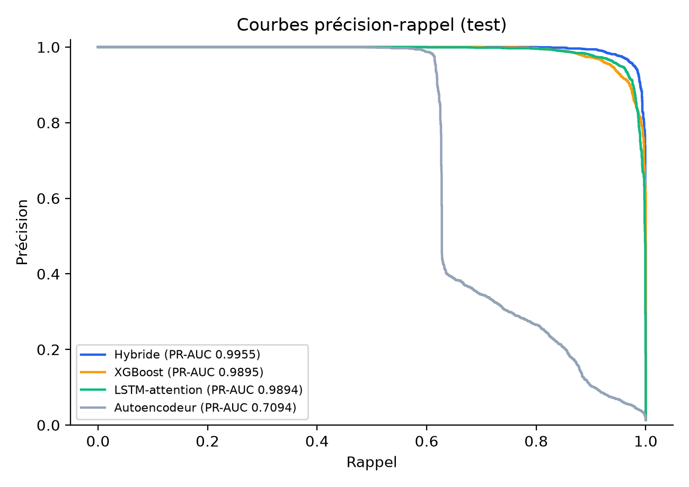
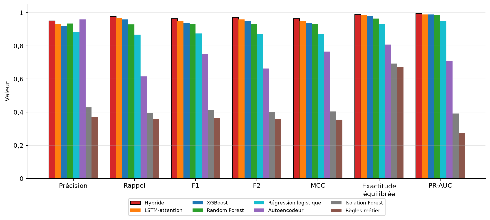
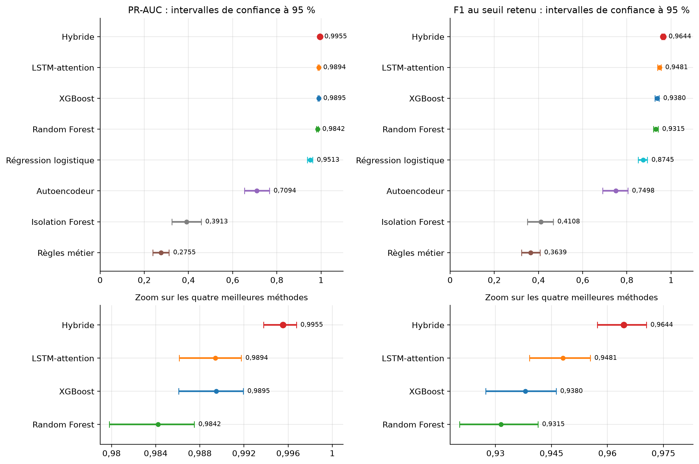
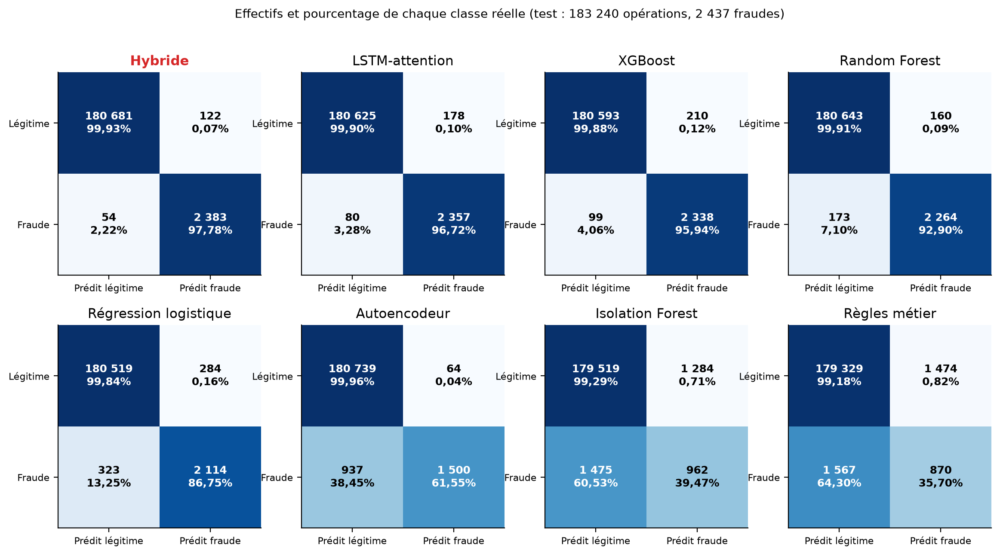
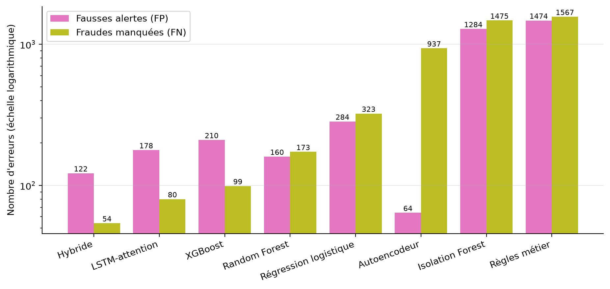
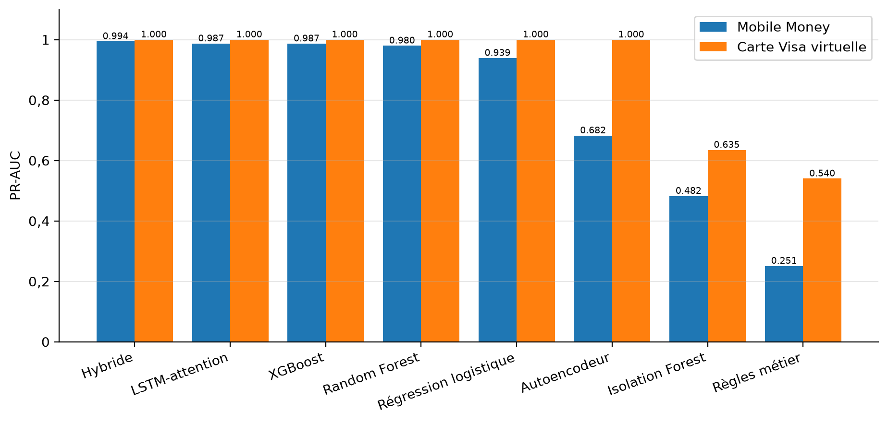
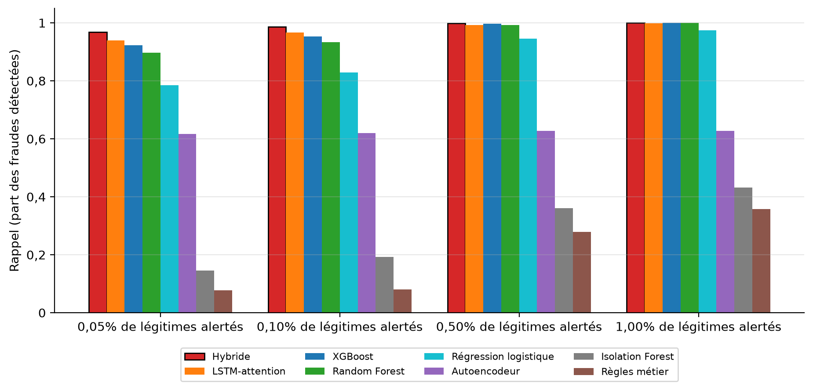
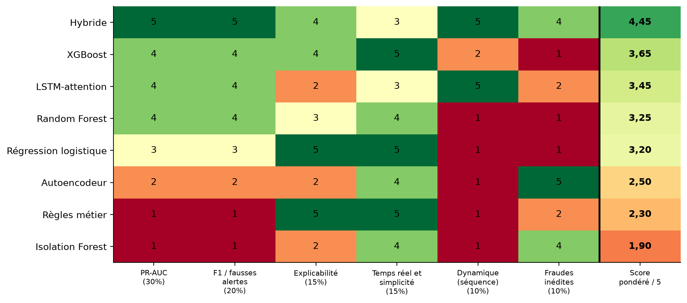
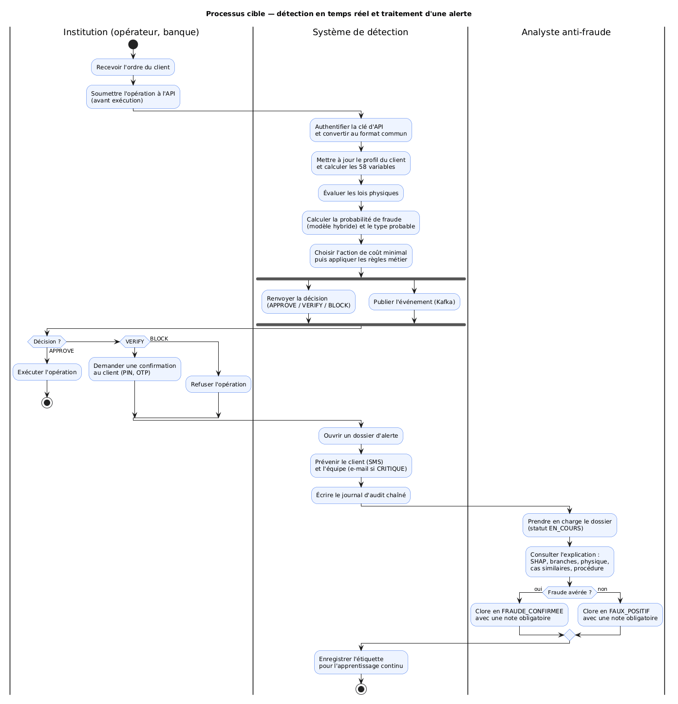
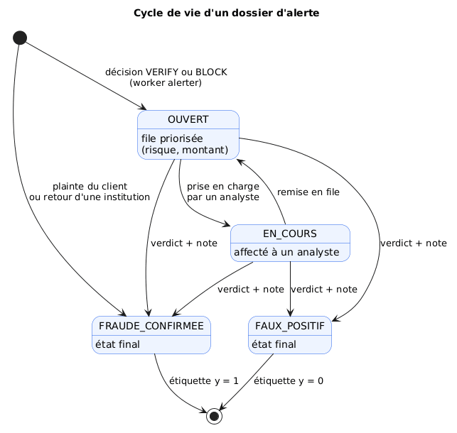

# CHAPITRE II. ANALYSE DU MÉTIER, MÉTHODOLOGIE ET CONCEPTION

## Introduction

Le premier chapitre a posé le cadre théorique de ce travail : la monnaie électronique, la fraude financière et les techniques d'apprentissage automatique appliquées à sa détection. Le présent chapitre fait le passage de la théorie à la construction. Il répond à trois questions successives.

- **Que faut-il résoudre ?** La première section analyse le métier de la lutte contre la fraude Mobile Money en RDC : le domaine, le processus actuel et ses insuffisances, les acteurs, les règles de gestion et les besoins que le futur système doit satisfaire.
- **Comment le résoudre de façon rigoureuse ?** La deuxième section expose la méthodologie : la démarche de recherche, la méthode de développement, la constitution des données, la construction des variables, le protocole qui permettra d'éprouver les hypothèses, puis l'étude comparative des méthodes d'apprentissage qui conduit au choix du modèle.
- **Quel système construire ?** La troisième section présente la conception : l'architecture, le modèle de données, le comportement dynamique, le moteur de détection, l'interface avec les institutions partenaires, la sécurité et le déploiement.

La modélisation utilise le langage **UML** (*Unified Modeling Language*). Les diagrammes sont écrits en PlantUML et leur code source est versionné avec le projet (`docs/uml/`). La comparaison des méthodes d'apprentissage, qui justifie le choix du modèle, figure dans ce chapitre (§ II.2.9) ; les résultats détaillés de l'évaluation des hypothèses sont présentés au chapitre III.

> **Précision méthodologique.** Aucun jeu de données réel de transactions Mobile Money congolaises n'est publiquement accessible. Le système est donc conçu, entraîné et évalué sur des **données simulées**, produites par un générateur qui reproduit le contexte de la RDC de 2019 à 2025 (§ II.2.3). Ce choix et ses conséquences sont discutés au § II.2.10.

---

## SECTION 1. ANALYSE DU MÉTIER

L'analyse du métier vise à comprendre l'activité que le système doit servir, avant de décider de la manière de l'informatiser. Elle suit la progression classique : présentation du domaine, étude de l'existant, critique de l'existant, puis spécification des besoins.

### II.1.1 Présentation du domaine

#### a) Le Mobile Money en RDC

En République démocratique du Congo, le Mobile Money est devenu un moyen de paiement de masse, dans un pays où une grande partie de la population n'a pas de compte bancaire. Trois opérateurs de téléphonie mobile se partagent le marché : **Vodacom (M-Pesa)**, **Airtel (Airtel Money)** et **Orange (Orange Money)**. Selon l'observatoire de l'ARPTC, on comptait fin 2025 environ 15,4 millions d'abonnés actifs pour M-Pesa, 11,1 millions pour Airtel Money et 7,7 millions pour Orange Money.

Le portefeuille mobile permet plusieurs opérations :

| Opération | Code | Description |
|---|---|---|
| Envoi d'argent | `P2P_SEND` | transfert vers un autre portefeuille |
| Réception | `P2P_RECEIVE` | crédit reçu d'un autre portefeuille |
| Dépôt | `CASH_IN` | remise d'espèces chez un agent, contre crédit du portefeuille |
| Retrait | `CASH_OUT` | retrait d'espèces chez un agent |
| Paiement marchand | `MERCHANT_PAYMENT` | règlement d'un achat chez un commerçant |
| Crédit téléphonique | `AIRTIME` | achat d'unités de communication |
| Facture | `BILL_PAYMENT` | eau, électricité, télévision, frais scolaires |
| Recharge de carte | `CARD_TOPUP` | alimentation de la carte Visa virtuelle depuis le portefeuille |
| Achat par carte | `CARD_PURCHASE` | paiement en ligne ou international par carte virtuelle |

Trois traits caractérisent ce marché :

1. **L'accès par USSD.** Une large part des clients utilise un téléphone simple et compose un code (par exemple `*1222#`). Le système ne peut donc pas compter sur des signaux propres aux smartphones, comme la géolocalisation fine ou l'empreinte de l'application.
2. **La double monnaie.** Les opérations se font en francs congolais (CDF) et en dollars américains (USD). Le franc s'est fortement déprécié sur la période étudiée : environ 1 650 CDF pour 1 USD en 2019, plus de 2 700 en 2024.
3. **Le réseau d'agents.** Les dépôts et les retraits passent par des agents de proximité. Ils sont indispensables à l'inclusion financière, mais constituent aussi un point de vulnérabilité.

#### b) La carte Visa virtuelle

Les opérateurs et certaines banques proposent une **carte Visa virtuelle** rechargée depuis le portefeuille mobile. Elle ouvre l'accès aux achats en ligne et internationaux. Ce second canal obéit à d'autres usages (commerçants en ligne, montants, horaires) et attire des fraudes spécifiques. Le sujet de ce travail prévoit une **extension comparative** à ce canal.

#### c) Le cadre réglementaire

La **Banque Centrale du Congo (BCC)** régule l'émission de monnaie électronique, notamment par l'Instruction n° 24 de 2011. Elle impose l'identification des clients selon des **niveaux KYC** (*Know Your Customer*), assortis de plafonds par opération. Elle attend des établissements une traçabilité de leurs décisions. L'**ARPTC** suit, de son côté, le marché des télécommunications.

#### d) Les typologies de fraude

L'analyse du domaine a permis de retenir huit typologies de fraude, qui forment le périmètre de détection du système :

| Typologie | Mécanisme | Signature comportementale attendue | Canal |
|---|---|---|---|
| Échange de SIM (*SIM swap*) | Le fraudeur obtient un duplicata de la carte SIM puis vide le compte depuis un nouvel appareil | nouvel appareil, montant élevé, vidage du solde | Mobile Money |
| Ingénierie sociale | Le client est manipulé (faux agent, faux gain, urgence familiale) et envoie lui-même l'argent | nouveau destinataire, montant inhabituel, message suspect | Mobile Money |
| Prise de contrôle de compte | Accès non autorisé à l'application du client | nouvel appareil, horaire inhabituel, rafale d'opérations | Mobile Money |
| Fraude d'agent | Retraits non autorisés par un agent compromis | nouvel agent, retraits répétés | Mobile Money |
| Fractionnement (*smurfing*) | Petits montants répétés vers des comptes mules pour rester sous les seuils | forte fréquence, destinataire lié à de nombreux clients | Mobile Money |
| Test de carte | Salves de petits achats pour vérifier une carte volée | rafale de petits montants, nouveaux commerçants | Visa virtuelle |
| Carte non présente (CNP) | Achat en ligne avec les données de la carte | commerçant ou pays inhabituel, adresse IP étrangère | Visa virtuelle |
| Vidage par rechargement | Rechargement de la carte puis vidage rapide | recharge suivie d'achats rapprochés | Visa virtuelle |

*Tableau II.1 — Typologies de fraude retenues.*

Ces fraudes **évoluent dans le temps** : les fraudeurs s'adaptent aux contrôles, et les techniques d'ingénierie sociale se sont développées sur la période. Cette évolution est au cœur de l'une des hypothèses de recherche (H5).

### II.1.2 Étude de l'existant

#### a) Diagramme de contexte

Le diagramme de contexte situe le système à construire parmi ses interlocuteurs. Il fixe la frontière du travail : le système ne gère pas les portefeuilles et n'exécute pas les opérations. Il **décide** si une opération soumise par une institution doit être acceptée, vérifiée ou refusée, et il **outille** l'équipe chargée de la fraude.

*Figure II.1 — Diagramme de contexte (`docs/uml/diagramme_contexte.puml`).*

#### b) Description du processus actuel

Dans le schéma courant, le contrôle anti-fraude d'un opérateur repose sur des **règles statiques** appliquées au moment de l'opération, complétées par un traitement **a posteriori** des plaintes :

1. le client initie l'opération et saisit son code PIN ;
2. le système de l'opérateur vérifie le PIN, le solde, puis un jeu de règles fixes : plafond de montant, liste noire de numéros, plafond KYC ;
3. si aucune règle n'est franchie, l'opération est exécutée immédiatement ;
4. si le client ne reconnaît pas l'opération, il appelle le service client, souvent plusieurs heures après ;
5. un agent du service anti-fraude enregistre la plainte, reconstitue l'historique à partir des journaux, tente de geler le compte bénéficiaire, puis ajuste éventuellement les seuils.

*Figure II.2 — Diagramme d'activité du processus existant (`docs/uml/activite_processus_existant.puml`).*

### II.1.3 Critique de l'existant

Le dispositif actuel présente des **points forts** réels : il est simple, rapide, compréhensible et facile à justifier devant le régulateur. Ses **insuffisances** sont toutefois structurelles :

| N° | Insuffisance | Conséquence |
|---|---|---|
| 1 | **Les règles ignorent l'individu.** Un même seuil s'applique à tous : un retrait de 300 USD est banal pour un commerçant et anormal pour un étudiant. | Le système produit à la fois des fausses alertes (clients actifs bloqués) et des fraudes manquées (montants modestes mais anormaux). |
| 2 | **Les règles sont figées.** Les fraudeurs apprennent les seuils et s'y adaptent, par exemple en fractionnant les montants. | L'efficacité se dégrade avec le temps ; la mise à jour dépend d'une intervention manuelle. |
| 3 | **La détection est tardive.** La fraude est souvent constatée par la plainte du client, après l'exécution. | Les fonds, déjà retirés ou transférés, sont rarement récupérables. |
| 4 | **La réponse n'est pas graduée.** Une règle accepte ou refuse, sans tenir compte du montant en jeu. | Refuser 2 USD de crédit et laisser passer 900 USD de retrait n'ont pas le même coût, mais sont traités de la même façon. |
| 5 | **Les décisions ne sont pas expliquées.** L'analyste ne sait pas pourquoi une opération est suspecte. | Le traitement des alertes est lent ; la décision est difficile à défendre devant le client ou le régulateur. |
| 6 | **Les plaintes ne nourrissent pas le dispositif.** Une fraude confirmée ne modifie pas automatiquement les contrôles. | Les mêmes schémas de fraude se répètent. |
| 7 | **Le marché est cloisonné.** Chaque opérateur contrôle ses propres flux, dans son propre format. | Un fraudeur qui opère sur plusieurs réseaux n'est vu par personne dans son ensemble ; le régulateur n'a pas de vision consolidée. |

*Tableau II.2 — Critique de l'existant.*

**Solution proposée.** Ces constats orientent le système vers un **profilage comportemental** : apprendre le comportement habituel de chaque client et juger chaque opération par rapport à ce comportement, avant son exécution. La décision doit être graduée selon le risque et le montant, expliquée, et le modèle doit se mettre à jour à partir des fraudes confirmées. Le système doit enfin s'ouvrir à plusieurs institutions par une interface commune.

### II.1.4 Problématique, hypothèses et objectifs

L'analyse qui précède conduit à la question centrale de ce travail :

> *Comment concevoir un modèle d'intelligence artificielle qui apprend le comportement habituel de chaque utilisateur pour détecter, en temps réel et de manière explicable, les transactions frauduleuses Mobile Money en RDC, et dans quelle mesure cette approche se transpose-t-elle aux cartes virtuelles ?*

| Question de recherche | Hypothèse |
|---|---|
| QR1 — Le profilage comportemental détecte-t-il mieux la fraude que les approches statiques ? | **H1** : un modèle fondé sur le profil comportemental de l'utilisateur est significativement plus performant que les règles statiques et qu'un modèle sans historique. |
| QR2 — Quelles caractéristiques comportementales sont les plus discriminantes ? | **H2** : les variables temporelles, fréquentielles et contextuelles contribuent significativement à la détection. |
| QR3 — Quelle famille de modèles est la plus adaptée ? | **H3** : les performances varient significativement selon la famille de modèles (ensembles d'arbres, modèles linéaires, détection d'anomalies, réseaux récurrents). |
| QR4 — La logique se transpose-t-elle aux cartes virtuelles ? | **H4** : un modèle appris sur le Mobile Money conserve une performance élevée sur les cartes Visa virtuelles, avec peu ou pas de données Visa. |
| QR5 — Le modèle doit-il évoluer avec les fraudes ? | **H5** : face à l'évolution des fraudes, un modèle régulièrement mis à jour reste significativement plus performant qu'un modèle figé. |

*Tableau II.3 — Questions de recherche et hypothèses.*

**Objectif général :** concevoir, réaliser et évaluer un système de détection de fraude par profilage comportemental, opérationnel en temps réel, explicable, évolutif et ouvert aux institutions du secteur.

**Objectifs spécifiques :**
1. construire un profil comportemental par utilisateur ;
2. comparer plusieurs familles de modèles selon un protocole statistique rigoureux ;
3. mesurer la transposabilité du Mobile Money vers la carte Visa virtuelle ;
4. intégrer le modèle dans une architecture temps réel, avec explication, supervision et réentraînement ;
5. l'exposer aux opérateurs, aux banques et au régulateur par une interface de programmation (API).

### II.1.5 Identification des acteurs

Un acteur est une entité externe au système qui interagit avec lui. On distingue les acteurs humains des systèmes externes, et les acteurs internes à l'organisation de ceux qui lui sont extérieurs.

| Acteur | Type | Rôle | Attentes |
|---|---|---|---|
| Client (titulaire) | Humain, externe | Effectue les opérations | Être protégé sans être bloqué à tort ; être prévenu en cas d'opération suspecte |
| Opérateur Mobile Money | Système externe | Transmet les opérations, applique la décision | Décision rapide (moins de 100 ms), fiable, dans son format natif |
| Émetteur de cartes virtuelles | Système externe | Transmet les opérations carte, applique la décision | Idem |
| Banque partenaire | Système externe | Utilise le système par l'API au format commun | Intégration simple, isolement de ses données |
| Analyste anti-fraude | Humain, interne | Traite les alertes et les dossiers | Alertes priorisées, expliquées et typées |
| Superviseur | Humain, interne | Encadre l'équipe, suit le modèle, déclenche le réentraînement | Indicateurs, journal d'audit, pilotage du modèle |
| Administrateur | Humain, interne | Gère les comptes, les rôles, les institutions et les clés d'API | Contrôle des accès |
| Régulateur (BCC), auditeur | Humain ou système, externe | Supervise le secteur, contrôle la conformité | Agrégats sans donnée personnelle, traçabilité inaltérable |

*Tableau II.4 — Acteurs du système.*

Deux relations de **généralisation** simplifient la modélisation : le superviseur hérite des droits de l'analyste ; l'émetteur Visa et la banque partenaire se comportent, vis-à-vis du système, comme un opérateur.

### II.1.6 Règles de gestion

Les règles de gestion traduisent les contraintes du métier que le système doit respecter. Elles ont été établies à partir de l'analyse du domaine, puis implémentées telles quelles (`ml/serving/decision.py`, `services/backoffice-api/app/routers/cases.py`).

| Réf. | Règle de gestion |
|---|---|
| RG-01 | Toute opération est soumise au système **avant** son exécution, et reçoit une décision parmi : APPROVE (laisser passer), VERIFY (faire confirmer par le client), BLOCK (refuser). |
| RG-02 | Tout montant est converti en USD au taux de change de l'année de l'opération avant d'être évalué. |
| RG-03 | Une opération soumise deux fois avec le même identifiant reçoit la décision d'origine (idempotence pendant 30 minutes). |
| RG-04 | Si la probabilité de fraude est au moins égale à 0,97, l'opération est bloquée quel que soit le montant ; si elle est inférieure à 0,01, elle est acceptée sans vérification. |
| RG-05 | Entre ces deux bornes, l'action retenue est celle dont le **coût attendu** est le plus faible, compte tenu de la probabilité de fraude, du montant et du canal. |
| RG-06 | Les règles métier et les lois physiques ne peuvent que **renforcer** la décision du modèle, jamais l'assouplir. |
| RG-07 | Un débit depuis un **nouvel appareil** qui vide presque entièrement le solde est au minimum soumis à vérification. |
| RG-08 | Un débit qui **dépasse le plafond KYC** du client est au minimum soumis à vérification. |
| RG-09 | Un **retrait** effectué depuis un nouvel appareil **et** dans une nouvelle province est au minimum soumis à vérification. |
| RG-10 | Un message de transfert présentant de fortes marques de manipulation impose une vérification ; le texte seul ne justifie **jamais** un blocage. |
| RG-11 | Un déplacement physiquement impossible entre deux opérations consécutives impose au minimum une vérification. |
| RG-12 | Toute décision VERIFY ou BLOCK ouvre un **dossier d'alerte** et déclenche une notification au client. Une alerte de niveau CRITIQUE déclenche aussi un e-mail à l'équipe anti-fraude. |
| RG-13 | Un dossier ne peut être clos (FRAUDE_CONFIRMEE ou FAUX_POSITIF) qu'avec une **note de résolution**. Un dossier clos ne peut plus être rouvert. |
| RG-14 | Seul un superviseur peut affecter un dossier à un autre analyste que lui-même. |
| RG-15 | Une plainte du client ou un retour d'une institution crée ou clôt le dossier en FRAUDE_CONFIRMEE ; le verdict devient une **étiquette** d'apprentissage. |
| RG-16 | Toute action sensible (décision, verdict, création de clé, consultation du régulateur) est inscrite dans un journal d'audit **non modifiable et non supprimable**. |
| RG-17 | Une institution ne voit que ses propres opérations ; le régulateur ne reçoit que des agrégats sans donnée personnelle. |
| RG-18 | Un nouveau modèle ne remplace le modèle en service que s'il est meilleur sur la même période et satisfait les contrôles de qualité. |

*Tableau II.5 — Règles de gestion.*

### II.1.7 Spécification des besoins fonctionnels

Les besoins fonctionnels décrivent ce que le système doit faire. Chacun est numéroté (BM pour « besoin métier ») afin d'être suivi jusqu'à la conception et aux tests.

| Réf. | Besoin | Réponse du système |
|---|---|---|
| BM-01 | Détecter la fraude **avant** l'exécution de l'opération | Notation synchrone de chaque opération par un modèle hybride |
| BM-02 | Reconnaître le **comportement habituel** de chaque client et ses écarts | 58 variables de profilage calculées sur l'historique du client |
| BM-03 | **Graduer la réponse** : laisser passer, faire vérifier, bloquer | Décision coût-sensible, règles métier prioritaires (RG-04 à RG-11) |
| BM-04 | Limiter les **fausses alertes** | Seuil optimisé ; vérification plutôt que blocage dans les cas intermédiaires |
| BM-05 | Identifier le **type de fraude** | Classifieur de typologie (8 types) affiché sur chaque alerte |
| BM-06 | **Expliquer** chaque décision | Contributions SHAP, part de chaque composante du modèle, attention sur l'historique, cas similaires |
| BM-07 | **Prioriser et traiter** les alertes | Dossiers classés par risque et montant ; statuts ; affectation ; note obligatoire |
| BM-08 | **Prévenir le client** | SMS au client, e-mail à l'équipe pour les cas critiques |
| BM-09 | Enregistrer les **plaintes** des clients | Plainte → dossier « fraude confirmée » → étiquette d'apprentissage |
| BM-10 | Repérer l'**ingénierie sociale** | Profilage, analyse du message (NLP), règle de vérification |
| BM-11 | Couvrir **plusieurs opérateurs et la carte Visa** | Un adaptateur par format, vers un schéma unique |
| BM-12 | **Comparer et transposer** au canal Visa | Protocole d'évaluation Mobile Money → Visa |
| BM-13 | Vision **géographique** nationale | Carte des 26 provinces |
| BM-14 | **Tableau de bord** de supervision | Indicateurs temps réel, séries, répartitions, performance du modèle |
| BM-15 | **S'adapter** aux fraudes nouvelles | Réentraînement déclenché, stratégie champion / challenger |
| BM-16 | Faire **examiner les comportements nouveaux** | Détection de nouveauté, revue d'analyste → étiquette |
| BM-17 | **Traçabilité** | Journal d'audit chaîné par hachage |
| BM-18 | **Gérer les droits** selon le rôle | Rôles analyste, superviseur, administrateur |
| BM-19 | Permettre aux institutions de **signaler les fraudes constatées** | Route d'API de retour : le dossier est clos et l'étiquette sert au réentraînement |
| BM-20 | Permettre au régulateur de **superviser le secteur** | API de supervision en lecture seule, agrégats sans donnée personnelle |
| BM-21 | **Gérer les institutions partenaires** et leurs accès | Création, droits, renouvellement et révocation des clés d'API |

*Tableau II.6 — Besoins fonctionnels.*

### II.1.8 Spécification des besoins non fonctionnels

Les besoins non fonctionnels (BT pour « besoin technique ») fixent les qualités attendues du système : rapidité, fiabilité, sécurité, maintenabilité.

| Catégorie | Réf. | Exigence | Réponse prévue |
|---|---|---|---|
| Performance | BT-01 | Décision avant exécution, en moins de 100 ms | Chemin critique synchrone réduit au minimum ; profil en mémoire (Redis) |
| | BT-02 | Absorber le débit des opérateurs | Plusieurs processus de notation, limitation de débit, réplicas |
| Disponibilité | BT-03 | Continuité si la notation est indisponible | Politique de repli configurable, relances bornées |
| | BT-04 | Résilience aux doublons | Idempotence (RG-03) |
| Intégration | BT-06 | Formats hétérogènes des opérateurs | Patron *Adapter* et schéma pivot `UnifiedTransaction` |
| | BT-07 | Double monnaie | Conversion CDF → USD au taux de l'année (RG-02) |
| | BT-10 | Découplage des traitements | Bus d'événements Kafka et workers indépendants |
| Apprentissage automatique | BT-11 | Cohérence entre entraînement et production | Mêmes fonctions de calcul des variables ; contrôle de l'empreinte de la normalisation |
| | BT-12 | Déséquilibre des classes (environ 1,3 % de fraudes) | Pondération, sous-échantillonnage, métrique PR-AUC |
| | BT-13 | Absence de fuite d'information | Variables calculées sur le passé ; découpage temporel |
| | BT-14 | Explicabilité | TreeSHAP exact, attention, recherche de cas similaires |
| | BT-15 | Évaluation statistiquement fondée | Bootstrap apparié par usager, test de McNemar |
| | BT-16 | Surveillance de la dérive | Kolmogorov-Smirnov, PSI, taux de nouveauté |
| | BT-17 | Réentraînement maîtrisé | Champion / challenger, porte de détection, garde-fou contre le surapprentissage |
| | BT-19 | Robustesse aux attaques inédites | Lois physiques (cinématique, conservation) |
| Sécurité | BT-20 | Authentification des systèmes partenaires | Clé d'API par institution (empreinte SHA-256), droits par institution |
| | BT-21 | Authentification des utilisateurs | Jeton JWT, contrôle d'accès par rôle |
| | BT-22 | Intégrité du journal | Chaînage SHA-256, modification et suppression interdites en base |
| | BT-23 | Confidentialité | Aucun service externe ; texte des messages jamais stocké ; isolement des données par institution |
| Exploitation | BT-25 | Observabilité | Métriques, tableaux de bord, journaux centralisés, alertes |
| | BT-26 | Qualité logicielle | Tests automatisés par service |
| | BT-27 | Portabilité | Conteneurs Docker, Docker Compose, Kubernetes |

*Tableau II.7 — Besoins non fonctionnels.*

### II.1.9 Contraintes propres au contexte congolais

| Contrainte | Conséquence sur la conception |
|---|---|
| Téléphones simples et USSD très répandus | Variables indépendantes de l'application (montant, fréquence, agent, destinataire) |
| Réseau d'agents de proximité | Variables liées à l'agent ; typologie « fraude d'agent » |
| Double monnaie CDF / USD, dépréciation du franc | Montants ramenés en USD au taux de l'année |
| Connectivité inégale | Aucune dépendance à un service en ligne externe pour décider |
| 26 provinces, territoire très vaste | Localisation par province ; loi physique de déplacement entre chefs-lieux |
| Niveaux KYC et plafonds | Variable « montant / plafond KYC » ; règle RG-08 |
| Marché multi-opérateurs régulé par la BCC | API ouverte aux institutions, isolement des données, supervision par le régulateur |
| Absence de jeu de données public | Générateur de données synthétiques ; validation sur données réelles à prévoir |

*Tableau II.8 — Contraintes du contexte et conséquences.*

### II.1.10 Diagramme des cas d'utilisation

Le diagramme des cas d'utilisation représente les services que le système rend à chaque acteur. Les cas sont regroupés en quatre paquetages : détection en temps réel, investigation, supervision et gouvernance, ouverture aux partenaires.

*Figure II.3 — Diagramme des cas d'utilisation (`docs/uml/besoins_metier.puml`).*

### II.1.11 Description textuelle des principaux cas d'utilisation

Le diagramme ne dit pas comment chaque cas se déroule. Les cas les plus importants sont donc décrits ci-dessous sous forme textuelle.

**Cas n° 1 — Soumettre une opération au scoring**

| Rubrique | Description |
|---|---|
| Acteur principal | Opérateur Mobile Money (ou émetteur Visa, banque partenaire) |
| Objectif | Obtenir une décision sur une opération avant de l'exécuter |
| Préconditions | L'institution dispose d'une clé d'API active et du droit « transactions » |
| Scénario nominal | 1. L'institution envoie l'opération, au format commun ou dans son format natif. 2. Le système vérifie la clé et les droits. 3. Il convertit l'opération au format commun et la rattache à l'institution. 4. Il met à jour le profil du client et calcule les variables. 5. Il évalue les lois physiques, calcule la probabilité de fraude et le type probable. 6. Il choisit l'action de coût minimal, puis applique les règles métier. 7. Il renvoie la décision, le niveau de risque, le type probable et les motifs. |
| Scénarios alternatifs | 2a. Clé absente, invalide ou révoquée : refus (401 ou 403). 3a. Format non reconnu : refus (422). 4a. Opération déjà reçue : renvoi de la décision d'origine (RG-03). 5a. Service de notation indisponible : application de la politique de repli (BT-03). |
| Postconditions | L'opération et sa décision sont publiées dans le bus d'événements ; si la décision est VERIFY ou BLOCK, un dossier est ouvert (RG-12). |
| Exigences liées | BM-01 à BM-06, BM-11 ; BT-01, BT-04, BT-06, BT-20 |

**Cas n° 2 — Traiter un dossier d'alerte**

| Rubrique | Description |
|---|---|
| Acteur principal | Analyste anti-fraude (ou superviseur) |
| Objectif | Établir si une opération signalée est une fraude |
| Préconditions | L'analyste est authentifié ; au moins un dossier est ouvert |
| Scénario nominal | 1. L'analyste consulte la file des dossiers, triée par niveau de risque puis par montant. 2. Il ouvre un dossier, qui passe au statut EN_COURS et lui est affecté. 3. Il consulte l'explication : variables déterminantes, contribution de chaque composante du modèle, lois physiques, historique récent, cas passés similaires et procédure recommandée pour le type de fraude. 4. Il rend son verdict (FRAUDE_CONFIRMEE ou FAUX_POSITIF) avec une note de résolution. 5. Le système enregistre l'étiquette et journalise l'action. |
| Scénarios alternatifs | 4a. Note absente : le système refuse la clôture (RG-13). 2a. Le superviseur réaffecte le dossier à un autre analyste (RG-14). 2b. L'analyste remet le dossier en file (retour à OUVERT). |
| Postconditions | Le dossier est clos ; l'étiquette est disponible pour le réentraînement ; l'action figure au journal d'audit. |
| Exigences liées | BM-06, BM-07, BM-15, BM-17 |

**Cas n° 3 — Enregistrer une plainte client**

| Rubrique | Description |
|---|---|
| Acteur principal | Analyste anti-fraude |
| Objectif | Prendre en compte une fraude que le système a laissé passer |
| Scénario nominal | 1. L'analyste recherche l'opération contestée. 2. Il saisit la plainte. 3. Le système analyse le texte de la plainte et en déduit, si possible, une typologie (par exemple « ingénierie sociale » si la plainte décrit une manipulation). 4. Le dossier est créé ou clos en FRAUDE_CONFIRMEE (RG-15). |
| Postconditions | L'étiquette « fraude » est enregistrée ; elle compte parmi les signaux de réentraînement. |
| Exigences liées | BM-09, BM-10, BM-15 |

**Cas n° 4 — Signaler une fraude constatée (API)**

| Rubrique | Description |
|---|---|
| Acteur principal | Institution partenaire |
| Préconditions | Clé d'API avec le droit « feedback » ; l'opération appartient à l'institution |
| Scénario nominal | 1. L'institution envoie l'identifiant de l'opération et son verdict (fraude constatée ou fausse alerte). 2. Le système vérifie que l'opération lui appartient. 3. Il clôt ou crée le dossier correspondant et enregistre l'étiquette. 4. Il journalise le retour. |
| Scénario alternatif | 2a. Opération inconnue ou appartenant à une autre institution : même réponse 404 dans les deux cas, pour ne rien révéler (RG-17). |
| Exigences liées | BM-19, BM-15, BT-23 |

**Cas n° 5 — Déclencher le réentraînement du modèle**

| Rubrique | Description |
|---|---|
| Acteur principal | Superviseur (déclenchement manuel) ou planificateur (déclenchement automatique) |
| Objectif | Adapter le modèle aux fraudes nouvelles |
| Scénario nominal | 1. Un signal est constaté : nouvelles étiquettes, dérive des données, comportements nouveaux, ou demande du superviseur. 2. Le planificateur vérifie le délai de carence. 3. Un modèle candidat (*challenger*) est entraîné. 4. Il est soumis aux contrôles de qualité. 5. S'il est meilleur que le modèle en service (*champion*), il est promu et chargé à chaud. |
| Scénarios alternatifs | 4a. Échec d'un contrôle : le candidat est rejeté et une alerte est levée ; le champion reste en service (RG-18). |
| Exigences liées | BM-15, BM-16, BT-16, BT-17 |

### II.1.12 Priorisation des besoins

Les besoins ont été priorisés par la méthode **MoSCoW**, qui distingue l'indispensable du souhaitable. Cette priorisation a guidé l'ordre de réalisation.

| Priorité | Besoins |
|---|---|
| **Indispensable** (*Must*) | BM-01, BM-02, BM-03, BM-04, BM-06, BM-17, BT-01, BT-11, BT-13, BT-21, BT-22 |
| **Important** (*Should*) | BM-05, BM-07, BM-08, BM-09, BM-11, BM-15, BM-19, BM-21, BT-03, BT-04, BT-16, BT-17, BT-20 |
| **Souhaitable** (*Could*) | BM-10, BM-12, BM-13, BM-14, BM-16, BM-20, BT-19, BT-25 |
| **Hors périmètre** (*Won't*, pour l'instant) | Raccordement aux systèmes réels des opérateurs ; validation sur données réelles ; analyse de messages en lingala et en swahili |

*Tableau II.9 — Priorisation MoSCoW.*

### II.1.13 Traçabilité entre besoins et hypothèses

Le tableau suivant relie chaque hypothèse de recherche aux besoins qui permettent de l'éprouver. Il garantit que le système construit sert bien la question de recherche, et non l'inverse.

| Hypothèse | Besoins concernés |
|---|---|
| H1 | BM-01, BM-02, BM-04 |
| H2 | BM-02, BT-13 |
| H3 | BM-01, BT-12, BT-15 |
| H4 | BM-11, BM-12 |
| H5 | BM-15, BM-16, BM-19, BT-16, BT-17 |

*Tableau II.10 — Traçabilité besoins / hypothèses.*

---

## SECTION 2. MÉTHODOLOGIE

### II.2.1 Démarche de recherche

Ce travail relève de la **science de la conception** (*Design Science Research*, Hevner et al., 2004). Cette démarche convient aux recherches dont le résultat est un **artefact** : on le construit pour répondre à un problème réel, puis on l'évalue de façon rigoureuse. Ici, l'artefact est le système de détection, et son évaluation passe par le test des cinq hypothèses.

Le volet données suit le cycle **CRISP-DM** (*Cross Industry Standard Process for Data Mining*), standard de fait des projets d'exploration de données, adapté comme suit :

| Étape CRISP-DM | Contenu dans ce travail | Livrable |
|---|---|---|
| 1. Compréhension du métier | Contexte RDC, typologies de fraude, acteurs, besoins | Section 1 du présent chapitre |
| 2. Compréhension et constitution des données | Générateur synthétique 2019-2025 | `ml/generator/`, `docs/dictionnaire_donnees.md` |
| 3. Préparation des données | 58 variables comportementales, normalisation, découpage temporel | `ml/features/`, `ml/preprocessing/` |
| 4. Modélisation | Modèles de référence, modèle hybride, classifieur de typologie | `ml/models/`, `ml/training/` |
| 5. Évaluation | Protocole statistique H1 à H5 | `ml/reports/`, chapitre III |
| 6. Déploiement | Architecture temps réel, API, supervision, apprentissage continu | Section 3 du présent chapitre |

*Tableau II.11 — Application du cycle CRISP-DM.*

### II.2.2 Méthode de développement du logiciel

Le développement suit une démarche **itérative et incrémentale**, inspirée du **processus unifié** et de sa variante en Y, **2TUP** (*Two Track Unified Process*). Cette variante sépare deux branches qui se rejoignent dans la conception :

- la **branche fonctionnelle** capte les besoins du métier (section 1) ;
- la **branche technique** recense les contraintes et les choix d'architecture (temps réel, sécurité, déploiement) ;
- la **branche de réalisation** fusionne les deux dans la conception détaillée, le codage et les tests.

Le projet a été conduit en **neuf incréments**, chacun produisant une version utilisable : données et variables ; modèles ; service de notation ; intégration des opérateurs ; tableau de bord ; workers asynchrones ; supervision ; conteneurisation ; apprentissage continu. Chaque incrément s'est achevé par une évaluation. Les diagnostics ont conduit à des corrections successives, notamment sur les fuites d'information, la cohérence entre l'entraînement et la production, le surapprentissage et le choix des seuils.

UML sert de langage de modélisation commun aux deux branches. Les diagrammes retenus et leur usage sont les suivants :

| Vue | Diagramme | Section |
|---|---|---|
| Fonctionnelle | Contexte, cas d'utilisation | II.1.2, II.1.10 |
| Processus métier | Activité (existant et cible) | II.1.2, II.3.5 |
| Statique | Packages, classes | II.3.3, II.3.4 |
| Dynamique | Séquence, états-transitions | II.3.5 |
| Physique | Composants, déploiement | II.3.2, II.3.10 |

*Tableau II.12 — Diagrammes UML utilisés.*

### II.2.3 Constitution des données

#### a) Justification du recours à des données simulées

Les données transactionnelles des opérateurs sont confidentielles, au titre du secret bancaire et de la protection des données personnelles. Aucun jeu public ne couvre la RDC. Un **générateur paramétré** a donc été conçu. Il reproduit les régularités connues du marché : opérateurs, provinces, agents, double monnaie, saisonnalité et typologies de fraude.

Le recours à un simulateur a des précédents. C'est notamment le cas de **PaySim** (Lopez-Rojas, Elmir et Axelsson, 2016), simulateur de transactions Mobile Money conçu pour la détection de fraude. La différence est que PaySim s'appuie sur un échantillon de transactions réelles agrégées, alors que le présent générateur repose entièrement sur des hypothèses paramétrées, faute d'un tel échantillon pour la RDC.

#### b) Source et provenance

Les données sont des **données primaires synthétiques**, produites par un générateur développé pour ce travail. Elles ne proviennent d'aucun opérateur, d'aucune banque ni d'aucune base publique, et ne contiennent aucune donnée personnelle réelle.

| Élément | Valeur |
|---|---|
| Source | Générateur du projet : `ml/generator/generate_synthetic_data.py` |
| Commande | `python ml/generator/generate_synthetic_data.py --multi-year` |
| Graine aléatoire | 42 : la génération est reproductible à l'identique |
| Fichiers produits | `transactions.csv` (631 968 lignes), `users.csv` (500), `agents.csv` (800), `merchants.csv`, `fraud_mapping.json` |
| Traçabilité | `ml/data/raw/generation_metadata.json` : configuration et statistiques de la génération |
| Dictionnaire des données | `docs/dictionnaire_donnees.md` |

*Tableau II.13 — Provenance des données.*

#### c) Caractéristiques du jeu de données

| Caractéristique | Valeur |
|---|---|
| Période | 1ᵉʳ janvier 2019 → 31 décembre 2025 |
| Transactions | 631 968 |
| Utilisateurs | 500 (arrivées progressives, croissance d'environ 8 % par an) |
| Fraudes | 8 426, soit **1,33 %** |
| Canaux | Mobile Money : 598 515 ; Visa virtuelle : 33 453 (lancée en 2021) |
| Opérateurs | Vodacom : 319 549 ; Airtel : 180 649 ; Orange : 131 770 |
| Monnaies | CDF et USD, taux de change par année |

*Tableau II.14 — Caractéristiques du jeu de données.*

Répartition des fraudes par typologie : échange de SIM 2 220, ingénierie sociale 1 850, fractionnement 1 334, prise de contrôle 1 112, fraude d'agent 888, carte non présente 406, test de carte 362, vidage par rechargement 254.

#### d) Ce que le générateur modélise

Les paramètres de simulation sont des **hypothèses de l'auteur**, choisies pour produire des ordres de grandeur plausibles ; ce ne sont pas des statistiques officielles. Le générateur reproduit :

- des **rythmes individuels** : heures d'activité propres à chaque client, cycles hebdomadaires, pics de fin de mois, frais scolaires de septembre, abonnements récurrents ;
- des **cas légitimes difficiles** : changement de téléphone (4 % des clients), voyage, usage nocturne, nouveau destinataire, montant inhabituel mais légitime ;
- des **déplacements réalistes** : la durée de trajet entre provinces est respectée ;
- des **fraudes par épisodes**, sur des victimes dont le solde est réellement débité ; une fraude échoue si le solde est insuffisant ;
- une **évolution des fraudes dans le temps** (paramètres `FRAUD_TRENDS`) : l'ingénierie sociale et le fractionnement progressent sur la période, ce qui permet de tester H5.

#### e) Confrontation aux sources officielles

Les paramètres ont été fixés avant d'être comparés, a posteriori, aux statistiques publiées par l'ARPTC, la BCC et la Banque mondiale :

| Indicateur | Générateur | Source officielle | Écart |
|---|---|---|---|
| Clients par opérateur | Vodacom 45 %, Airtel 32 %, Orange 23 % | Abonnés actifs fin 2025 : 45 % / 33 % / 23 % (ARPTC) | cohérent |
| Provinces les plus actives | Kinshasa, Haut-Katanga, Nord-Kivu | Même classement des revenus Mobile Money, T1 2024 (ARPTC) | même classement |
| Taux USD/CDF 2019 à 2022 | 1 650 ; 1 850 ; 1 990 ; 2 010 | 1 647,8 ; 1 851,1 ; 1 989,4 ; 2 006,7 (Banque mondiale, d'après la BCC) | moins de 0,2 % |
| Taux USD/CDF 2023 et 2025 | 2 450 ; 2 850 | 2 340,0 ; 2 693,2 | + 4,7 % ; + 5,8 % |
| Taux de fraude | 1,24 % (Mobile Money) | aucune statistique publique pour la RDC | non vérifiable |

*Tableau II.15 — Confrontation du générateur aux sources officielles.*

La **structure** du marché simulé est donc cohérente avec les statistiques officielles. En revanche, le **taux de fraude** et la **répartition des typologies** restent des hypothèses, qu'aucune donnée publique ne permet de vérifier pour la RDC.

### II.2.4 Préparation des données et ingénierie des variables

#### a) Principe

Le profilage comportemental repose sur une idée simple : une fraude se manifeste par une **rupture des habitudes** du client. Chaque transaction est donc décrite par **58 variables**, qui mesurent l'écart entre l'opération courante et le comportement passé du client.

Toutes les variables sont calculées **uniquement à partir du passé** du client, par un rejeu chronologique des opérations. Aucune information future ne peut ainsi entrer dans le calcul, ce qui exclut toute fuite d'information (BT-13). Les **mêmes fonctions** servent à l'entraînement et en production (BT-11).

#### b) Familles de variables

| Famille | Exemples | Ce qu'elle capte |
|---|---|---|
| **Montants** | écart au montant habituel, rapport au montant moyen, part du solde, vidage, montant / plafond KYC | rupture des habitudes de dépense |
| **Fréquentielles** | nombre d'opérations sur 1 h, 24 h et 7 j ; somme débitée sur 24 h ; délai depuis l'opération précédente | vélocité anormale (vidage, salves) |
| **Contextuelles** | nouvel appareil, nouvel agent, nouvelle province, nouveau destinataire, destinataire lié à de nombreux clients, adresse IP étrangère | rupture de contexte |
| **Temporelles** | heure cyclique, nuit inhabituelle, écart à l'heure habituelle, jour de la semaine | rupture des horaires |
| Socle | type d'opération, canal d'accès, ancienneté, niveau KYC | contexte de l'opération |
| **Physiques** (hors entrée du modèle) | infaisabilité du déplacement, déficit de conservation, vitesse de vidage | lois que la fraude ne peut contourner |

*Tableau II.16 — Familles de variables comportementales.*

#### c) Formulation des principales variables

Soit $u$ un client, $a_t$ le montant en USD de l'opération à l'instant $t$, $n_u$ le nombre d'opérations passées du client et $B_t$ son solde avant l'opération.

**Écart au montant habituel.** On travaille sur le logarithme des montants, car leur distribution est très asymétrique :

$$\mu_u=\frac{1}{n_u}\sum_{i=1}^{n_u}\ln(1+a_i),\qquad z_{\text{montant}}=\operatorname{clip}\!\left(\frac{\ln(1+a_t)-\mu_u}{s_u},\,-10,\,10\right)$$

où $s_u$ est l'écart-type correspondant, augmenté de 0,25 pour éviter les divisions par un écart nul chez les clients très réguliers.

**Vélocité.** Pour une fenêtre $\Delta \in \{1\ \text{h},\ 24\ \text{h},\ 7\ \text{j}\}$, $N_\Delta(t)$ est le nombre d'opérations du client dans l'intervalle $]t-\Delta,\,t]$.

**Nouveauté du contexte.** La variable « nouvel appareil » vaut 1 si le client a déjà un historique et que l'appareil $d_t$ n'appartient pas à l'ensemble $D_u$ de ses appareils connus. Le même principe s'applique à la province, à l'agent et au destinataire.

**Horaires.** L'heure est représentée sur un cercle, pour que 23 h et 0 h soient voisines : $\theta_t = 2\pi h_t/24$, codée par $(\sin\theta_t,\ \cos\theta_t)$. L'écart à l'heure habituelle utilise la moyenne circulaire des heures passées, pondérée par la régularité $R$ du client.

**Normalisation.** Chaque variable est centrée et réduite :

$$\tilde x_j=\operatorname{clip}\!\left(\frac{x_j-m_j}{\sigma_j},\,-10,\,10\right)$$

où $m_j$ et $\sigma_j$ sont estimés **sur la seule période d'entraînement**. L'ensemble des formules figure dans `docs/formules_mathematiques.md`.

### II.2.5 Découpage temporel

Un découpage aléatoire des données serait irréaliste : il mélangerait passé et futur et laisserait fuir les tendances futures dans l'entraînement. Le découpage est donc **chronologique**, comme en situation réelle, où l'on apprend sur le passé pour décider sur l'avenir.

| Tranche | Période | Usage |
|---|---|---|
| Entraînement | 01/2019 → 02/03/2023 | apprentissage des modèles |
| Arrêt précoce | 02/03/2023 → 25/11/2023 | arrêt de l'apprentissage, détection du surapprentissage |
| Validation | 25/11/2023 → 13/12/2024 | choix du seuil, calibrage de la combinaison des modèles |
| **Test** | 13/12/2024 → 31/12/2025 | évaluation finale sur 183 240 transactions jamais vues, dont 2 437 fraudes |

*Tableau II.17 — Découpage temporel des données.*

### II.2.6 Modèles comparés

Pour éprouver les hypothèses H1 et H3, plusieurs familles de modèles sont comparées, des plus simples aux plus élaborées :

| Famille | Modèle | Rôle dans l'étude |
|---|---|---|
| Règles statiques | Règles métier à seuils fixes | référence : pratique actuelle du secteur |
| Statique appris | XGBoost limité aux variables sans historique | isole l'apport du profilage (H1) |
| Linéaire | Régression logistique | référence interprétable |
| Ensembles d'arbres | Random Forest, XGBoost | modèles tabulaires de référence |
| Détection d'anomalies | Isolation Forest, autoencodeur | apprentissage sans étiquette |
| Séquentiel | LSTM avec attention sur les 10 dernières opérations | dynamique du comportement |
| **Hybride (proposé)** | XGBoost + LSTM-attention + autoencodeur, combinés par empilement | combine profil instantané, séquence et anomalie |
| Second étage | XGBoost multiclasse restreint par canal | type de fraude (8 classes) |

*Tableau II.18 — Modèles comparés.*

**Gestion du déséquilibre des classes.** Avec 1,3 % de fraudes, un modèle qui déclarerait toutes les opérations légitimes aurait 98,7 % d'exactitude, tout en étant inutile. Les fraudes sont donc pondérées dans la fonction de perte (poids $N^-/N^+$ pour XGBoost) et les opérations légitimes sont sous-échantillonnées à chaque époque pour le LSTM.

**Mesures contre le surapprentissage :**
- arrêt précoce sur une tranche distincte de la validation ;
- abandon aléatoire de neurones (*dropout*) de 0,2 ;
- régularisation L2 (AdamW pour le LSTM, paramètres $\lambda$ et $\gamma$ pour XGBoost) ;
- découpage temporel ;
- diagnostic automatique de l'écart de PR-AUC entre entraînement et validation, qui bloque la promotion d'un modèle si cet écart dépasse 0,05.

### II.2.7 Métriques et tests statistiques

#### a) Métriques

Avec 1,3 % de fraudes, la courbe ROC est trompeuse : son aire reste élevée même lorsque le modèle produit beaucoup de fausses alertes. La métrique principale est donc la **PR-AUC**, aire sous la courbe précision-rappel, qui se concentre sur la classe minoritaire.

On note $VP$ les vrais positifs (fraudes détectées), $FP$ les faux positifs (fausses alertes), $FN$ les faux négatifs (fraudes manquées) et $VN$ les vrais négatifs.

| Métrique | Définition | Lecture métier |
|---|---|---|
| PR-AUC | aire sous la courbe précision-rappel | qualité du classement des opérations |
| Rappel | $VP/(VP+FN)$ | part des fraudes interceptées |
| Précision | $VP/(VP+FP)$ | part des alertes justifiées |
| F1 | $2PR/(P+R)$ | compromis au seuil retenu |
| Taux de faux positifs | $FP/(FP+VN)$ | clients honnêtes dérangés |
| Rappel à 1 % de faux positifs | rappel quand 1 % des légitimes sont alertés | performance à budget d'alertes fixé |

*Tableau II.19 — Métriques d'évaluation.*

Le seuil de décision $\tau^*$ est celui qui maximise le F1 **sur la validation** ; il n'est jamais choisi sur le test.

#### b) Tests statistiques

Une différence de performance n'a de valeur que si elle n'est pas due au hasard. Trois outils sont employés :

- **Intervalles de confiance à 95 % par bootstrap apparié par usager.** On rééchantillonne les clients, et non les transactions, car les opérations d'un même client sont corrélées. Les deux modèles comparés sont évalués sur le même rééchantillon, ce qui donne un écart apparié.
- **Test de McNemar exact**, qui compare les erreurs de deux modèles sur les mêmes opérations, au seuil opérationnel.
- **Variance selon la graine** : les entraînements sont répétés avec plusieurs graines aléatoires.

Une différence est déclarée **significative** si l'intervalle de confiance de l'écart exclut 0.

### II.2.8 Protocole expérimental par hypothèse

| Hyp. | Expérience | Critère de confirmation |
|---|---|---|
| H1 | Modèle de profilage (toutes variables) contre modèle statique appris et règles métier | écart de PR-AUC significatif ; McNemar p < 0,05 |
| H2 | Ablation (retrait de chaque famille de variables), ajout (socle + une famille), AUC univariées | retrait dégradant significativement, ou ajout améliorant nettement |
| H3 | Comparaison XGBoost, Random Forest, régression logistique, Isolation Forest, règles ; composantes et hybride | écarts significatifs entre familles |
| H4 | Entraînement sur le Mobile Money seul puis évaluation sur Visa ; variantes avec 5 % et 20 % de données Visa ; sens inverse | PR-AUC élevée sur Visa sans données Visa |
| H5 | Modèle figé (entraîné sur 2019-2021) contre modèle mis à jour (cumulatif, ou glissant sur 3 ans), évalués chaque année de 2022 à 2025 | modèle mis à jour significativement meilleur, écart croissant avec le temps |

*Tableau II.20 — Protocole expérimental.*

### II.2.9 Étude comparative des méthodes d'apprentissage et choix du modèle

Un travail scientifique ne peut pas se contenter d'affirmer qu'un modèle est le meilleur : il doit le **démontrer**, en comparant plusieurs méthodes dans les mêmes conditions, selon des critères fixés à l'avance, puis justifier le choix. Cette section présente cette comparaison. Elle procède en six temps : les méthodes candidates, les critères de choix, les résultats mesurés, la significativité des écarts, l'analyse complète des métriques et des graphiques, puis la décision.

Tous les chiffres de cette section sont **reproductibles**. Ils sont produits par le script `ml/training/model_selection.py` (commande `python -m ml.training.model_selection`), qui réutilise les prédictions de l'entraînement et génère le rapport `ml/reports/model_selection.md` ainsi que les figures. La même comparaison est consultable dans le tableau de bord du système, sur la carte « Comparaison des méthodes d'apprentissage ».

#### a) Les méthodes candidates

Huit méthodes, représentatives des grandes familles de l'apprentissage automatique appliqué à la fraude, ont été mises en concurrence. Leur principe et leurs forces et faiblesses *a priori* sont résumés ci-dessous.

| Méthode | Famille | Principe | Forces attendues | Faiblesses attendues |
|---|---|---|---|---|
| Règles métier | Système expert | Seuils fixes (montant, plafond, liste noire) | Simple, transparent, auditable | Ignore l'individu, facile à contourner |
| Régression logistique | Linéaire supervisée | Combinaison linéaire des variables passée dans une sigmoïde | Interprétable, rapide | Ne capte pas les interactions non linéaires |
| Random Forest | Ensemble d'arbres (*bagging*) | Moyenne de nombreux arbres appris sur des échantillons différents | Robuste, peu de réglages | Moins précis que le *boosting*, explication plus lourde |
| XGBoost | Ensemble d'arbres (*boosting*) | Arbres ajoutés successivement pour corriger les erreurs des précédents | État de l'art sur données tabulaires ; TreeSHAP exact | Ne voit que l'opération courante, pas la séquence |
| Isolation Forest | Détection d'anomalies non supervisée | Isole les points rares par partitions aléatoires | Sans étiquette, détecte l'inédit | Une anomalie n'est pas toujours une fraude |
| Autoencodeur | Réseau de neurones non supervisé | Apprend à reconstruire les opérations légitimes ; l'erreur de reconstruction mesure l'anomalie | Sans étiquette de fraude, détecte l'inédit | Aveugle aux fraudes qui imitent le comportement normal |
| LSTM avec attention | Réseau récurrent supervisé | Lit la séquence des 10 dernières opérations | Capte la dynamique (escalade, salves) | Plus coûteux, explication moins directe |
| **Hybride** | Empilement (*stacking*) | Combine XGBoost, LSTM et autoencodeur par une régression logistique | Cumule les forces des trois | Plus complexe à entraîner et à maintenir |

*Tableau II.21 — Méthodes d'apprentissage comparées.*

Toutes les méthodes sont entraînées sur les mêmes données, avec les mêmes 58 variables, et évaluées sur le **même jeu de test** (13/12/2024 → 31/12/2025 : 183 240 transactions dont 2 437 fraudes, jamais vues pendant l'apprentissage). Le seuil de chaque modèle est fixé sur la validation. La comparaison est donc équitable.

#### b) Les critères de choix

Les critères ont été fixés **avant** l'expérimentation, à partir des besoins de la section 1. Chacun reçoit un poids qui traduit son importance pour le métier.

| Critère | Poids | Mesure | Besoin lié |
|---|---|---|---|
| Performance de détection | 30 % | PR-AUC sur le test | BM-01, BM-02 |
| Qualité au seuil opérationnel | 20 % | F1, fausses alertes, fraudes manquées | BM-04 |
| Explicabilité | 15 % | Possibilité d'expliquer chaque décision à l'analyste et au régulateur | BM-06, BT-14 |
| Temps réel et simplicité | 15 % | Latence d'inférence, coût d'entraînement et de maintenance | BT-01 |
| Prise en compte de la dynamique | 10 % | Capacité à lire la séquence des opérations | BM-02 |
| Détection de fraudes inédites | 10 % | Capacité à signaler un comportement jamais vu, sans étiquette | BM-15, BM-16, BT-19 |

*Tableau II.22 — Critères de choix et pondération.*

La performance de détection pèse le plus, car c'est la raison d'être du système. Mais un modèle très performant, impossible à expliquer ou trop lent pour décider avant l'exécution, ne serait pas utilisable en RDC, sous le contrôle de la BCC.

#### c) Résultats mesurés sur le test

| Méthode | PR-AUC | ROC-AUC | Précision | Rappel | F1 | Taux de faux positifs |
|---|---|---|---|---|---|---|
| **Hybride** | **0,9955** | 0,9999 | **0,951** | **0,978** | **0,964** | 0,067 % |
| XGBoost seul | 0,9895 | 0,9998 | 0,918 | 0,959 | 0,938 | 0,116 % |
| LSTM-attention seul | 0,9894 | 0,9998 | 0,930 | 0,967 | 0,948 | 0,098 % |
| Random Forest | 0,9842 | 0,9998 | 0,934 | 0,929 | 0,932 | 0,088 % |
| Régression logistique | 0,9513 | 0,9989 | 0,882 | 0,868 | 0,875 | 0,157 % |
| Autoencodeur seul | 0,7094 | 0,9708 | 0,959 | 0,616 | 0,750 | 0,035 % |
| Isolation Forest | 0,3913 | 0,9487 | 0,428 | 0,395 | 0,411 | 0,710 % |
| Règles métier | 0,2755 | 0,7841 | 0,371 | 0,357 | 0,364 | 0,815 % |

*Tableau II.23 — Performances des méthodes sur le jeu de test (source : `ml/reports/phase3_model_comparison.csv`).*

*Figure II.4 — PR-AUC et F1 des méthodes comparées.*

*Figure II.5 — Courbes précision-rappel de l'hybride et de ses trois composantes.*

**Lecture.** La ROC-AUC est très élevée pour presque toutes les méthodes (≥ 0,95), même pour l'Isolation Forest qui ne détecte pourtant que 39 % des fraudes. C'est la confirmation pratique du choix de la PR-AUC comme métrique principale (§ II.2.7) : sur des données où 98,7 % des opérations sont légitimes, seule la PR-AUC sépare clairement les bonnes méthodes des mauvaises.

Les résultats font apparaître trois groupes :

1. **Les méthodes non supervisées et les règles** (Isolation Forest, règles métier, autoencodeur seul) sont nettement insuffisantes. L'autoencodeur est très précis (95,9 %) mais ne voit que 61,6 % des fraudes : il manque celles qui imitent un comportement normal, comme l'ingénierie sociale (rappel 0,3 %) ou le fractionnement (0 %).
2. **Les méthodes supervisées** (régression logistique, Random Forest, XGBoost, LSTM) atteignent de très bonnes performances, ce qui montre la valeur des 58 variables comportementales. La régression logistique reste en retrait, faute de capter les interactions entre variables.
3. **L'hybride** obtient les meilleurs résultats sur toutes les mesures principales : PR-AUC, précision, rappel et F1.

#### d) Les écarts sont-ils significatifs ?

Les écarts entre l'hybride, XGBoost et le LSTM semblent faibles en PR-AUC (environ 0,006). Il faut donc vérifier qu'ils ne sont pas dus au hasard, avec les tests définis au § II.2.7.

| Comparaison | Écart de PR-AUC [IC 95 %] | Test de McNemar | Conclusion |
|---|---|---|---|
| Hybride − XGBoost | +0,0060 [+0,0044 ; +0,0079] | 156 contre 23 ; p = 1,8 × 10⁻²⁵ | Hybride significativement meilleur |
| Hybride − LSTM-attention | +0,0061 [+0,0045 ; +0,0078] | 157 contre 75 ; p = 7,8 × 10⁻⁸ | Hybride significativement meilleur |
| Hybride − autoencodeur | +0,2861 [+0,2306 ; +0,3417] | 943 contre 118 ; p = 2,5 × 10⁻¹⁶⁰ | Hybride significativement meilleur |
| XGBoost − Random Forest | +0,0104 [+0,0079 ; +0,0135] | — | XGBoost significativement meilleur |
| XGBoost − régression logistique | +0,0450 [+0,0340 ; +0,0591] | — | XGBoost significativement meilleur |

*Tableau II.24 — Significativité des écarts (bootstrap apparié par usager, 1 000 tirages ; McNemar exact au seuil retenu).*

Dans le test de McNemar, « 156 contre 23 » signifie que, sur les opérations où les deux modèles sont en désaccord, l'hybride a raison 156 fois et XGBoost 23 fois. Aucun intervalle de confiance ne contient 0 : **la supériorité de l'hybride est statistiquement établie**, et non due au hasard de l'échantillon.

Un écart de 0,006 de PR-AUC peut sembler faible ; ses conséquences pratiques ne le sont pas :

| Méthode | Fausses alertes | Fraudes manquées |
|---|---|---|
| **Hybride** | **122** | **54** |
| XGBoost seul | 210 | 99 |
| LSTM-attention seul | 178 | 80 |

*Tableau II.25 — Erreurs au seuil retenu sur le test.*

Par rapport à XGBoost seul, l'hybride réduit les **fausses alertes de 42 %** (210 → 122) et les **fraudes manquées de 45 %** (99 → 54). Pour un opérateur, cela signifie moins de clients honnêtes dérangés et moins d'argent perdu.

#### e) Analyse par typologie de fraude

| Typologie | Nombre | Hybride | XGBoost | LSTM | Autoencodeur |
|---|---|---|---|---|---|
| Échange de SIM | 623 | 1,000 | 1,000 | 1,000 | 0,998 |
| Ingénierie sociale | 630 | **0,921** | 0,859 | 0,882 | 0,003 |
| Prise de contrôle | 406 | 1,000 | 1,000 | 1,000 | 0,988 |
| Fractionnement | 303 | **0,987** | 0,974 | 0,987 | 0,000 |
| Fraude d'agent | 181 | 1,000 | 1,000 | 1,000 | 1,000 |
| Carte non présente | 131 | **1,000** | 0,985 | 0,985 | 1,000 |
| Vidage par rechargement | 82 | 1,000 | 1,000 | 1,000 | 1,000 |
| Test de carte | 81 | 1,000 | 1,000 | 1,000 | 1,000 |

*Tableau II.26 — Rappel par typologie de fraude (test).*

L'apport de l'hybride se concentre là où il est le plus utile : **l'ingénierie sociale**, fraude la plus difficile car c'est la victime elle-même qui paie, et la plus en hausse sur la période. Son rappel passe de 85,9 % (XGBoost) à 92,1 %. Les composantes se complètent : le LSTM repère mieux la dynamique de l'ingénierie sociale et du fractionnement ; l'autoencodeur repère toutes les fraudes carte non présente, dont XGBoost manque une partie.

#### f) Contribution de chaque composante (ablation)

Pour vérifier que chaque composante de l'hybride est utile, on la retire et on mesure la perte :

| Modèle | PR-AUC | F1 | Taux de faux positifs |
|---|---|---|---|
| Hybride complet | **0,9955** | **0,964** | **0,067 %** |
| Sans LSTM-attention | 0,9905 | 0,944 | 0,098 % |
| Sans XGBoost | 0,9912 | 0,957 | 0,084 % |
| Sans autoencodeur | 0,9950 | 0,960 | 0,080 % |

*Tableau II.27 — Ablation des composantes de l'hybride.*

Chaque retrait dégrade le modèle. Le LSTM et XGBoost sont les deux piliers. L'autoencodeur apporte peu en PR-AUC sur les fraudes connues du test, mais il réduit les fausses alertes et, surtout, il remplit un rôle qu'aucune autre composante ne remplit : il signale les comportements **jamais vus**. Son taux d'opérations « nouvelles » est l'un des signaux qui déclenchent le réentraînement (§ II.3.8).

#### g) Matrice de décision multicritère

Les résultats mesurés sont enfin combinés aux autres critères dans une matrice de décision. Chaque méthode reçoit une note de 1 (faible) à 5 (excellent) par critère. Les notes de performance découlent directement des résultats mesurés ci-dessus ; les autres sont justifiées sous le tableau.

| Méthode | PR-AUC (30 %) | F1 (20 %) | Explicabilité (15 %) | Temps réel (15 %) | Dynamique (10 %) | Inédit (10 %) | **Score pondéré / 5** |
|---|---|---|---|---|---|---|---|
| Règles métier | 1 | 1 | 5 | 5 | 1 | 2 | 2,30 |
| Régression logistique | 3 | 3 | 5 | 5 | 1 | 1 | 3,20 |
| Random Forest | 4 | 4 | 3 | 4 | 1 | 1 | 3,25 |
| Isolation Forest | 1 | 1 | 2 | 4 | 1 | 4 | 1,90 |
| Autoencodeur | 2 | 2 | 2 | 4 | 1 | 5 | 2,50 |
| XGBoost | 4 | 4 | 4 | 5 | 2 | 1 | 3,65 |
| LSTM-attention | 4 | 4 | 2 | 3 | 5 | 2 | 3,45 |
| **Hybride** | **5** | **5** | **4** | **3** | **5** | **4** | **4,45** |

*Tableau II.28 — Matrice de décision multicritère.*

**Justification des notes non mesurées :**
- **Explicabilité.** Les règles et la régression logistique sont transparentes par nature (5). XGBoost dispose de TreeSHAP, qui donne la contribution **exacte** de chaque variable (4). L'hybride conserve TreeSHAP et y ajoute la contribution de chaque composante et les poids d'attention (4). Le LSTM seul n'offre que l'attention, et les méthodes d'anomalie qu'un score global (2).
- **Temps réel et simplicité.** Les modèles linéaires et à arbres sont très rapides (4 ou 5). Le LSTM et l'hybride demandent davantage de calcul et de maintenance (3). Pour l'hybride, la latence de bout en bout mesurée lors d'un rejeu de flux est de 59 ms en médiane et de 104 ms au 95ᵉ centile.
- **Dynamique.** Seuls le LSTM et l'hybride lisent la séquence des opérations (5). XGBoost n'en voit qu'un résumé, à travers les variables de fréquence (2).
- **Inédit.** L'autoencodeur et l'Isolation Forest apprennent sans étiquette de fraude (5 et 4). L'hybride hérite de cette capacité par sa composante autoencodeur, renforcée par les lois physiques : lors d'une attaque par relais simulée, jamais vue à l'entraînement, le modèle de données seul n'en détecte que 0,3 %, contre 100 % avec les lois physiques.

**Robustesse de la décision.** Une pondération comporte une part de jugement. Pour vérifier que le choix n'en dépend pas, deux contrôles ont été faits :
- avec des **poids égaux** pour les six critères, l'hybride reste premier (4,33, contre 3,33 pour XGBoost et le LSTM) ;
- sur **2 000 pondérations tirées au hasard**, l'hybride arrive premier dans **91 %** des cas (1 817 sur 2 000). XGBoost ne passe devant que lorsque presque tout le poids porte sur la simplicité et l'explicabilité.

#### h) Métriques complètes et analyse graphique

Les tableaux précédents résument chaque méthode par quelques indicateurs. Pour une évaluation scientifique complète, cette section donne l'ensemble des métriques usuelles de la classification binaire. Elle les accompagne de quatorze figures et de leurs intervalles de confiance.

Les chiffres sont produits par le script `ml/training/figures_comparaison.py` (commande `python -m ml.training.figures_comparaison`), qui écrit `ml/reports/figures_comparaison.md` et les figures du dossier `ml/reports/figures/chapitre2/`. Les quatre méthodes de référence (règles, régression logistique, Random Forest, Isolation Forest) y sont ré-entraînées avec les mêmes fonctions, les mêmes périodes et la même graine que lors de l'expérimentation. **Contrôle de reproductibilité :** pour les huit méthodes, la PR-AUC et le F1 recalculés sont identiques, à la quatrième décimale, à ceux du Tableau II.23.

**Métriques ajoutées.** En plus des métriques du Tableau II.19, on calcule :
- la **spécificité** $VN/(VN+FP)$, part des opérations légitimes laissées passer sans alerte ;
- le **F2**, qui donne deux fois plus de poids au rappel qu'à la précision, puisque manquer une fraude coûte plus cher qu'une fausse alerte ;
- le **coefficient de corrélation de Matthews** (MCC), qui utilise les quatre cases de la matrice de confusion et reste fiable quand les classes sont très déséquilibrées :

$$MCC = \frac{VP \cdot VN - FP \cdot FN}{\sqrt{(VP+FP)(VP+FN)(VN+FP)(VN+FN)}}$$

- l'**exactitude équilibrée**, moyenne du rappel et de la spécificité, qui neutralise le poids écrasant des opérations légitimes ;
- le **kappa de Cohen**, accord entre prédictions et réalité corrigé de l'accord dû au hasard ;
- le **score de Brier** $\frac{1}{n}\sum_i (\hat{p}_i - y_i)^2$, qui mesure la qualité des probabilités prédites.

| Méthode | VP | FP | FN | VN | Précision | Rappel | Spécificité | F1 | F2 | MCC | Exact. équil. | Kappa |
|---|---|---|---|---|---|---|---|---|---|---|---|---|
| **Hybride** | **2 383** | 122 | **54** | 180 681 | 0,9513 | **0,9778** | 0,9993 | **0,9644** | **0,9724** | **0,9640** | **0,9886** | **0,9639** |
| LSTM-attention | 2 357 | 178 | 80 | 180 625 | 0,9298 | 0,9672 | 0,9990 | 0,9481 | 0,9595 | 0,9476 | 0,9831 | 0,9474 |
| XGBoost | 2 338 | 210 | 99 | 180 593 | 0,9176 | 0,9594 | 0,9988 | 0,9380 | 0,9507 | 0,9374 | 0,9791 | 0,9372 |
| Random Forest | 2 264 | 160 | 173 | 180 643 | 0,9340 | 0,9290 | 0,9991 | 0,9315 | 0,9300 | 0,9306 | 0,9641 | 0,9306 |
| Régression logistique | 2 114 | 284 | 323 | 180 519 | 0,8816 | 0,8675 | 0,9984 | 0,8745 | 0,8702 | 0,8728 | 0,9329 | 0,8728 |
| Autoencodeur | 1 500 | **64** | 937 | **180 739** | **0,9591** | 0,6155 | **0,9996** | 0,7498 | 0,6630 | 0,7660 | 0,8076 | 0,7472 |
| Isolation Forest | 962 | 1 284 | 1 475 | 179 519 | 0,4283 | 0,3947 | 0,9929 | 0,4108 | 0,4010 | 0,4036 | 0,6938 | 0,4032 |
| Règles métier | 870 | 1 474 | 1 567 | 179 329 | 0,3712 | 0,3570 | 0,9918 | 0,3639 | 0,3597 | 0,3556 | 0,6744 | 0,3555 |

*Tableau II.29 — Métriques complètes au seuil retenu sur la validation (test : 183 240 opérations, dont 2 437 fraudes).*

| Méthode | IC 95 % PR-AUC | IC 95 % précision | IC 95 % rappel | IC 95 % F1 |
|---|---|---|---|---|
| **Hybride** | [0,9938 ; 0,9967] | [0,9400 ; 0,9610] | [0,9701 ; 0,9841] | [0,9573 ; 0,9704] |
| LSTM-attention | [0,9861 ; 0,9918] | [0,9168 ; 0,9412] | [0,9580 ; 0,9749] | [0,9391 ; 0,9554] |
| XGBoost | [0,9861 ; 0,9919] | [0,9019 ; 0,9318] | [0,9482 ; 0,9699] | [0,9274 ; 0,9462] |
| Random Forest | [0,9798 ; 0,9875] | [0,9201 ; 0,9459] | [0,9150 ; 0,9417] | [0,9203 ; 0,9414] |
| Régression logistique | [0,9375 ; 0,9626] | [0,8493 ; 0,9057] | [0,8426 ; 0,8907] | [0,8516 ; 0,8930] |
| Autoencodeur | [0,6533 ; 0,7668] | [0,9457 ; 0,9721] | [0,5401 ; 0,6914] | [0,6899 ; 0,8047] |
| Isolation Forest | [0,3246 ; 0,4578] | [0,3231 ; 0,5268] | [0,3458 ; 0,4431] | [0,3498 ; 0,4672] |
| Règles métier | [0,2388 ; 0,3123] | [0,3251 ; 0,4219] | [0,3101 ; 0,4015] | [0,3227 ; 0,4074] |

*Tableau II.30 — Intervalles de confiance à 95 % (bootstrap par usager, 1 000 tirages).*

**Lecture des tableaux II.29 et II.30.** L'hybride obtient la meilleure valeur sur toutes les mesures au seuil, sauf trois : la précision, la spécificité et le nombre de fausses alertes. Ses intervalles de confiance en PR-AUC et en F1 **ne recoupent pas** ceux du LSTM et d'XGBoost, ce qui confirme les tests du Tableau II.24.

Sur ces trois mesures, une seule méthode le dépasse : l'**autoencodeur**. Il produit moins de fausses alertes (64 contre 122), mais au prix de 937 fraudes manquées, soit 17 fois plus que l'hybride. Cette précision est donc celle d'un détecteur très prudent, pas d'un meilleur détecteur, comme le montre son MCC de 0,766 contre 0,964.

*Figure II.6 — Courbes ROC des huit méthodes : (a) vue complète ; (b) taux de faux positifs en échelle logarithmique.*

La vue complète (a) confirme la limite de la ROC-AUC sur données déséquilibrées : sept courbes sur huit se confondent près du coin supérieur gauche. L'échelle logarithmique (b) révèle la zone qui compte pour un opérateur, celle où très peu de clients honnêtes sont dérangés. Dans cette zone, l'hybride domine nettement : à 0,01 % de faux positifs, il détecte déjà 91,3 % des fraudes, contre 84,6 % pour XGBoost et 83,8 % pour le LSTM.

*Figure II.7 — Courbes précision-rappel des huit méthodes : (a) vue complète ; (b) zoom sur la zone des meilleures méthodes.*

Le zoom (b) montre que la courbe de l'hybride se situe **au-dessus de toutes les autres sur toute la plage de rappel** de 0,85 à 1. Il ne s'agit donc pas d'un avantage obtenu à un seul seuil favorable : pour n'importe quel niveau de rappel visé, l'hybride offre la meilleure précision.

*Figure II.8 — Précision, rappel, F1, F2, MCC, exactitude équilibrée et PR-AUC des huit méthodes.*

*Figure II.9 — PR-AUC et F1 avec leurs intervalles de confiance à 95 % ; en bas, zoom sur les quatre meilleures méthodes.*

Sur le zoom de la figure II.9, l'intervalle de l'hybride est entièrement à droite de ceux de ses concurrents. La supériorité observée n'est donc pas un effet de l'échantillon de test.

*Figure II.10 — Matrices de confusion des huit méthodes (effectifs et pourcentage de chaque classe réelle).*

*Figure II.11 — Fausses alertes et fraudes manquées de chaque méthode (échelle logarithmique).*

Les figures II.10 et II.11 traduisent les métriques en erreurs concrètes. Les règles métier et l'Isolation Forest cumulent plus de 1 200 fausses alertes **et** plus de 1 400 fraudes manquées. L'hybride est la seule méthode qui reste sous 125 fausses alertes et sous 60 fraudes manquées.

*Figure II.12 — Rappel des huit méthodes par typologie de fraude (test).*

La carte de chaleur étend le Tableau II.26 aux huit méthodes. Deux colonnes séparent les méthodes : l'**ingénierie sociale** et le **fractionnement**. Ces fraudes imitent un comportement normal. L'autoencodeur et l'Isolation Forest y échouent presque totalement (0 à 11 %). Les règles détectent 45 % du fractionnement, mais seulement 0,3 % de l'ingénierie sociale. Les autres typologies sont détectées à plus de 98 % par toutes les méthodes supervisées. L'écart entre méthodes se joue donc sur les fraudes difficiles, et c'est là que l'hybride est le meilleur.

*Figure II.13 — PR-AUC par canal : Mobile Money (2 143 fraudes) et carte Visa virtuelle (294 fraudes).*

Sur le canal **Visa**, toutes les méthodes supervisées atteignent une PR-AUC de 1,000 : ce canal est trop facile pour départager les modèles (effet plafond, § II.2.10). Le classement se fait donc sur le **Mobile Money**, où l'hybride obtient 0,9943, contre 0,9869 pour le LSTM et 0,9867 pour XGBoost.

*Figure II.14 — Rappel obtenu lorsque le taux de fausses alertes est plafonné à 0,05 %, 0,10 %, 0,50 % et 1 %.*

| Méthode | 0,05 % de FP | 0,10 % de FP | 0,50 % de FP | 1 % de FP |
|---|---|---|---|---|
| **Hybride** | **0,9688** | **0,9865** | **0,9992** | 0,9996 |
| LSTM-attention | 0,9401 | 0,9672 | 0,9918 | 0,9979 |
| XGBoost | 0,9233 | 0,9528 | 0,9967 | **1,0000** |
| Random Forest | 0,8970 | 0,9327 | 0,9930 | 0,9996 |
| Régression logistique | 0,7854 | 0,8289 | 0,9458 | 0,9746 |
| Autoencodeur | 0,6167 | 0,6204 | 0,6274 | 0,6278 |
| Isolation Forest | 0,1461 | 0,1924 | 0,3603 | 0,4313 |
| Règles métier | 0,0771 | 0,0804 | 0,2794 | 0,3570 |

*Tableau II.31 — Rappel à budget de fausses alertes fixé.*

Un opérateur ne peut traiter qu'un nombre limité d'alertes. Plus ce budget est serré, plus l'avantage de l'hybride est grand : à 0,05 % de faux positifs, il détecte 96,9 % des fraudes, contre 94,0 % pour le LSTM et 92,3 % pour XGBoost. À 1 %, budget très large, les meilleures méthodes se rejoignent ; XGBoost détecte alors toutes les fraudes, une de plus que l'hybride. L'avantage de l'hybride est donc maximal dans les conditions réalistes d'exploitation, où les alertes doivent rester rares.

*Figure II.15 — Ablation : PR-AUC, F1 et taux de faux positifs de l'hybride complet et de l'hybride privé d'une composante.*

La figure II.15 visualise le Tableau II.27 : le retrait de n'importe quelle composante fait baisser la PR-AUC et le F1 et augmente les fausses alertes.

*Figure II.16 — Précision, rappel et F1 de l'hybride sur le test selon le seuil de décision ; τ\* est le seuil retenu sur la validation.*

Le seuil τ\* = 0,538, choisi sur la validation, tombe dans le **plateau** du F1 sur le test : entre 0,45 et 0,75, le F1 varie de moins d'un point. Le choix du seuil est donc robuste ; il n'a pas été ajusté sur le test. Le graphique montre aussi l'arbitrage disponible pour l'opérateur. Abaisser le seuil augmente le rappel au prix de fausses alertes supplémentaires ; c'est le principe de la décision coût-sensible (§ II.3.6).

*Figure II.17 — Distribution de la probabilité de fraude donnée par l'hybride, pour les opérations légitimes et frauduleuses (échelle logarithmique).*

Les deux classes sont nettement séparées. Sur 179 349 opérations notées sous 0,01, une seule est une fraude. Les 1 830 opérations notées au-dessus de 0,99 sont toutes des fraudes. Seules 419 opérations (0,2 % du test) tombent dans la zone d'incertitude entre 0,2 et 0,8.

*Figure II.18 — Courbe de calibration de l'hybride.*

Le score de Brier de l'hybride est très faible (0,00077). La courbe de calibration montre toutefois que, dans la zone intermédiaire (0,2 à 0,8), la probabilité prédite **surestime** le taux réel de fraude. Par exemple, une opération notée 0,45 est frauduleuse dans environ 20 % des cas. Cette zone ne concerne que 0,2 % des opérations et n'affecte pas la décision, qui repose sur un seuil. En revanche, la valeur affichée à l'analyste ne doit pas être lue comme une probabilité exacte dans cette zone. Une recalibration (régression isotonique sur la validation) est une amélioration possible.

*Figure II.19 — Matrice de décision multicritère (notes de 1 à 5 et score pondéré), forme graphique du Tableau II.28.*

**Synthèse.** Toutes les métriques et tous les graphiques convergent avec la comparaison des § c) à g). L'hybride domine sur les métriques de classement (PR-AUC, courbe précision-rappel sur toute la plage de rappel) et sur les métriques au seuil (F1, F2, MCC, kappa, exactitude équilibrée). Ses intervalles de confiance sont séparés de ceux des concurrents. Il conserve son avantage quand le budget d'alertes est serré et sur les fraudes difficiles.

Ses deux limites sont mesurées et assumées :
- une précision légèrement inférieure à celle de l'autoencodeur, qui manque en revanche 38 % des fraudes ;
- des probabilités imparfaitement calibrées dans la zone intermédiaire.

#### i) Décision et justification

**Le modèle hybride (XGBoost + LSTM-attention + autoencodeur, combinés par empilement) est retenu.** Ce choix repose sur six raisons :

1. **Il est le plus performant** sur toutes les mesures principales : PR-AUC 0,9955, F1 0,964, rappel 97,8 %, précision 95,1 %.
2. **Sa supériorité est statistiquement significative** face à chacun de ses concurrents, y compris les deux meilleurs (XGBoost et LSTM) : intervalles de confiance excluant 0 et tests de McNemar avec p < 10⁻⁷.
3. **Il réduit nettement les erreurs qui coûtent** : 42 % de fausses alertes et 45 % de fraudes manquées en moins par rapport à XGBoost seul.
4. **Il détecte mieux la fraude la plus difficile et la plus en hausse**, l'ingénierie sociale (92,1 % contre 85,9 %).
5. **Il couvre les trois dimensions du comportement**, ce qu'aucune méthode seule ne fait : le profil instantané (XGBoost), la dynamique (LSTM) et l'anomalie (autoencodeur). Les composantes sont complémentaires, comme le montre l'ablation.
6. **Il reste explicable et compatible avec le temps réel** : TreeSHAP exact, contribution de chaque composante, attention ; décision en 59 ms en médiane.

**Pourquoi pas XGBoost seul ?** C'est la meilleure méthode individuelle, la plus simple et la plus rapide. Mais il est significativement moins bon que l'hybride, il manque près de deux fois plus de fraudes, et il ne lit pas la séquence des opérations. Il n'est pas écarté pour autant : il reste une composante centrale de l'hybride et la **solution de repli** naturelle si les autres composantes devenaient indisponibles.

**Pourquoi pas le LSTM seul ?** Ses performances égalent celles d'XGBoost, mais il est moins explicable (pas de contribution par variable) et plus coûteux, sans être meilleur.

**Pourquoi pas une méthode non supervisée ?** L'autoencodeur et l'Isolation Forest manquent les fraudes qui imitent un comportement normal. Ils ne peuvent pas être le détecteur principal ; l'autoencodeur est en revanche conservé comme composante, pour la détection de l'inédit.

**Coût du choix.** L'hybride est plus complexe à entraîner (environ 10 minutes pour l'ensemble) et à maintenir. Son 95ᵉ centile de latence (104 ms) se situe à la limite de l'objectif de 100 ms (BT-01) ; il pourra être réduit par la mise à l'échelle horizontale du service de notation. Ce coût est jugé acceptable au regard du gain de détection. Enfin, comme tous les résultats de ce travail, ces chiffres sont obtenus sur des données simulées (§ II.2.10) : la hiérarchie entre méthodes devra être confirmée sur données réelles.

### II.2.10 Validité de l'étude et limites

| Menace | Nature | Mesure prise ou réserve |
|---|---|---|
| **Données simulées** | Validité externe | Les fraudes simulées sont plus nettes que les vraies : les performances réelles seront plus faibles. Une validation sur données réelles est prévue (§ II.2.11). |
| Circularité de H5 | Validité interne | L'évolution des fraudes est un paramètre du générateur : H5 démontre surtout que le mécanisme de mise à jour fonctionne. |
| Canal Visa trop séparable | Validité de construit | Effet plafond possible : la transposabilité (H4) peut être surestimée. |
| Fuite d'information | Validité interne | Variables calculées sur le passé, découpage temporel, seuil choisi sur la validation. |
| Corrélation intra-client | Validité statistique | Bootstrap par usager plutôt que par transaction. |
| Surapprentissage | Validité interne | Arrêt précoce, régularisation, diagnostic automatique. |
| Corpus de messages construit par l'auteur | Validité externe | Messages en français seulement ; lingala et swahili non couverts. |
| Étiquettes réelles imparfaites | Validité externe | Fraudes non signalées, délai d'étiquetage ; les retours des institutions (BM-19) visent à les réduire. |

*Tableau II.32 — Menaces sur la validité.*

### II.2.11 Démarche de validation sur données réelles

Pour passer du prototype à un usage réel, la démarche proposée comporte cinq étapes :

1. **accord de données** avec un opérateur, avec anonymisation ;
2. **validation hors ligne** sur son historique, avec le même protocole ;
3. **mode observation** de deux à quatre semaines : le système note les opérations sans rien bloquer ;
4. **recalibrage** des seuils et des coûts ;
5. **mise en service progressive** : vérification seulement, puis blocage des cas critiques.

### II.2.12 Outils et environnement

| Domaine | Outils |
|---|---|
| Langage, données | Python 3.12, pandas, NumPy |
| Apprentissage | XGBoost 2.0, PyTorch 2.2 (LSTM, autoencodeur), scikit-learn |
| Explicabilité | SHAP (TreeSHAP) |
| Suivi des expériences | MLflow (registre des modèles) |
| Services web | FastAPI |
| Interface | Next.js, Tailwind CSS |
| Données | PostgreSQL / TimescaleDB, Redis, Kafka (Redpanda) |
| Tests | pytest |
| Modélisation | PlantUML |
| Déploiement | Docker, Docker Compose, Kubernetes |

*Tableau II.33 — Outils utilisés.*

---

## SECTION 3. CONCEPTION DU SYSTÈME

La conception traduit les besoins de la section 1 en une architecture logicielle concrète. Elle est présentée de la vue la plus générale (architecture) à la plus détaillée (moteur de détection, sécurité, déploiement).

### II.3.1 Principes d'architecture

| Principe | Mise en œuvre | Besoins servis |
|---|---|---|
| **Microservices** | Intégration, notation, back-office, workers et tâches d'apprentissage sont déployables séparément | BT-02, BT-27 |
| **Architecture orientée événements** | Le chemin critique (décision) est synchrone ; tout le reste (enregistrement, alertes, audit) passe par Kafka, de façon asynchrone | BT-01, BT-10 |
| **Schéma pivot** | Un format unique (`UnifiedTransaction`) entre l'intégration et la notation | BM-11, BT-06 |
| **Défense en profondeur** | Modèle appris + règles métier + lois physiques ; les règles ne peuvent que renforcer la décision | BM-03, BT-19 |
| **Explicabilité par conception** | Chaque décision est accompagnée de son explication et de ses preuves | BM-06, BT-14 |
| **Évolutivité maîtrisée** | Un nouveau modèle n'est promu que s'il est meilleur et passe les contrôles | BM-15, BT-17 |
| **Sécurité et confidentialité** | Moindre privilège, isolement par institution, aucun service externe | BT-20 à BT-23 |

*Tableau II.34 — Principes d'architecture.*

### II.3.2 Architecture logique

Le système est organisé en couches. Le diagramme de composants montre les composants et leurs dépendances.

*Figure II.20 — Diagramme de composants (`docs/uml/diagramme_composants.puml`).*

| Couche | Composants | Responsabilité |
|---|---|---|
| Présentation | Nginx, tableau de bord Next.js | accès des utilisateurs internes |
| Intégration (API publique) | adaptateurs, format commun, clés et droits, retours, supervision | point d'entrée de toutes les institutions |
| Détection temps réel | magasin de profils, lois physiques, modèle hybride, typologie, SHAP, NLP, recherche de cas, politique de décision | décision en moins de 100 ms |
| Traitement asynchrone | Kafka ; workers *persister*, *alerter*, *auditor* | enregistrement, alertes, journal d'audit |
| Back-office | API interne : transactions, dossiers, rapports, audit, institutions, réentraînement | travail des analystes et des administrateurs |
| Apprentissage continu | moniteur de dérive, planificateur, entraînement du challenger, MLflow | adaptation du modèle |
| Données | PostgreSQL / TimescaleDB, Redis, artefacts des modèles | persistance |
| Supervision | Prometheus, Grafana, Loki | observabilité |

*Tableau II.35 — Couches de l'architecture.*

Quatre **sujets Kafka** relient les composants : `transactions.scored` (toute opération notée), `fraud.alerts` (décisions VERIFY et BLOCK), `analyst.feedback` (verdicts) et `audit.logs` (actions des utilisateurs).

### II.3.3 Organisation en packages

*Figure II.21 — Diagramme de packages (`docs/uml/diagramme_packages.puml`).*

| Package | Contenu |
|---|---|
| `frontend/` | tableau de bord : pages, composants, accès à l'API |
| `services/integration-layer` | API publique : adaptateurs, format commun, gestion des partenaires |
| `services/scoring-service` | service de décision en temps réel |
| `services/backoffice-api` | API interne, migrations de la base (Alembic) |
| `services/workers` | workers *persister*, *alerter*, *auditor* |
| `ml/` | générateur, variables, lois physiques, modèles, entraînement, mise en service, surveillance, réentraînement |
| `shared/` | modèles de base, schémas, sujets Kafka, NLP, recherche de cas, utilitaires (taux de change, clés d'API) |
| `infra/` | Nginx, Prometheus, Grafana, Loki, Kubernetes |

*Tableau II.36 — Packages du système.*

### II.3.4 Conception de la base de données

#### a) Diagramme de classes

*Figure II.22 — Diagramme de classes (`docs/uml/diagramme_classes.puml`).*

#### b) Description des tables

| Table | Rôle | Particularités |
|---|---|---|
| `scored_transactions` | toute opération notée : données, décision, explication, variables, étiquette | hypertable TimescaleDB partitionnée par le temps ; clé (`transaction_id`, `tx_time`) ; rattachée à une institution |
| `cases` | dossier d'alerte : statut, affectation, résolution | statuts OUVERT, EN_COURS, FRAUDE_CONFIRMEE, FAUX_POSITIF |
| `notifications` | SMS et e-mails envoyés | liées au dossier |
| `audit_logs` | journal d'audit inaltérable | chaînage `prev_hash` → `hash` (SHA-256) ; modification et suppression interdites par déclencheur |
| `bo_users` | utilisateurs internes | rôle ANALYSTE, SUPERVISEUR ou ADMIN ; mot de passe haché par bcrypt |
| `institutions` | partenaires de l'API | type, droits, formats natifs, empreinte de la clé |
| `model_registry` | versions des modèles | statut CHAMPION, CHALLENGER, ARCHIVE ou REJETE ; métriques |
| `retrain_events`, `retrain_state` | journal et signaux de l'apprentissage continu | déclencheur AUTO ou MANUEL, motifs |

*Tableau II.37 — Tables de la base de données.*

#### c) Le magasin de profils

L'état comportemental de chaque client est conservé dans **Redis**, en mémoire, pour être lu en moins d'une milliseconde : agrégats de montants, appareils, agents et destinataires connus, dernière province, séquence des 10 dernières opérations. Les décisions y sont aussi conservées 30 minutes, pour l'idempotence (RG-03). La mise à jour du profil se fait sous **verrou**, afin que deux opérations simultanées d'un même client ne se contredisent pas.

#### d) Intégrité du journal d'audit

Chaque entrée du journal contient l'empreinte de l'entrée précédente :

$$h_n = \mathrm{SHA256}\big(h_{n-1}\ \Vert\ \text{contenu}_n\big)$$

Modifier une entrée passée change son empreinte et rompt toute la chaîne qui suit. Une vérification de la chaîne, accessible au superviseur, permet donc de prouver que le journal n'a pas été altéré (BM-17, BT-22).

### II.3.5 Comportement dynamique

#### a) Notation d'une opération en temps réel

*Figure II.23 — Diagramme de séquence de la notation en temps réel (`docs/uml/sequence_scoring_temps_reel.puml`).*

1. L'institution envoie l'opération **avant de l'exécuter**.
2. L'API d'intégration vérifie la clé, convertit le format et rattache l'opération à l'institution.
3. Le service de notation vérifie l'idempotence, met à jour le profil sous verrou, calcule les variables et les lois physiques, applique le modèle hybride puis le classifieur de typologie, analyse le message éventuel et décide.
4. La décision est renvoyée de façon synchrone. En parallèle, l'événement est publié dans Kafka : les workers enregistrent l'opération, ouvrent un dossier si nécessaire, préviennent le client et écrivent le journal d'audit.

#### b) Processus cible de traitement d'une alerte

Le diagramme d'activité suivant montre le processus complet, de la soumission de l'opération jusqu'au verdict de l'analyste. Il est à comparer au processus existant (figure II.2) : la détection a lieu **avant** l'exécution, la réponse est graduée, et le verdict de l'analyste alimente l'apprentissage.

*Figure II.24 — Diagramme d'activité du processus cible (`docs/uml/activite_traitement_alerte.puml`).*

#### c) Cycle de vie d'un dossier d'alerte

*Figure II.25 — Diagramme d'états-transitions d'un dossier (`docs/uml/etats_dossier.puml`).*

Un dossier naît OUVERT lorsqu'une décision VERIFY ou BLOCK est rendue, ou directement FRAUDE_CONFIRMEE lorsqu'il résulte d'une plainte ou d'un retour d'institution. Les deux états finaux produisent une étiquette ($y=1$ ou $y=0$) et ne peuvent plus être quittés (RG-13).

#### d) Réentraînement champion / challenger

*Figure II.26 — Diagramme de séquence du réentraînement (`docs/uml/sequence_reentrainement.puml`).*

### II.3.6 Conception du moteur de détection

#### a) Le modèle hybride

L'étude comparative (§ II.2.9) a montré qu'aucune famille de modèles ne capte seule toutes les formes de fraude, et que leur combinaison est significativement plus performante. Le modèle retenu combine donc trois composantes complémentaires :

| Composante | Entrée | Ce qu'elle capte |
|---|---|---|
| XGBoost | 58 variables de l'opération courante | profil instantané, interactions non linéaires entre variables |
| LSTM + attention | séquence des 10 dernières opérations | dynamique : escalade, salves, changement soudain |
| Autoencodeur | 58 variables ; entraîné sur les seules opérations légitimes | anomalie, y compris des fraudes jamais vues |

*Tableau II.38 — Composantes du modèle hybride.*

**XGBoost** construit un modèle additif de $K$ arbres de décision, $F(\tilde x)=\sum_{k=1}^{K}f_k(\tilde x)$, en minimisant une perte logistique pondérée et régularisée :

$$\mathcal{L}=\sum_i w_i\Big[-y_i\ln\sigma(F_i)-(1-y_i)\ln\big(1-\sigma(F_i)\big)\Big]+\sum_k\Omega(f_k),\qquad \Omega(f)=\gamma T+\tfrac12\lambda\lVert w\rVert^2$$

**Le LSTM avec attention** lit la séquence des 10 dernières opérations. Un mécanisme d'attention attribue à chaque opération passée un poids $\alpha_\tau$ :

$$e_\tau=v^\top\tanh(W_a h_\tau+b_a),\qquad \alpha_\tau=\frac{e^{e_\tau}}{\sum_{\tau'}e^{e_{\tau'}}},\qquad c=\sum_\tau\alpha_\tau h_\tau$$

Ces poids indiquent à l'analyste **quelles opérations passées** ont pesé dans la décision.

**L'autoencodeur** ($58\to32\to16\to8\to16\to32\to58$) apprend à reconstruire les opérations légitimes. Une opération qu'il reconstruit mal est inhabituelle : son erreur de reconstruction sert de score d'anomalie.

**La combinaison** se fait par empilement (*stacking*). Les scores des trois composantes sont standardisés ($z_k$), puis combinés par une régression logistique apprise sur la validation :

$$p=\sigma\Big(\beta_0+\sum_k\beta_k z_k\Big)$$

Le terme $\beta_k z_k$ mesure la **contribution de chaque composante**, affichée à l'analyste.

#### b) La décision coût-sensible

Un seuil unique « fraude / pas fraude » ignore le montant en jeu. Le système choisit plutôt l'action dont le **coût attendu** est minimal. Pour une probabilité $p$ et un montant $m$ :

$$\mathbb{E}[\text{APPROVE}]=p\,m,\qquad \mathbb{E}[\text{VERIFY}]=c_f+p\,m(1-\kappa),\qquad \mathbb{E}[\text{BLOCK}]=(1-p)(c_b+\lambda m)$$

| Paramètre | Signification | Mobile Money | Visa virtuelle |
|---|---|---|---|
| $c_f$ | coût de friction d'une vérification (USD) | 0,30 | 0,15 |
| $\kappa$ | part des fraudes stoppées par la vérification | 0,85 | 0,90 |
| $c_b$ | coût fixe d'un client honnête bloqué (USD) | 4,00 | 6,00 |
| $\lambda$ | part du montant perdue lors d'un blocage à tort | 0,05 | 0,05 |

*Tableau II.39 — Paramètres de coût par canal.*

Ces paramètres sont réglables **sans réentraîner** le modèle. La vérification est moins coûteuse et plus efficace sur carte, grâce au protocole 3-D Secure. Les règles métier (RG-07 à RG-11) sont appliquées ensuite et ne peuvent que renforcer l'action.

Le **niveau de risque** affiché à l'analyste dépend de la position de $p$ par rapport au seuil $\tau^*$ : CRITIQUE si $p \ge \max(0{,}9;\ \tau^*)$, ÉLEVÉ si $p \ge \tau^*$, MOYEN si $p \ge \tau^*/5$, FAIBLE sinon.

#### c) Les lois physiques

Un modèle appris ne connaît que les fraudes qu'il a vues. Les **lois physiques** ajoutent des contraintes que toute fraude, même inédite, doit respecter :

- **Cinématique.** Le système calcule la distance de grand cercle $d$ entre les chefs-lieux des provinces de deux opérations consécutives, puis la durée minimale du trajet, par la route (80 km/h) ou par avion (800 km/h plus 2 h de formalités) :

$$t_{\min}(d)=\min\Big(\frac{d}{80},\ 2+\frac{d}{800}\Big),\qquad I=\max\Big(0,\ \frac{t_{\min}(d)}{\Delta t}-1\Big)$$

  Une infaisabilité $I \ge 1$ signifie que le client aurait dû voyager au moins deux fois plus vite que le moyen le plus rapide : c'est une violation nette, typique d'une attaque par relais.
- **Conservation.** Un débit ne peut dépasser le solde. La vitesse de vidage du compte est également mesurée.

En mode `enforce`, une violation nette impose au minimum une vérification (RG-11).

#### d) Explication et preuves

Chaque décision est accompagnée de plusieurs éléments d'explication :

- **SHAP exact** (TreeSHAP) : la contribution de chaque variable à la décision de XGBoost, qui répond à la question « pourquoi cette opération ? » ;
- **contributions des composantes** et **poids d'attention** : la part de chaque composante et les opérations passées qui ont compté ;
- **recherche de cas similaires**, sans modèle de langage externe :
  - les opérations passées les plus proches dans l'espace des variables (k plus proches voisins), avec leur proportion de fraudes et un indicateur de cohérence avec la décision ;
  - les passages pertinents d'une base de procédures par type de fraude, retrouvés par TF-IDF ;
- **analyse du message** du transfert (NLP) : score d'ingénierie sociale fondé sur des indices lexicaux de manipulation (urgence, gain, faux agent). Le texte n'est jamais stocké en clair.

#### e) La typologie

Un second modèle, XGBoost multiclasse, est entraîné sur les seules fraudes. Sa sortie est restreinte aux typologies possibles pour le canal $c$ (un test de carte n'a pas de sens en Mobile Money), puis renormalisée :

$$\hat P(k\mid\tilde x,c)=\frac{P(k\mid\tilde x)\,\mathbb{1}[k\in\mathcal{K}_c]}{\sum_{k'\in\mathcal{K}_c}P(k'\mid\tilde x)}$$

### II.3.7 Conception de l'API partenaires

L'API ouvre le système aux opérateurs, aux banques et au régulateur. Elle est versionnée (`/v1`) et documentée au format OpenAPI.

| Route | Droit requis | Rôle |
|---|---|---|
| `POST /v1/transactions` | transactions | notation au format commun |
| `POST /v1/transactions/{format}` | transactions | notation au format natif d'un opérateur (Vodacom, Airtel, Orange, Visa) |
| `GET /v1/transactions/{id}` | transactions | décision, dossier et étiquette d'une opération de l'institution |
| `POST /v1/feedback` | feedback | fraude constatée ou fausse alerte → étiquette |
| `GET /v1/stats` | transactions | statistiques de l'institution |
| `GET /v1/supervision/summary`, `/daily` | supervision | agrégats de toutes les institutions, sans donnée personnelle |

*Tableau II.40 — Routes de l'API partenaires.*

**Choix de conception :**
- **Patron *Adapter*.** Chaque format d'opérateur dispose d'un adaptateur qui le convertit vers `UnifiedTransaction`. Ajouter un opérateur revient à écrire un adaptateur, sans toucher au moteur.
- **Clé de 256 bits par institution.** Seule son empreinte SHA-256 est conservée ; la clé n'est affichée qu'une fois, à sa création.
- **Droits par institution.** Un régulateur ne soumet pas d'opérations ; une banque ne supervise pas le secteur.
- **Isolement des données.** Le code de l'institution est fixé par le serveur d'après la clé, jamais d'après la requête. Une institution reçoit la même réponse 404 pour l'opération d'une autre que pour une opération inexistante.
- **Limitation de débit** et audit des créations de clés, des retours et des consultations du régulateur.

### II.3.8 Conception de l'apprentissage continu

| Signal | Mesure | Déclenchement |
|---|---|---|
| Nouvelles étiquettes | verdicts d'analystes, plaintes, retours des institutions | seuil d'étiquettes nouvelles atteint |
| Dérive des données | test de Kolmogorov-Smirnov et indice PSI par variable, PSI du score | PSI au-dessus du seuil |
| Comportements nouveaux | part des opérations dont l'erreur de reconstruction dépasse le 99ᵉ centile de référence | taux supérieur à 4 % |
| Demande manuelle | superviseur | immédiat |

*Tableau II.41 — Signaux de réentraînement.*

L'indice de stabilité de population (PSI) compare la distribution d'une variable en production ($q_i$) à sa distribution de référence ($p_i$), sur des classes $i$ :

$$\mathrm{PSI}=\sum_i (q_i-p_i)\,\ln\frac{q_i}{p_i}$$

Le cycle de réentraînement suit quatre étapes :
1. le planificateur décide, en respectant un délai de carence entre deux réentraînements ;
2. un **challenger** est entraîné sur l'historique et les données de production étiquetées ;
3. le challenger doit passer trois contrôles : le diagnostic de surapprentissage ; la **porte de détection** (rappel minimal par type de fraude, taux maximal de faux positifs) ; la comparaison avec le champion sur la même période ;
4. s'il est meilleur, il est promu par écriture atomique et enregistré dans MLflow. Le service de notation le recharge à chaud, après un contrôle de cohérence ; en cas d'échec, l'ancien modèle est conservé et une alerte est levée.

### II.3.9 Conception de la sécurité

| Menace | Contre-mesure |
|---|---|
| Accès non autorisé à l'interface | Jeton JWT, rôles, routes protégées côté serveur et côté interface |
| Système partenaire non autorisé | Clés d'API par institution, droits, révocation |
| Fuite de données entre institutions | Rattachement fixé par le serveur, filtrage systématique |
| Altération des preuves | Journal d'audit chaîné, modification et suppression interdites en base |
| Abus et déni de service | Limitation de débit (Nginx), délais bornés |
| Fuite de données personnelles | Aucun service externe, texte des messages non stocké, supervision par agrégats |
| Injection SQL, XSS | Requêtes paramétrées (SQLAlchemy), échappement à l'affichage, en-têtes de sécurité |

*Tableau II.42 — Menaces et contre-mesures.*

Le contrôle d'accès suit une hiérarchie de rôles :

| Rôle | Droits |
|---|---|
| Analyste | consulter les opérations, traiter ses dossiers, enregistrer les plaintes, examiner les comportements nouveaux |
| Superviseur | droits de l'analyste + affecter les dossiers, consulter et vérifier le journal d'audit, déclencher le réentraînement |
| Administrateur | droits du superviseur + gérer les utilisateurs, les institutions et les clés d'API |

*Tableau II.43 — Rôles et droits.*

### II.3.10 Conception du déploiement et de la supervision

*Figure II.27 — Diagramme de déploiement (`docs/uml/diagramme_deploiement.puml`).*

Le prototype est déployé par **Docker Compose** sur un hôte unique : une vingtaine de conteneurs, avec volumes persistants. Les manifestes **Kubernetes** (`infra/kubernetes/`) reprennent les mêmes images pour un déploiement en grappe sur plusieurs zones (déclinaisons Kinshasa et Katanga), afin de rapprocher le service des opérateurs et d'assurer la continuité en cas de panne d'un site.

La supervision repose sur trois outils :
- **Prometheus** collecte les métriques : latence, décisions, erreurs, dérive, violations physiques, relances, cohérence du magasin de profils ;
- **Grafana** les présente en tableaux de bord ;
- **Loki** centralise les journaux.

Des règles d'alerte couvrent notamment la hausse des comportements nouveaux, un taux élevé de violations physiques, le rejet d'un nouveau modèle et l'incohérence du magasin de profils.

### II.3.11 Conception des interfaces utilisateur

| Page | Rôle minimal | Contenu |
|---|---|---|
| Accueil (publique) | aucun | présentation du système, accès à la connexion |
| Connexion | aucun | authentification |
| Tableau de bord | analyste | indicateurs temps réel, flux, alertes récentes, typologies, performance du modèle, apprentissage continu |
| Carte des fraudes | analyste | 26 provinces, intensité de la fraude |
| Transactions | analyste | recherche, filtres ; détail : SHAP, composantes, physique, analyse du message, cas similaires, revue |
| Alertes et dossiers | analyste | file priorisée, instruction, verdict |
| Journal d'audit | superviseur | consultation du journal et vérification de la chaîne |
| Utilisateurs | administrateur | comptes et rôles |
| Institutions et API | administrateur | partenaires, droits, clés d'API |

*Tableau II.44 — Pages de l'interface.*

L'interface est conçue pour l'analyste : chaque alerte présente d'emblée le niveau de risque, le type probable, les motifs et la procédure recommandée, afin de réduire le temps de traitement d'un dossier.

### II.3.12 Justification des choix technologiques

| Besoin | Choix | Justification |
|---|---|---|
| Services web | FastAPI (Python) | même langage que les modèles, traitement asynchrone, documentation OpenAPI automatique |
| Modèle tabulaire | XGBoost | état de l'art sur données tabulaires, explication SHAP exacte |
| Séquences, anomalies | PyTorch | LSTM avec attention, autoencodeur |
| Profil en temps réel | Redis | accès en moins d'une milliseconde, verrous, expiration automatique |
| Historique | PostgreSQL + TimescaleDB | relationnel et séries temporelles, requêtes analytiques |
| Bus d'événements | Kafka (Redpanda) | découplage, rejeu, garanties de livraison |
| Interface | Next.js, Tailwind CSS | rendu rapide, composants réutilisables |
| Registre de modèles | MLflow | traçabilité des versions et des métriques |
| Observabilité | Prometheus, Grafana, Loki | standards ouverts, sans coût de licence |
| Déploiement | Docker, Kubernetes | portabilité, montée en charge |

*Tableau II.45 — Choix technologiques.*

L'ensemble repose sur des logiciels **libres**, sans coût de licence ni dépendance à un service en ligne, ce qui convient au contexte congolais (BT-23, contrainte de connectivité).

---

## Conclusion partielle

Ce chapitre a d'abord analysé le métier de la lutte contre la fraude Mobile Money en RDC. L'étude de l'existant a montré qu'un contrôle fondé sur des règles statiques ignore l'individu, se laisse contourner, intervient trop tard, ne gradue pas sa réponse et n'explique pas ses décisions. De cette critique sont nés dix-huit règles de gestion, vingt et un besoins fonctionnels et une vingtaine de besoins non fonctionnels, priorisés et reliés aux hypothèses de recherche.

La méthodologie a ensuite défini la manière de répondre à ces besoins avec rigueur : une démarche de science de la conception, le cycle CRISP-DM pour les données, un développement itératif inspiré de 2TUP, un jeu de données synthétique reproductible confronté aux sources officielles, 58 variables comportementales calculées sans fuite d'information, un découpage temporel, et un protocole statistique propre à chacune des cinq hypothèses. L'étude comparative de huit méthodes d'apprentissage a conduit à retenir le **modèle hybride** (XGBoost, LSTM avec attention, autoencodeur). C'est le plus performant (PR-AUC 0,9955), et sa supériorité sur les meilleures méthodes isolées est statistiquement significative. Il réduit de 42 % les fausses alertes et de 45 % les fraudes manquées par rapport à XGBoost seul, tout en restant explicable et compatible avec le temps réel.

La conception, enfin, a traduit ces choix en un système complet : une architecture en microservices orientée événements, un moteur de détection hybride (XGBoost, LSTM avec attention, autoencodeur) complété par une décision coût-sensible, des règles métier et des lois physiques, une explication de chaque décision, une API ouverte aux institutions, un apprentissage continu maîtrisé et un dispositif de sécurité et de supervision.

Le chapitre suivant présente la réalisation de ce système et les résultats obtenus en appliquant le protocole expérimental défini ici.

---

## Références du chapitre

- Hevner, A. R., March, S. T., Park, J., & Ram, S. (2004). Design Science in Information Systems Research. *MIS Quarterly*, 28(1), 75-105.
- Chapman, P., Clinton, J., Kerber, R., Khabaza, T., Reinartz, T., Shearer, C., & Wirth, R. (2000). *CRISP-DM 1.0: Step-by-step data mining guide*. SPSS.
- Lopez-Rojas, E. A., Elmir, A., & Axelsson, S. (2016). PaySim: A financial mobile money simulator for fraud detection. *28th European Modeling and Simulation Symposium (EMSS)*, Larnaca, Chypre.
- Chen, T., & Guestrin, C. (2016). XGBoost: A Scalable Tree Boosting System. *Proceedings of the 22nd ACM SIGKDD*, 785-794.
- Hochreiter, S., & Schmidhuber, J. (1997). Long Short-Term Memory. *Neural Computation*, 9(8), 1735-1780.
- Lundberg, S. M., & Lee, S.-I. (2017). A Unified Approach to Interpreting Model Predictions. *Advances in Neural Information Processing Systems 30*.
- Saito, T., & Rehmsmeier, M. (2015). The Precision-Recall Plot Is More Informative than the ROC Plot When Evaluating Binary Classifiers on Imbalanced Datasets. *PLoS ONE*, 10(3).
- Roques, P., & Vallée, F. (2011). *UML 2 en action : de l'analyse des besoins à la conception*. Eyrolles (processus 2TUP).
- ARPTC. *Observatoire du marché de la téléphonie mobile*, rapports T1-2024 et T4-2025. <https://arptc.gouv.cd>
- Banque mondiale. *Official exchange rate (LCU per US$, period average)*, indicateur PA.NUS.FCRF, RDC. <https://data.worldbank.org/indicator/PA.NUS.FCRF?locations=CD>
- Banque Centrale du Congo. *Cours de change officiels* ; Instruction n° 24 relative à l'émission de monnaie électronique (2011). <https://www.bcc.cd>
