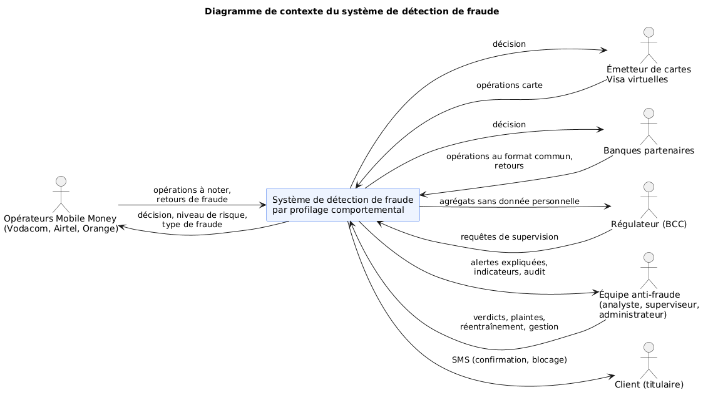
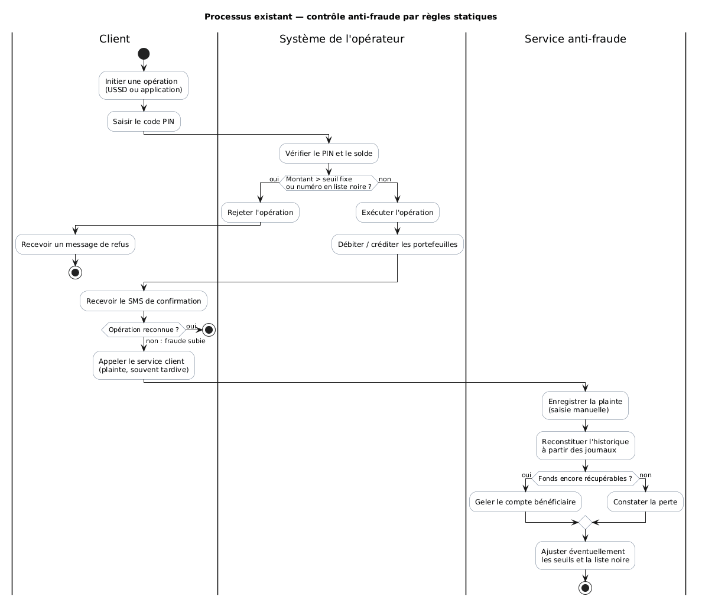
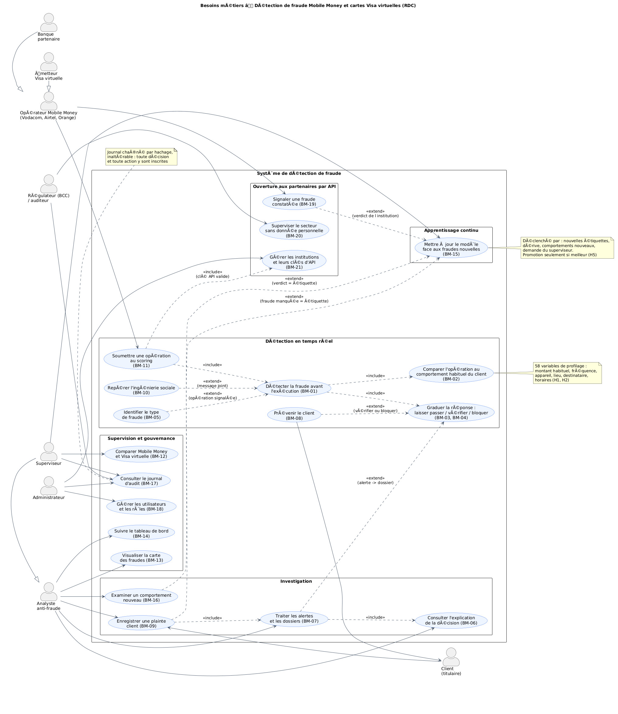

Ce deuxième chapitre présente l'analyse des besoins et la méthodologie qui conduisent au système de détection de fraude. Il répond à deux questions. D'abord, que faut-il construire, et avec quelles données ? La première partie spécifie les besoins du métier, puis décrit les sources de données, leur collecte et leur préparation. Ensuite, comment établir avec rigueur que le système fonctionne ? La seconde partie justifie le choix des algorithmes, fixe leurs paramètres, puis définit l'évaluation : ce que l'on mesure, avec quelles métriques et selon quel protocole.

La conception détaillée du système (architecture, services, déploiement) et les résultats obtenus font l'objet du chapitre III.

> **Précision méthodologique.** Aucun jeu de données réel de transactions Mobile Money congolaises n'est publiquement accessible. Le système est donc conçu, entraîné et évalué sur des **données simulées**, produites par un générateur qui reproduit le contexte de la République démocratique du Congo (RDC) de 2019 à 2025. Ce choix et ses conséquences sont discutés tout au long du chapitre, notamment dans la section « Sources de données » et dans le protocole d'évaluation.

## I. Spécification des besoins et des données

### 1. Analyse et spécification des besoins

L'analyse des besoins vise à comprendre l'activité que le système doit servir avant de décider de la manière de l'informatiser. Elle suit la progression classique : présentation du domaine, étude et critique de l'existant, puis spécification des besoins.

#### 1.1 Présentation du domaine

**Le Mobile Money en RDC.** Le Mobile Money est devenu un moyen de paiement de masse dans un pays où une grande partie de la population n'a pas de compte bancaire. Trois opérateurs de téléphonie mobile se partagent le marché : **Vodacom (M-Pesa)**, **Airtel (Airtel Money)** et **Orange (Orange Money)**. Selon l'observatoire de l'Autorité de régulation de la poste et des télécommunications du Congo (ARPTC), on comptait fin 2025 environ 15,4 millions d'abonnés actifs pour M-Pesa, 11,1 millions pour Airtel Money et 7,7 millions pour Orange Money.

Le portefeuille mobile permet neuf types d'opérations, présentés dans le tableau II.1.

*Tableau II.1 — Types d'opérations Mobile Money et carte.*

| Opération | Code | Description |
|---|---|---|
| Envoi d'argent | `P2P_SEND` | transfert vers un autre portefeuille |
| Réception | `P2P_RECEIVE` | crédit reçu d'un autre portefeuille |
| Dépôt | `CASH_IN` | remise d'espèces chez un agent, contre crédit du portefeuille |
| Retrait | `CASH_OUT` | retrait d'espèces chez un agent |
| Paiement marchand | `MERCHANT_PAYMENT` | règlement d'un achat chez un commerçant |
| Crédit téléphonique | `AIRTIME` | achat d'unités de communication |
| Facture | `BILL_PAYMENT` | eau, électricité, télévision, frais scolaires |
| Recharge de carte | `CARD_TOPUP` | alimentation de la carte Visa virtuelle depuis le portefeuille |
| Achat par carte | `CARD_PURCHASE` | paiement en ligne ou international par carte virtuelle |

Trois traits caractérisent ce marché et orientent la conception du système :

1. **L'accès par USSD** (*Unstructured Supplementary Service Data*). Une large part des clients utilise un téléphone simple et compose un code (par exemple `*1222#`). Le système ne peut donc pas compter sur des signaux propres aux smartphones, comme la géolocalisation fine ou l'empreinte de l'application.
2. **La double monnaie.** Les opérations se font en francs congolais (CDF) et en dollars américains (USD). Le franc s'est fortement déprécié sur la période étudiée : environ 1 650 CDF pour 1 USD en 2019, plus de 2 700 en 2024.
3. **Le réseau d'agents.** Les dépôts et les retraits passent par des agents de proximité. Ils sont indispensables à l'inclusion financière, mais constituent aussi un point de vulnérabilité.

**La carte Visa virtuelle.** Les opérateurs et certaines banques proposent une carte Visa virtuelle, rechargée depuis le portefeuille mobile. Elle ouvre l'accès aux achats en ligne et internationaux. Ce second canal obéit à d'autres usages (commerçants en ligne, montants, horaires) et attire des fraudes spécifiques. Le travail prévoit une extension comparative à ce canal.

**Le cadre réglementaire.** La Banque Centrale du Congo (BCC) régule l'émission de monnaie électronique, notamment par l'Instruction n° 24 de 2011. Elle impose l'identification des clients selon des niveaux KYC (*Know Your Customer*), assortis de plafonds par opération, et attend des établissements une traçabilité de leurs décisions. L'ARPTC suit de son côté le marché des télécommunications.

**Les typologies de fraude.** L'analyse du domaine a permis de retenir huit typologies de fraude, qui forment le périmètre de détection du système (tableau II.2).

*Tableau II.2 — Typologies de fraude retenues.*

| Typologie | Mécanisme | Signature comportementale attendue | Canal |
|---|---|---|---|
| Échange de SIM (*SIM swap*) | Le fraudeur obtient un duplicata de la carte SIM puis vide le compte depuis un nouvel appareil | nouvel appareil, montant élevé, vidage du solde | Mobile Money |
| Ingénierie sociale | Le client est manipulé (faux agent, faux gain, urgence familiale) et envoie lui-même l'argent | nouveau destinataire, montant inhabituel, message suspect | Mobile Money |
| Prise de contrôle de compte | Accès non autorisé à l'application du client | nouvel appareil, horaire inhabituel, rafale d'opérations | Mobile Money |
| Fraude d'agent | Retraits non autorisés par un agent compromis | nouvel agent, retraits répétés | Mobile Money |
| Fractionnement (*smurfing*) | Petits montants répétés vers des comptes mules pour rester sous les seuils | forte fréquence, destinataire lié à de nombreux clients | Mobile Money |
| Test de carte | Salves de petits achats pour vérifier une carte volée | rafale de petits montants, nouveaux commerçants | Visa virtuelle |
| Carte non présente (CNP) | Achat en ligne avec les données de la carte | commerçant ou pays inhabituel, adresse IP étrangère | Visa virtuelle |
| Vidage par rechargement | Rechargement de la carte puis vidage rapide | recharge suivie d'achats rapprochés | Visa virtuelle |

Un **compte mule** est un compte (souvent loué ou volé) qui reçoit l'argent frauduleux avant son retrait. Il se repère parce qu'il reçoit de nombreux clients sans lien entre eux. Ces fraudes **évoluent dans le temps** : les fraudeurs s'adaptent aux contrôles, et les techniques d'ingénierie sociale se sont développées sur la période. Cette évolution est au cœur de l'une des hypothèses de recherche (H5).

#### 1.2 Étude et critique de l'existant

**Diagramme de contexte.** Le diagramme de contexte situe le système à construire parmi ses interlocuteurs et fixe la frontière du travail : le système ne gère pas les portefeuilles et n'exécute pas les opérations. Il **décide** si une opération soumise par une institution doit être acceptée, vérifiée ou refusée, et il **outille** l'équipe chargée de la fraude.

*Figure II.1 — Diagramme de contexte du système.*

**Processus actuel.** Dans le schéma courant, le contrôle anti-fraude d'un opérateur repose sur des **règles statiques** appliquées au moment de l'opération, complétées par un traitement **a posteriori** des plaintes :

1. le client initie l'opération et saisit son code PIN ;
2. le système de l'opérateur vérifie le PIN, le solde, puis un jeu de règles fixes : plafond de montant, liste noire de numéros, plafond KYC ;
3. si aucune règle n'est franchie, l'opération est exécutée immédiatement ;
4. si le client ne reconnaît pas l'opération, il appelle le service client, souvent plusieurs heures après ;
5. un agent du service anti-fraude enregistre la plainte, reconstitue l'historique à partir des journaux, tente de geler le compte bénéficiaire, puis ajuste éventuellement les seuils.

*Figure II.2 — Diagramme d'activité du processus existant.*

**Critique de l'existant.** Le dispositif actuel présente des points forts réels : il est simple, rapide, compréhensible et facile à justifier devant le régulateur. Ses insuffisances sont toutefois structurelles (tableau II.3).

*Tableau II.3 — Critique de l'existant.*

| N° | Insuffisance | Conséquence |
|---|---|---|
| 1 | **Les règles ignorent l'individu.** Un même seuil s'applique à tous : un retrait de 300 USD est banal pour un commerçant et anormal pour un étudiant. | Fausses alertes (clients actifs bloqués) et fraudes manquées (montants modestes mais anormaux). |
| 2 | **Les règles sont figées.** Les fraudeurs apprennent les seuils et s'y adaptent, par exemple en fractionnant les montants. | L'efficacité se dégrade avec le temps ; la mise à jour dépend d'une intervention manuelle. |
| 3 | **La détection est tardive.** La fraude est souvent constatée par la plainte du client, après l'exécution. | Les fonds, déjà retirés ou transférés, sont rarement récupérables. |
| 4 | **La réponse n'est pas graduée.** Une règle accepte ou refuse, sans tenir compte du montant en jeu. | Refuser 2 USD de crédit et laisser passer 900 USD de retrait n'ont pas le même coût, mais sont traités de la même façon. |
| 5 | **Les décisions ne sont pas expliquées.** L'analyste ne sait pas pourquoi une opération est suspecte. | Le traitement des alertes est lent ; la décision est difficile à défendre devant le client ou le régulateur. |
| 6 | **Les plaintes ne nourrissent pas le dispositif.** Une fraude confirmée ne modifie pas automatiquement les contrôles. | Les mêmes schémas de fraude se répètent. |
| 7 | **Le marché est cloisonné.** Chaque opérateur contrôle ses propres flux, dans son propre format. | Un fraudeur qui opère sur plusieurs réseaux n'est vu par personne dans son ensemble ; le régulateur n'a pas de vision consolidée. |

**Solution proposée.** Ces constats orientent le système vers un **profilage comportemental** : apprendre le comportement habituel de chaque client et juger chaque opération par rapport à ce comportement, avant son exécution. La décision doit être graduée selon le risque et le montant, expliquée, et le modèle doit se mettre à jour à partir des fraudes confirmées. Le système doit enfin s'ouvrir à plusieurs institutions par une interface commune.

#### 1.3 Problématique, hypothèses et objectifs

L'analyse qui précède conduit à la question centrale de ce travail :

> *Comment concevoir un modèle d'intelligence artificielle qui apprend le comportement habituel de chaque utilisateur pour détecter, en temps réel et de manière explicable, les transactions frauduleuses Mobile Money en RDC, et dans quelle mesure cette approche se transpose-t-elle aux cartes virtuelles ?*

Une **hypothèse de recherche** est une affirmation testable, formulée avant l'expérience, qu'on confirme ou infirme selon un critère fixé à l'avance. Le tableau II.4 relie chaque question de recherche à son hypothèse.

*Tableau II.4 — Questions de recherche et hypothèses.*

| Question de recherche | Hypothèse |
|---|---|
| QR1 — Le profilage comportemental détecte-t-il mieux la fraude que les approches statiques ? | **H1** : un modèle fondé sur le profil comportemental de l'utilisateur est significativement plus performant que les règles statiques et qu'un modèle sans historique. |
| QR2 — Quelles caractéristiques comportementales sont les plus discriminantes ? | **H2** : les variables temporelles, fréquentielles et contextuelles contribuent significativement à la détection. |
| QR3 — Quelle famille de modèles est la plus adaptée ? | **H3** : les performances varient significativement selon la famille de modèles (ensembles d'arbres, modèles linéaires, détection d'anomalies, réseaux récurrents). |
| QR4 — La logique se transpose-t-elle aux cartes virtuelles ? | **H4** : un modèle appris sur le Mobile Money conserve une performance élevée sur les cartes Visa virtuelles, avec peu ou pas de données Visa. |
| QR5 — Le modèle doit-il évoluer avec les fraudes ? | **H5** : face à l'évolution des fraudes, un modèle régulièrement mis à jour reste significativement plus performant qu'un modèle figé. |

**Objectif général.** Concevoir, réaliser et évaluer un système de détection de fraude par profilage comportemental, opérationnel en temps réel, explicable, évolutif et ouvert aux institutions du secteur.

**Objectifs spécifiques :**

1. construire un profil comportemental par utilisateur ;
2. comparer plusieurs familles de modèles selon un protocole statistique rigoureux ;
3. mesurer la transposabilité du Mobile Money vers la carte Visa virtuelle ;
4. intégrer le modèle dans une architecture temps réel, avec explication, supervision et réentraînement ;
5. l'exposer aux opérateurs, aux banques et au régulateur par une interface de programmation (API) ;
6. mesurer ce que le modèle laisse passer et à qui il nuit : fraudes manquées, fausses alertes et équité entre groupes de clients.

#### 1.4 Identification des acteurs

Un acteur est une entité externe au système qui interagit avec lui. On distingue les acteurs humains des systèmes externes, et les acteurs internes à l'organisation de ceux qui lui sont extérieurs (tableau II.5).

*Tableau II.5 — Acteurs du système.*

| Acteur | Type | Rôle | Attentes |
|---|---|---|---|
| Client (titulaire) | Humain, externe | Effectue les opérations | Être protégé sans être bloqué à tort ; être prévenu en cas d'opération suspecte |
| Opérateur Mobile Money | Système externe | Transmet les opérations, applique la décision | Décision rapide (moins de 100 ms), fiable, dans son format natif |
| Émetteur de cartes virtuelles | Système externe | Transmet les opérations carte, applique la décision | Idem |
| Banque partenaire | Système externe | Utilise le système par l'API au format commun | Intégration simple, isolement de ses données |
| Analyste anti-fraude | Humain, interne | Traite les alertes et les dossiers | Alertes priorisées, expliquées et typées |
| Superviseur | Humain, interne | Encadre l'équipe, suit le modèle, règle la politique de décision, valide les déblocages importants | Indicateurs, journal d'audit, pilotage du modèle |
| Administrateur | Humain, interne | Gère les comptes, les rôles, les institutions et les clés d'API | Contrôle des accès |
| Régulateur (BCC), auditeur | Humain ou système, externe | Supervise le secteur, contrôle la conformité | Agrégats sans donnée personnelle, traçabilité inaltérable |

Deux relations de **généralisation** (relation UML « hérite de ») simplifient la modélisation : le superviseur hérite des droits de l'analyste ; l'émetteur Visa et la banque partenaire se comportent, vis-à-vis du système, comme un opérateur.

#### 1.5 Règles de gestion

Les règles de gestion traduisent les contraintes du métier que le système doit respecter, indépendamment de la technique. Elles ont été établies à partir de l'analyse du domaine, puis implémentées telles quelles dans le code (tableau II.6).

*Tableau II.6 — Règles de gestion.*

| Réf. | Règle de gestion |
|---|---|
| RG-01 | Toute opération est soumise au système **avant** son exécution, et reçoit une décision parmi : APPROVE (laisser passer), VERIFY (faire confirmer par le client), BLOCK (refuser). |
| RG-02 | Tout montant est converti en USD au taux de change de l'année de l'opération avant d'être évalué. |
| RG-03 | Une opération soumise deux fois avec le même identifiant reçoit la décision d'origine (idempotence pendant 30 minutes). |
| RG-04 | Si la probabilité de fraude est au moins égale à 0,97, l'opération est bloquée quel que soit le montant ; si elle est inférieure à 0,01, elle est acceptée sans vérification. |
| RG-05 | Entre ces deux bornes, l'action retenue est celle dont le **coût attendu** est le plus faible, compte tenu de la probabilité de fraude, du montant, du canal et, pour le Mobile Money, de l'opérateur. |
| RG-06 | Les règles métier et les lois physiques ne peuvent que **renforcer** la décision du modèle, jamais l'assouplir. |
| RG-07 | Un débit depuis un **nouvel appareil** qui vide presque entièrement le solde est au minimum soumis à vérification. |
| RG-08 | Un débit qui **dépasse le plafond KYC** du client est au minimum soumis à vérification. |
| RG-09 | Un **retrait** effectué depuis un nouvel appareil **et** dans une nouvelle province est au minimum soumis à vérification. |
| RG-10 | Un message de transfert présentant de fortes marques de manipulation impose une vérification ; le texte seul ne justifie **jamais** un blocage. |
| RG-11 | Un déplacement physiquement impossible entre deux opérations consécutives impose au minimum une vérification. |
| RG-12 | Toute décision VERIFY ou BLOCK ouvre un **dossier d'alerte** et déclenche une notification au client. Une alerte de niveau CRITIQUE déclenche aussi un e-mail à l'équipe anti-fraude. |
| RG-13 | Un dossier ne peut être clos (FRAUDE_CONFIRMEE ou FAUX_POSITIF) qu'avec une **note de résolution**. Un dossier clos ne peut plus être rouvert. |
| RG-14 | Seul un superviseur peut affecter un dossier à un autre analyste que lui-même. |
| RG-15 | Une plainte du client ou un retour d'une institution crée ou clôt le dossier en FRAUDE_CONFIRMEE ; le verdict devient une **étiquette** d'apprentissage. |
| RG-16 | Toute action sensible (décision, verdict, création de clé, consultation du régulateur) est inscrite dans un journal d'audit **non modifiable et non supprimable**. |
| RG-17 | Une institution ne voit que ses propres opérations ; le régulateur ne reçoit que des agrégats sans donnée personnelle. |
| RG-18 | Un nouveau modèle ne remplace le modèle en service que s'il est meilleur sur la même période et satisfait les contrôles de qualité. |
| RG-19 | **Quatre yeux.** Déclarer « faux positif » (donc débloquer) une opération bloquée d'au moins 500 USD crée une demande, appliquée seulement après validation par un second superviseur ou administrateur, différent du demandeur. |
| RG-20 | Cinq échecs de connexion consécutifs verrouillent le compte pendant 15 minutes ; la double authentification (code à usage unique) est facultative et peut être rendue obligatoire par rôle. |
| RG-21 | La politique de coût est **versionnée** (auteur, justification, effet simulé) ; une nouvelle version est simulée avant son application, puis rechargée à chaud par le service de décision. |
| RG-22 | Chaque institution partenaire est limitée à un débit maximal de requêtes ; au-delà, elle reçoit une réponse 429 avec le délai d'attente. |
| RG-23 | Au réentraînement, un verdict vérifié (analyste, plainte, file de revue) pèse trois fois une étiquette supposée ; une opération sans plainte après 7 jours est supposée légitime. |

#### 1.6 Spécification des besoins fonctionnels

Les besoins fonctionnels décrivent ce que le système doit faire. Chacun est numéroté (BM pour « besoin métier ») afin d'être suivi jusqu'à la conception et aux tests (tableau II.7).

*Tableau II.7 — Besoins fonctionnels.*

| Réf. | Besoin | Réponse du système |
|---|---|---|
| BM-01 | Détecter la fraude **avant** l'exécution de l'opération | Notation synchrone de chaque opération par un modèle hybride |
| BM-02 | Reconnaître le **comportement habituel** de chaque client et ses écarts | 58 variables de profilage calculées sur l'historique du client |
| BM-03 | **Graduer la réponse** : laisser passer, faire vérifier, bloquer | Décision coût-sensible, règles métier prioritaires (RG-04 à RG-11) |
| BM-04 | Limiter les **fausses alertes** | Seuil optimisé ; vérification plutôt que blocage dans les cas intermédiaires |
| BM-05 | Identifier le **type de fraude** | Classifieur de typologie (8 types) affiché sur chaque alerte |
| BM-06 | **Expliquer** chaque décision | Contributions SHAP, part de chaque composante du modèle, attention sur l'historique, cas similaires |
| BM-07 | **Prioriser et traiter** les alertes | Dossiers classés par risque et montant ; statuts ; affectation ; note obligatoire |
| BM-08 | **Prévenir le client** | SMS au client, e-mail à l'équipe pour les cas critiques |
| BM-09 | Enregistrer les **plaintes** des clients | Plainte, dossier « fraude confirmée », étiquette d'apprentissage |
| BM-10 | Repérer l'**ingénierie sociale** | Profilage, analyse du message (NLP), règle de vérification |
| BM-11 | Couvrir **plusieurs opérateurs et la carte Visa** | Un adaptateur par format, vers un schéma unique |
| BM-12 | **Comparer et transposer** au canal Visa | Protocole d'évaluation Mobile Money vers Visa |
| BM-13 | Vision **géographique** nationale | Carte des 26 provinces |
| BM-14 | **Tableau de bord** de supervision | Indicateurs temps réel, séries, répartitions, performance du modèle |
| BM-15 | **S'adapter** aux fraudes nouvelles | Réentraînement déclenché, stratégie champion / challenger |
| BM-16 | Faire **examiner les comportements nouveaux** | Détection de nouveauté, revue d'analyste, étiquette |
| BM-17 | **Traçabilité** | Journal d'audit chaîné par hachage |
| BM-18 | **Gérer les droits** selon le rôle | Rôles analyste, superviseur, administrateur |
| BM-19 | Permettre aux institutions de **signaler les fraudes constatées** | Route d'API de retour : le dossier est clos et l'étiquette sert au réentraînement |
| BM-20 | Permettre au régulateur de **superviser le secteur** | API de supervision en lecture seule, agrégats sans donnée personnelle |
| BM-21 | **Gérer les institutions partenaires** et leurs accès | Création, droits, quota de débit, renouvellement et révocation des clés d'API |
| BM-22 | Révéler les **réseaux de fraude** (comptes mules, appareils et agents partagés) | Analyse de graphe comptes, portefeuilles, appareils, agents, marchands |
| BM-23 | **Mesurer la qualité réelle** du modèle et choisir quoi faire revoir | File de revue (incertitude, nouveauté, réseau, échantillon témoin), fraudes manquées estimées |
| BM-24 | **Régler les coûts** de décision sans réentraîner | Politique de coût versionnée, simulée avant application, rechargée à chaud |
| BM-25 | Vérifier que les erreurs ne **pénalisent pas un groupe** de clients | Taux de fausses alertes par groupe, avec intervalles de confiance |
| BM-26 | **Protéger les comptes** du back-office et les décisions sensibles | Double authentification, verrouillage, validation à quatre yeux |

#### 1.7 Spécification des besoins non fonctionnels

Les besoins non fonctionnels (BT pour « besoin technique ») fixent les qualités attendues du système : rapidité, fiabilité, sécurité, maintenabilité (tableau II.8).

*Tableau II.8 — Besoins non fonctionnels.*

| Catégorie | Réf. | Exigence | Réponse prévue |
|---|---|---|---|
| Performance | BT-01 | Décision avant exécution, en moins de 100 ms | Chemin critique synchrone réduit au minimum ; profil en mémoire (Redis) |
| | BT-02 | Absorber le débit des opérateurs | Plusieurs processus de notation, limitation de débit, réplicas |
| Disponibilité | BT-03 | Continuité si la notation est indisponible | Politique de repli configurable, relances bornées |
| | BT-04 | Résilience aux doublons | Idempotence (RG-03) |
| Intégration | BT-06 | Formats hétérogènes des opérateurs | Patron *Adapter* et schéma pivot `UnifiedTransaction` |
| | BT-07 | Double monnaie | Conversion CDF vers USD au taux de l'année (RG-02) |
| | BT-10 | Découplage des traitements | Bus d'événements Kafka et workers indépendants |
| Apprentissage automatique | BT-11 | Cohérence entre entraînement et production | Mêmes fonctions de calcul des variables ; contrôle de l'empreinte de la normalisation |
| | BT-12 | Déséquilibre des classes (environ 1,3 % de fraudes) | Pondération, sous-échantillonnage, métrique PR-AUC |
| | BT-13 | Absence de fuite d'information | Variables calculées sur le passé ; découpage temporel |
| | BT-14 | Explicabilité | TreeSHAP exact, attention, recherche de cas similaires |
| | BT-15 | Évaluation statistiquement fondée | Bootstrap apparié par usager, test de McNemar |
| | BT-16 | Surveillance de la dérive | Kolmogorov-Smirnov, PSI, taux de nouveauté |
| | BT-17 | Réentraînement maîtrisé | Champion / challenger, porte de détection, garde-fou contre le surapprentissage |
| | BT-19 | Robustesse aux attaques inédites | Lois physiques (cinématique, conservation) |
| | BT-29 | Équité mesurable | Taux d'erreur par groupe avec intervalles de confiance de Wilson |
| Sécurité | BT-20 | Authentification des systèmes partenaires | Clé d'API par institution (empreinte SHA-256), droits par institution |
| | BT-21 | Authentification des utilisateurs | Jeton JWT, contrôle d'accès par rôle, double authentification facultative |
| | BT-22 | Intégrité du journal | Chaînage SHA-256, modification et suppression interdites en base |
| | BT-23 | Confidentialité | Aucun service externe ; texte des messages jamais stocké ; isolement des données par institution |
| | BT-28 | Protection contre les abus | Quota par institution (seau à jetons), limitation par adresse (Nginx) |
| Exploitation | BT-25 | Observabilité | Métriques, tableaux de bord, journaux centralisés, alertes |
| | BT-26 | Qualité logicielle | Tests automatisés par service |
| | BT-27 | Portabilité | Conteneurs Docker, Docker Compose, Kubernetes |

#### 1.8 Contraintes propres au contexte congolais

Le contexte congolais impose des contraintes dont la conception tient compte explicitement (tableau II.9).

*Tableau II.9 — Contraintes du contexte et conséquences.*

| Contrainte | Conséquence sur la conception |
|---|---|
| Téléphones simples et USSD très répandus | Variables indépendantes de l'application (montant, fréquence, agent, destinataire) |
| Réseau d'agents de proximité | Variables liées à l'agent ; typologie « fraude d'agent » |
| Double monnaie CDF / USD, dépréciation du franc | Montants ramenés en USD au taux de l'année |
| Connectivité inégale | Aucune dépendance à un service en ligne externe pour décider |
| 26 provinces, territoire très vaste | Localisation par province ; loi physique de déplacement entre chefs-lieux |
| Niveaux KYC et plafonds | Variable « montant / plafond KYC » ; règle RG-08 |
| Marché multi-opérateurs régulé par la BCC | API ouverte aux institutions, isolement des données, supervision par le régulateur |
| Absence de jeu de données public | Générateur de données synthétiques ; validation sur données réelles à prévoir |

#### 1.9 Cas d'utilisation

Le diagramme des cas d'utilisation représente les services que le système rend à chaque acteur. Les cas sont regroupés en quatre paquetages : détection en temps réel, investigation, supervision et gouvernance, ouverture aux partenaires.

*Figure II.3 — Diagramme des cas d'utilisation.*

Le diagramme ne dit pas comment chaque cas se déroule. Les trois cas les plus structurants sont donc décrits sous forme textuelle (tableaux II.10 à II.12).

*Tableau II.10 — Cas n° 1 : soumettre une opération au scoring.*

| Rubrique | Description |
|---|---|
| Acteur principal | Opérateur Mobile Money (ou émetteur Visa, banque partenaire) |
| Objectif | Obtenir une décision sur une opération avant de l'exécuter |
| Préconditions | L'institution dispose d'une clé d'API active, du droit « transactions » et n'a pas dépassé son quota de débit |
| Scénario nominal | 1. L'institution envoie l'opération, au format commun ou dans son format natif. 2. Le système vérifie la clé, les droits et le quota. 3. Il convertit l'opération au format commun et la rattache à l'institution. 4. Il met à jour le profil du client et calcule les variables. 5. Il évalue les lois physiques, calcule la probabilité de fraude et le type probable. 6. Il choisit l'action de coût minimal, puis applique les règles métier. 7. Il renvoie la décision, le niveau de risque, le type probable et les motifs. |
| Scénarios alternatifs | 2a. Clé absente, invalide ou révoquée : refus (401 ou 403). 2b. Quota dépassé : refus (429) avec le délai d'attente. 3a. Format non reconnu : refus (422). 4a. Opération déjà reçue : renvoi de la décision d'origine (RG-03). 5a. Service de notation indisponible : politique de repli (BT-03). |
| Postconditions | L'opération et sa décision sont publiées dans le bus d'événements ; si la décision est VERIFY ou BLOCK, un dossier est ouvert (RG-12). |
| Exigences liées | BM-01 à BM-06, BM-11 ; BT-01, BT-04, BT-06, BT-20, BT-28 |

*Tableau II.11 — Cas n° 2 : traiter un dossier d'alerte.*

| Rubrique | Description |
|---|---|
| Acteur principal | Analyste anti-fraude (ou superviseur) |
| Objectif | Établir si une opération signalée est une fraude |
| Préconditions | L'analyste est authentifié ; au moins un dossier est ouvert |
| Scénario nominal | 1. L'analyste consulte la file des dossiers, triée par niveau de risque puis par montant. 2. Il ouvre un dossier, qui passe au statut EN_COURS et lui est affecté. 3. Il consulte l'explication : variables déterminantes, contribution de chaque composante du modèle, lois physiques, historique récent, cas passés similaires, réseau du compte et procédure recommandée. 4. Il rend son verdict (FRAUDE_CONFIRMEE ou FAUX_POSITIF) avec une note de résolution. 5. Le système enregistre l'étiquette et journalise l'action. |
| Scénarios alternatifs | 4a. Note absente : refus de la clôture (RG-13). 4b. Faux positif sur une opération bloquée d'au moins 500 USD : le verdict devient une demande en attente d'un second validateur (RG-19). 2a. Le superviseur réaffecte le dossier (RG-14). |
| Postconditions | Le dossier est clos ; l'étiquette est disponible pour le réentraînement ; l'action figure au journal d'audit. |
| Exigences liées | BM-06, BM-07, BM-15, BM-17, BM-22, BM-26 |

*Tableau II.12 — Cas n° 3 : déclencher le réentraînement du modèle.*

| Rubrique | Description |
|---|---|
| Acteur principal | Superviseur (déclenchement manuel) ou planificateur (déclenchement automatique) |
| Objectif | Adapter le modèle aux fraudes nouvelles |
| Scénario nominal | 1. Un signal est constaté : nouvelles étiquettes, dérive des données, comportements nouveaux, ou demande du superviseur. 2. Le planificateur vérifie le délai de carence. 3. Un modèle candidat (*challenger*) est entraîné, les verdicts vérifiés pesant trois fois les étiquettes supposées. 4. Il est soumis aux contrôles de qualité. 5. S'il est meilleur que le modèle en service (*champion*), il est promu et chargé à chaud. |
| Scénarios alternatifs | 4a. Échec d'un contrôle : le candidat est rejeté et une alerte est levée ; le champion reste en service (RG-18). |
| Exigences liées | BM-15, BM-16, BM-23, BT-16, BT-17 |

#### 1.10 Priorisation et traçabilité des besoins

Les besoins ont été priorisés par la méthode **MoSCoW**, qui distingue l'indispensable (*Must*), l'important (*Should*), le souhaitable (*Could*) et ce qui est hors périmètre pour l'instant (*Won't*). Cette priorisation a guidé l'ordre de réalisation (tableau II.13).

*Tableau II.13 — Priorisation MoSCoW.*

| Priorité | Besoins |
|---|---|
| **Indispensable** (*Must*) | BM-01, BM-02, BM-03, BM-04, BM-06, BM-17, BT-01, BT-11, BT-13, BT-21, BT-22 |
| **Important** (*Should*) | BM-05, BM-07, BM-08, BM-09, BM-11, BM-15, BM-19, BM-21, BM-26, BT-03, BT-04, BT-16, BT-17, BT-20, BT-28 |
| **Souhaitable** (*Could*) | BM-10, BM-12, BM-13, BM-14, BM-16, BM-20, BM-22, BM-23, BM-24, BM-25, BT-19, BT-25, BT-29 |
| **Hors périmètre** (*Won't*, pour l'instant) | Raccordement aux systèmes réels des opérateurs ; validation sur données réelles ; analyse de messages en lingala et en swahili |

Une **matrice de traçabilité** relie chaque hypothèse aux besoins qui permettent de l'éprouver (tableau II.14). Elle garantit que le système construit sert la question de recherche, et non l'inverse.

*Tableau II.14 — Traçabilité entre hypothèses et besoins.*

| Hypothèse | Besoins concernés |
|---|---|
| H1 | BM-01, BM-02, BM-04 |
| H2 | BM-02, BT-13 |
| H3 | BM-01, BT-12, BT-15 |
| H4 | BM-11, BM-12 |
| H5 | BM-15, BM-16, BM-19, BM-23, BT-16, BT-17 |

### 2. Sources de données

#### 2.1 Panorama des sources

Le système s'appuie sur quatre sources de données, de nature et de rôle différents (tableau II.15).

*Tableau II.15 — Sources de données du système.*

| Source | Nature | Rôle | Volume |
|---|---|---|---|
| Transactions simulées | Données primaires synthétiques, produites par le générateur du projet | Entraînement, validation et test des modèles | 631 968 transactions, 500 clients, 800 agents, 900 marchands |
| Données de production | Opérations notées par le système en fonctionnement, avec décisions, explications et verdicts | Suivi, apprentissage continu, qualité réelle, équité | Croît avec l'usage (base PostgreSQL) |
| Corpus de messages | Messages de transfert rédigés pour le projet, annotés (manipulation, sentiment) | Mise au point et évaluation de l'analyse de texte | 50 messages de développement, 61 de test |
| Base de connaissances | Neuf fiches de procédures (une par typologie, plus la politique de décision) | Preuves textuelles proposées à l'analyste | 9 fiches |
| Sources externes | Statistiques officielles de l'ARPTC, de la BCC et de la Banque mondiale | Confrontation des paramètres du générateur | Indicateurs agrégés |

#### 2.2 Justification du recours à des données simulées

Les données transactionnelles des opérateurs sont confidentielles, au titre du secret bancaire et de la protection des données personnelles. Aucun jeu public ne couvre la RDC. Un **générateur paramétré** a donc été conçu. Il reproduit les régularités connues du marché : opérateurs, provinces, agents, double monnaie, saisonnalité et typologies de fraude.

Le recours à un simulateur a des précédents dans le domaine. Le plus connu est **PaySim** (Lopez-Rojas, Elmir et Axelsson, 2016), simulateur de transactions Mobile Money conçu pour la détection de fraude parce que les données réelles ne sont pas publiques. PaySim s'appuie sur un échantillon de journaux réels d'un service Mobile Money d'un pays africain. Plus récemment, le simulateur **MoMTSim** (Azamuke et al., 2022), calibré sur des données de plateformes Mobile Money d'Afrique subsaharienne, a été proposé pour les mêmes raisons. La différence avec le présent travail est que le générateur repose entièrement sur des hypothèses paramétrées, faute d'un échantillon réel pour la RDC.

#### 2.3 Provenance et reproductibilité

Les données sont des **données primaires synthétiques**, produites par un générateur développé pour ce travail. Elles ne proviennent d'aucun opérateur, d'aucune banque ni d'aucune base publique, et ne contiennent aucune donnée personnelle réelle (tableau II.16).

*Tableau II.16 — Provenance des données.*

| Élément | Valeur |
|---|---|
| Source | Générateur du projet : `ml/generator/generate_synthetic_data.py` |
| Commande | `python ml/generator/generate_synthetic_data.py --multi-year` |
| Graine aléatoire | 42 : la génération est reproductible à l'identique |
| Fichiers produits | `transactions.csv` (631 968 lignes), `users.csv` (500), `agents.csv` (800), `merchants.csv` (900), `fraud_mapping.json` |
| Traçabilité | `ml/data/raw/generation_metadata.json` : configuration et statistiques de la génération |
| Dictionnaire des données | `docs/dictionnaire_donnees.md` |

La **graine aléatoire** initialise le générateur de nombres pseudo-aléatoires : une même graine produit toujours les mêmes données, ce qui rend toute l'étude reproductible.

#### 2.4 Structure des données

Quatre fichiers décrivent le jeu : les transactions, les clients, les agents et les marchands. Chaque colonne a un **rôle** qui détermine son usage : information disponible à l'entrée de l'opération (**E**), identifiant (**ID**), cible à prédire (**C**), ou information cachée de vérité terrain, interdite en entrée car elle provoquerait une fuite d'information (**H**) (tableau II.17).

*Tableau II.17 — Principales colonnes du fichier des transactions.*

| Colonne | Domaine | Description | Rôle |
|---|---|---|---|
| `transaction_id`, `user_id` | identifiants | Opération et titulaire du compte | ID |
| `timestamp` | date-heure, heure locale RDC | Date et heure de l'opération | E |
| `channel` | `MOBILE_MONEY`, `VISA_VIRTUAL` | Canal de paiement | E |
| `operator` | `VODACOM`, `AIRTEL`, `ORANGE` | Opérateur du portefeuille | E |
| `tx_type`, `access_channel` | 9 types ; `USSD`, `APP`, `AGENT` | Type d'opération et moyen d'accès | E |
| `amount`, `currency`, `amount_usd` | décimal ; `CDF`, `USD` | Montant d'origine et montant converti au taux de l'année | E |
| `balance_before_usd` | décimal | Solde avant l'opération | E |
| `counterparty_id`, `merchant_id`, `agent_id` | identifiants | Destinataire, marchand, agent | E |
| `device_id`, `device_type`, `ip_country` | texte | Appareil, type de téléphone, pays de l'adresse IP | E |
| `location_province` | 26 provinces | Province d'où l'opération est initiée | E |
| `status`, `balance_after_usd` | `SUCCESS`, `FAILED_INSUFFICIENT_FUNDS` | Résultat et solde après (inconnus au moment de décider) | H |
| `is_fraud` | 0 ou 1 | **Cible** : l'opération fait partie d'un épisode de fraude | C |
| `fraud_type`, `fraud_episode_id` | catégorie ; identifiant | Typologie et épisode (analyse et second étage uniquement) | H |

Le fichier des clients précise le segment socio-économique (étudiant, commerçant, salarié, secteur informel, agriculteur, bénéficiaire de la diaspora), le niveau KYC, le plafond par opération, le revenu mensuel déclaré et l'appareil principal. Ses colonnes `is_mule_account` et `typical_amount_usd` sont cachées (rôle H). Le fichier des agents indique la province et si l'agent est compromis (rôle H). Le dictionnaire complet figure dans `docs/dictionnaire_donnees.md`.

#### 2.5 Ce que modélise le générateur

Les paramètres de simulation sont des **hypothèses de l'auteur**, choisies pour produire des ordres de grandeur plausibles ; ce ne sont pas des statistiques officielles. Le générateur reproduit :

- des **rythmes individuels** : heures d'activité propres à chaque client, cycles hebdomadaires, pics de fin de mois, frais scolaires de septembre, abonnements récurrents ;
- des **cas légitimes difficiles** : changement de téléphone (4 % des clients), voyage, usage nocturne, nouveau destinataire, montant inhabituel mais légitime ;
- des **déplacements réalistes** : la durée de trajet entre provinces est respectée ;
- des **fraudes par épisodes**, sur des victimes dont le solde est réellement débité ; une fraude échoue si le solde est insuffisant ;
- une **évolution des fraudes dans le temps** (paramètres `FRAUD_TRENDS`) : l'ingénierie sociale et le fractionnement progressent sur la période, ce qui permet de tester H5 ;
- l'**ouverture progressive des comptes** (35 % des clients existent au départ), une croissance de l'activité d'environ 8 % par an et le lancement de la carte Visa en 2021.

Le tableau II.18 résume les caractéristiques du jeu obtenu.

*Tableau II.18 — Caractéristiques du jeu de données.*

| Caractéristique | Valeur |
|---|---|
| Période | 1er janvier 2019 au 31 décembre 2025 |
| Transactions | 631 968 |
| Utilisateurs | 500 (arrivées progressives, croissance d'environ 8 % par an) |
| Fraudes | 8 426, soit **1,33 %** (3 028 épisodes) |
| Canaux | Mobile Money : 598 515 ; Visa virtuelle : 33 453 (lancée en 2021) |
| Opérateurs | Vodacom : 319 549 ; Airtel : 180 649 ; Orange : 131 770 |
| Monnaies | CDF et USD, taux de change par année |

Répartition des fraudes par typologie : échange de SIM 2 220, ingénierie sociale 1 850, fractionnement 1 334, prise de contrôle 1 112, fraude d'agent 888, carte non présente 406, test de carte 362, vidage par rechargement 254.

#### 2.6 Confrontation aux sources officielles

Les paramètres ont été fixés avant d'être comparés, a posteriori, aux statistiques publiées par l'ARPTC, la BCC et la Banque mondiale (tableau II.19).

*Tableau II.19 — Confrontation du générateur aux sources officielles.*

| Indicateur | Générateur | Source officielle | Écart |
|---|---|---|---|
| Clients par opérateur | Vodacom 45 %, Airtel 32 %, Orange 23 % | Abonnés actifs fin 2025 : 45 % / 33 % / 23 % (ARPTC) | cohérent |
| Provinces les plus actives | Kinshasa, Haut-Katanga, Nord-Kivu | Même classement des revenus Mobile Money, T1 2024 (ARPTC) | même classement |
| Taux USD/CDF 2019 à 2022 | 1 650 ; 1 850 ; 1 990 ; 2 010 | 1 647,8 ; 1 851,1 ; 1 989,4 ; 2 006,7 (Banque mondiale, d'après la BCC) | moins de 0,2 % |
| Taux USD/CDF 2023 et 2025 | 2 450 ; 2 850 | 2 340,0 ; 2 693,2 | + 4,7 % ; + 5,8 % |
| Taux de fraude | 1,24 % (Mobile Money) | aucune statistique publique pour la RDC | non vérifiable |

La **structure** du marché simulé est donc cohérente avec les statistiques officielles. En revanche, le **taux de fraude** et la **répartition des typologies** restent des hypothèses qu'aucune donnée publique ne permet de vérifier pour la RDC.

### 3. Processus de collecte

#### 3.1 Collecte des données d'apprentissage : la génération

Les données d'apprentissage ne sont pas collectées auprès d'un opérateur : elles sont **générées** par un processus automatisé et déterministe. Le générateur crée d'abord la population (clients, agents, marchands, avec leurs profils), puis rejoue le temps jour après jour : chaque client produit ses opérations légitimes selon ses habitudes, puis des épisodes de fraude sont injectés sur des victimes tirées parmi les clients actifs ce jour-là. Les fraudes tirent leur typologie selon l'intensité de chaque année (`FRAUD_TRENDS`). Le résultat est écrit dans quatre fichiers CSV et un fichier de métadonnées qui consigne la configuration complète de la génération.

#### 3.2 Collecte en exploitation : le flux temps réel

En fonctionnement, les opérations arrivent des institutions partenaires par l'**API d'intégration** et suivent une chaîne en quatre étapes.

1. **Réception et normalisation.** Chaque institution s'authentifie par une clé d'API. Son opération, au format commun ou dans son format natif (Vodacom, Airtel, Orange, Visa), est convertie par un adaptateur vers un **schéma pivot** unique, `UnifiedTransaction`. Le code de l'institution est fixé par le serveur d'après la clé, jamais d'après la requête.
2. **Notation synchrone.** Le service de notation vérifie l'idempotence, met à jour le profil du client, calcule les variables et rend la décision, en moins de 100 ms.
3. **Publication asynchrone.** Le résultat est publié dans le bus d'événements **Kafka**, qui découple la décision (rapide, synchrone) de tout le reste.
4. **Consommation par des workers.** Trois workers lisent les événements : le *persister* enregistre l'opération dans PostgreSQL / TimescaleDB, l'*alerter* ouvre les dossiers et prévient le client, l'*auditor* écrit le journal d'audit.

Quatre sujets Kafka relient les composants (tableau II.20).

*Tableau II.20 — Sujets Kafka.*

| Sujet | Contenu | Producteur | Consommateur |
|---|---|---|---|
| `transactions.scored` | toute opération notée, avec sa décision et son explication | service de notation | *persister* |
| `fraud.alerts` | décisions VERIFY et BLOCK | service de notation | *alerter* |
| `analyst.feedback` | verdicts des analystes et des institutions | back-office, API partenaires | *persister* (étiquette) |
| `audit.logs` | actions des utilisateurs | back-office | *auditor* |

#### 3.3 Collecte des étiquettes

Une donnée n'est utile à l'apprentissage que si l'on sait si l'opération était frauduleuse. En production, cette **étiquette** n'est pas immédiate ; elle provient de plusieurs sources de fiabilité inégale (tableau II.21).

*Tableau II.21 — Sources d'étiquettes.*

| Source | Étiquette | Fiabilité | Limite |
|---|---|---|---|
| Verdict d'un analyste sur une alerte | fraude ou faux positif | élevée | ne couvre que les opérations alertées |
| Plainte d'un client | fraude | élevée | ne couvre que les fraudes que le client remarque et signale |
| Retour d'une institution (API) | fraude ou fausse alerte | élevée | dépend de la diligence de l'institution |
| File de revue ciblée | fraude ou légitime | élevée | volume limité par la capacité des analystes |
| Échantillon témoin (tirage aléatoire parmi les opérations approuvées) | fraude ou légitime | élevée, **sans biais de sélection** | volume limité ; seule source qui mesure les fraudes manquées |
| Opération mûre sans plainte (7 jours) | légitime, par hypothèse | faible | contient des fraudes jamais signalées |

Le système corrige activement ce déséquilibre. Les analystes ne voient naturellement que les alertes du modèle, ce qui ne permet ni d'apprendre de ses erreurs d'omission ni de les mesurer. La **file de revue** propose donc aussi des opérations *approuvées*, choisies pour ce que leur verdict apprend : celles où le modèle a hésité (probabilité proche du seuil), les comportements jamais vus de l'autoencodeur, les opérations liées à une entité à risque du réseau, et un **échantillon témoin aléatoire** renouvelé chaque jour. Cette dernière source est la seule qui permette d'estimer sans biais la part de fraudes que le modèle laisse passer.

#### 3.4 Qualité, confidentialité et traçabilité

La collecte obéit à quatre garanties.

- **Idempotence.** Une opération renvoyée par un opérateur n'est ni comptée ni décidée deux fois (RG-03) ; la clé primaire (`transaction_id`, `tx_time`) interdit le doublon en base.
- **Confidentialité.** Aucune donnée ne quitte la plateforme : aucun service externe n'est appelé pour décider ni pour expliquer. Le texte des messages de transfert n'est jamais stocké en clair ; seuls le score et les catégories d'indices sont conservés.
- **Isolement.** Une institution ne voit que ses opérations ; le régulateur ne reçoit que des agrégats (RG-17).
- **Traçabilité.** Chaque action sensible est inscrite dans un journal d'audit chaîné par hachage (RG-16) ; les métadonnées de génération consignent la configuration des données d'apprentissage.

### 4. Pré-processing des données

#### 4.1 Contrôles de qualité et traitement des valeurs manquantes

Avant toute transformation, le jeu fait l'objet de contrôles systématiques (détaillés au chapitre III) : unicité des identifiants, montants strictement positifs, horodatages renseignés, soldes non négatifs, cohérence des types. Les champs vides sont tous **structurels** : ils sont absents parce qu'ils n'ont pas de sens pour le type d'opération, et non parce que la donnée est perdue. Par exemple, le destinataire n'existe que pour les transferts et les crédits téléphoniques, l'agent que pour les dépôts et retraits, le marchand que pour les paiements et les achats par carte. Ces absences ne sont donc pas imputées : elles sont encodées par des indicateurs (type d'opération, canal d'accès) et par des variables qui valent zéro quand la notion ne s'applique pas.

#### 4.2 Conversion monétaire

Chaque montant est converti en dollars au **taux de change de l'année de l'opération** (RG-02) :

$$a^{\text{USD}}_t=\begin{cases}a_t & \text{si la devise est l'USD}\\[2pt] \dfrac{a_t}{\text{taux}_{\text{USD/CDF}}(\text{année}(t))} & \text{si la devise est le CDF}\end{cases}$$

où $a_t$ est le montant de l'opération à l'instant $t$. Sans cette conversion, 100 000 CDF n'auraient pas la même valeur en 2019 et en 2025, et le modèle confondrait dépréciation de la monnaie et comportement anormal. Les taux annuels sont des paramètres de simulation, à remplacer par le cours officiel de la BCC en exploitation.

#### 4.3 Ingénierie des variables

**Principe.** Le profilage comportemental repose sur une idée simple : une fraude se manifeste par une **rupture des habitudes** du client. Chaque transaction est donc décrite par **58 variables**, qui mesurent l'écart entre l'opération courante et le comportement passé du client. Toutes les variables sont calculées **uniquement à partir du passé** du client, par un rejeu chronologique des opérations. Aucune information future ne peut ainsi entrer dans le calcul. Cette absence de **fuite d'information** (*data leakage*) est essentielle : utiliser, pendant l'apprentissage, une donnée indisponible au moment de la décision rendrait le modèle excellent en test et inutilisable en production.

*Tableau II.22 — Familles de variables comportementales.*

| Famille (nombre) | Exemples | Ce qu'elle capte |
|---|---|---|
| **Montants** (7) | écart au montant habituel, rapport au montant moyen, part du solde, vidage, montant / plafond KYC | rupture des habitudes de dépense |
| **Fréquentielles** (7) | nombre d'opérations sur 1 h, 24 h et 7 j ; somme débitée sur 24 h ; délai depuis l'opération précédente | vélocité anormale (vidage, salves) |
| **Appareil** (8) | nouvel appareil, utilisations passées, nombre de clients partageant l'appareil, moyen d'accès | usurpation, appareil de fraudeur |
| **Localisation** (3) | adresse IP étrangère, nouvelle province, éloignement du domicile | rupture de contexte géographique |
| **Contrepartie** (7) | nouveau destinataire, nouvel agent, nouveau marchand, destinataire lié à de nombreux clients | comptes mules, agents compromis |
| **Temporelles** (10) | heure cyclique, nuit inhabituelle, écart à l'heure habituelle, week-end, fin de mois | rupture des horaires |
| **Trans-canal** (3) | délai depuis la dernière recharge de carte, rapport achat / recharge | vidage par rechargement |
| **Profil KYC** (4) | niveau KYC, ancienneté du compte, revenu, détention d'une carte | contexte du client |
| **Type d'opération** (9) | codage disjonctif des 9 types | nature de l'opération |

Pour l'étude de l'hypothèse H2, ces familles sont regroupées en quatre : les variables de **montant**, les variables **fréquentielles**, les variables **temporelles** et les variables **contextuelles** (appareil, localisation et contrepartie), le reste formant le socle (profil du client et type d'opération).

Soit $u$ un client, $a_t$ le montant en USD de l'opération à l'instant $t$, $n_u$ le nombre d'opérations passées du client et $B_t$ son solde avant l'opération. Les principales variables se formulent ainsi.

**Écart au montant habituel.** On travaille sur le logarithme des montants, car leur distribution est très asymétrique :

$$\mu_u=\frac{1}{n_u}\sum_{i=1}^{n_u}\ln(1+a_i),\qquad z_{\text{montant}}=\operatorname{clip}\!\left(\frac{\ln(1+a_t)-\mu_u}{s_u},\,-10,\,10\right)$$

où $s_u$ est l'écart-type correspondant, augmenté de 0,25 pour éviter les divisions par un écart nul chez les clients très réguliers, et $\operatorname{clip}(x,-10,10)$ borne la valeur entre $-10$ et $10$. Exemple : un client qui a payé 10, 12, 8, 15, 10 et 11 USD a $\mu_u=2{,}469$ et $s_u=0{,}426$. Une opération de 12 USD donne $z=0{,}22$ (normale) ; une opération de 300 USD donne $z=7{,}6$ (rupture nette).

**Solde et plafond.** La part du solde débitée est $\min\big(a_t/(B_t+1),\,5\big)$. L'indicateur de vidage vaut $\mathbb{1}[B_t>1 \wedge a_t\ge 0{,}85\,B_t]$, où $\mathbb{1}[\cdot]$ est la fonction indicatrice (1 si la condition est vraie, 0 sinon). Le rapport au plafond KYC est $a_t/L_{\text{KYC}}$.

**Vélocité.** Pour une fenêtre $\Delta \in \{1\ \text{h},\ 24\ \text{h},\ 7\ \text{j}\}$, $N_\Delta(t)$ est le nombre d'opérations du client dans l'intervalle $]t-\Delta,\,t]$.

**Nouveauté du contexte.** La variable « nouvel appareil » vaut 1 si le client a déjà un historique et que l'appareil $d_t$ n'appartient pas à l'ensemble $D_u$ de ses appareils connus : $\mathbb{1}[n_u>0 \wedge d_t\notin D_u]$. Le même principe s'applique à la province, à l'agent, au marchand et au destinataire. La variable « destinataire lié à de nombreux clients » vaut $\ln(1+k)$, où $k$ est le nombre d'autres clients ayant échangé avec ce destinataire : un compte mule reçoit de nombreuses victimes sans lien entre elles.

**Horaires.** L'heure est représentée sur un cercle, pour que 23 h et 0 h soient voisines :

$$\theta_t = \frac{2\pi h_t}{24},\qquad (\sin\theta_t,\ \cos\theta_t)$$

Codée ainsi, 23 h donne $(-0{,}26\,;\,0{,}97)$ et 0 h donne $(0\,;\,1)$, deux points voisins, alors que midi donne $(0\,;\,-1)$, à l'opposé. L'écart à l'heure habituelle utilise la moyenne circulaire des heures passées, pondérée par la régularité $R\in[0,1]$ du client : une opération à 3 h est très anormale pour un client toujours actif vers 9 h ($R$ proche de 1), peu pour un client aux horaires dispersés ($R$ faible).

#### 4.4 Variables physiques

Six variables supplémentaires traduisent des contraintes physiques : distance parcourue depuis l'opération précédente, vitesse requise pour la parcourir, infaisabilité du déplacement, déficit de conservation (débit supérieur au solde), temps avant vidage du compte et score physique synthétique. Elles ne sont **pas** des entrées du modèle appris : elles alimentent un détecteur à part, les lois physiques, décrit dans la partie « Méthodologie ». L'étude de leur apport comme variables du modèle est menée au chapitre III.

#### 4.5 Normalisation

Les 58 variables sont centrées et réduites pour être sur la même échelle, condition nécessaire à l'apprentissage des réseaux de neurones :

$$\tilde x_j=\operatorname{clip}\!\left(\frac{x_j-m_j}{\sigma_j},\,-10,\,10\right)$$

où $m_j$ et $\sigma_j$ sont la moyenne et l'écart-type de la variable $j$ estimés **sur la seule période d'entraînement**. Les estimer sur tout le jeu serait une fuite d'information. L'empreinte de cette normalisation est vérifiée au démarrage du service de notation (§ 4.8).

#### 4.6 Séquences pour le réseau récurrent

Le réseau LSTM ne lit pas une opération isolée mais la **séquence des 10 dernières opérations du même client**. Un index construit, pour chaque transaction, les positions de ses 9 prédécesseurs chez le même client, dans l'ordre chronologique ; les positions manquantes (début d'historique) sont masquées. Seules des opérations passées entrent dans la séquence.

#### 4.7 Découpage temporel

Un découpage aléatoire des données serait irréaliste : il mélangerait passé et futur, et laisserait fuir les tendances futures dans l'entraînement. Le découpage est donc **chronologique**, comme en situation réelle, où l'on apprend sur le passé pour décider sur l'avenir (tableau II.23).

*Tableau II.23 — Découpage temporel des données.*

| Tranche | Période | Usage |
|---|---|---|
| Entraînement | 01/2019 au 02/03/2023 | apprentissage des modèles |
| Arrêt précoce | 02/03/2023 au 25/11/2023 | arrêt de l'apprentissage, détection du surapprentissage |
| Validation | 25/11/2023 au 13/12/2024 | choix du seuil, calibrage de la combinaison des modèles |
| **Test** | 13/12/2024 au 31/12/2025 | évaluation finale sur 183 240 transactions jamais vues, dont 2 437 fraudes |

Une tranche d'arrêt précoce distincte de la validation évite d'optimiser deux fois sur les mêmes données (arrêt de l'apprentissage et choix du seuil), ce qui rendrait le seuil trop optimiste.

#### 4.8 Déséquilibre des classes et cohérence entre entraînement et production

**Déséquilibre.** Avec 1,33 % de fraudes, un « modèle » qui déclarerait toutes les opérations légitimes aurait 98,67 % d'exactitude (*accuracy*) tout en étant inutile. Deux mécanismes compensent ce déséquilibre. Pour XGBoost, chaque fraude est pondérée dans la fonction de perte par $w=N^-/N^+$ (nombre de légitimes divisé par nombre de fraudes), soit environ 74. Pour le LSTM, seule une partie (30 %) des opérations légitimes, tirée au hasard, est conservée à chaque époque.

**Cohérence entraînement et production.** Pour que le modèle reçoive en production exactement ce qu'il a appris, les variables sont calculées par **la même classe** (`BehavioralFeatureExtractor`) lors de l'entraînement (rejeu de l'historique) et en production (une opération à la fois, avec l'état du client conservé dans Redis). Un test de parité compare les deux calculs, et l'empreinte de la normalisation est contrôlée au démarrage du service de notation : en cas d'écart, le service le signale. Cette discipline évite l'écart classique entre entraînement et production (*training-serving skew*).
