Ce troisième chapitre présente la réalisation du système et les résultats obtenus en appliquant la méthodologie du chapitre II. La première partie expose les résultats : analyse exploratoire des données, performances des modèles et des composants du moteur de décision, interprétation, comparaison avec la littérature et discussion. La seconde partie décrit l'implémentation : environnement et technologies de développement, architecture de la solution, services et déploiement.

> **Rappel.** Les données sont simulées : les résultats mesurent la capacité des modèles à retrouver des fraudes injectées par un générateur, et non la fraude réelle. Les valeurs absolues, très élevées, ne doivent pas être lues comme des performances attendues en exploitation ; c'est la comparaison entre méthodes, faite dans des conditions identiques et reproductibles, qui est le résultat de ce travail.

## I. Résultats

### 1. Analyse exploratoire des données

L'analyse exploratoire décrit le jeu de données avant toute modélisation. Elle vérifie sa qualité, caractérise le déséquilibre des classes, la répartition des fraudes et la distribution des montants et des horaires, puis examine la structure par client et les relations entre variables. Tous les chiffres proviennent du script `ml/eda/exploratory_analysis.py`.

#### 1.1 Qualité des données

Le jeu contient 631 968 transactions décrites par 34 colonnes, sur la période du 1er janvier 2019 au 31 décembre 2025. Les contrôles de qualité sont tous satisfaits (tableau III.1).

*Tableau III.1 — Contrôles de qualité du jeu de données.*

| Contrôle | Résultat |
|---|---|
| Identifiants de transaction en double | 0 |
| Montants nuls ou négatifs | 0 |
| Horodatages manquants | 0 |
| Soldes négatifs | 0 |
| Opérations échouées (solde insuffisant) | 0,98 % |
| Clients, agents, marchands, appareils distincts | 500, 800, 900, 687 |
| Champs vides | `card_id` 94,7 %, `merchant_id` 84,0 %, `agent_id` 70,1 %, `ip_country` 69,3 %, `counterparty_id` 48,2 % |

Les champs vides sont tous **structurels** : le destinataire n'existe que pour les transferts et les crédits téléphoniques, l'agent que pour les dépôts et les retraits, le marchand que pour les paiements, les factures et les achats par carte, le pays de l'adresse IP que pour les accès par application, la carte que pour les opérations par carte. Aucune valeur n'est donc perdue ni imputée.

#### 1.2 Volumes et déséquilibre des classes

L'activité croît fortement sur la période, de 35 541 transactions en 2019 à 175 360 en 2025, sous l'effet de l'ouverture progressive des comptes, d'une croissance d'environ 8 % par an de l'activité par client et du lancement de la carte Visa en 2021 (figure III.1). Le montant total traité passe de 1,6 à 8,2 millions de dollars par an.

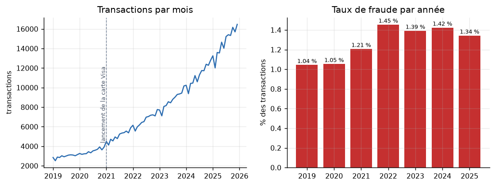

*Figure III.1 — Transactions par mois (à gauche) et taux de fraude par année (à droite).*

*Tableau III.2 — Volumes et fraudes par année.*

| Année | Transactions | Fraudes | Taux de fraude | Montant (USD) |
|---|---|---|---|---|
| 2019 | 35 541 | 371 | 1,04 % | 1 588 229 |
| 2020 | 41 937 | 442 | 1,05 % | 1 871 912 |
| 2021 | 60 402 | 729 | 1,21 % | 2 643 633 |
| 2022 | 80 066 | 1 164 | 1,45 % | 3 766 148 |
| 2023 | 104 108 | 1 449 | 1,39 % | 4 910 983 |
| 2024 | 134 554 | 1 916 | 1,42 % | 6 514 604 |
| 2025 | 175 360 | 2 355 | 1,34 % | 8 218 631 |

Le jeu est **fortement déséquilibré** : 8 426 fraudes pour 623 542 opérations légitimes, soit 1,33 % de fraudes, ou 74 légitimes pour une fraude. Un modèle qui déclarerait tout légitime atteindrait 98,67 % d'exactitude sans rien détecter, ce qui justifie le choix de la PR-AUC comme métrique principale. Le taux de fraude monte de 1,04 % à 1,45 % entre 2019 et 2022, puis se stabilise autour de 1,4 %. Le nombre de fraudes, lui, est multiplié par plus de six, de 371 à 2 355.

#### 1.3 Répartition des fraudes

**Par typologie et par année.** L'échange de SIM (2 220 opérations) et l'ingénierie sociale (1 850) dominent, suivis du fractionnement (1 334) et de la prise de contrôle (1 112). Les trois typologies de la carte Visa n'existent qu'à partir de 2021. La part de l'ingénierie sociale et de la prise de contrôle augmente nettement : l'ingénierie sociale passe de 65 opérations en 2019 à 610 en 2025, la prise de contrôle de 32 à 398, alors que la fraude d'agent reste quasi stable (92 puis 168). Cette évolution, voulue dans le générateur (`FRAUD_TRENDS`), crée la dérive de concept dont l'effet est testé par l'hypothèse H5 (figure III.2).

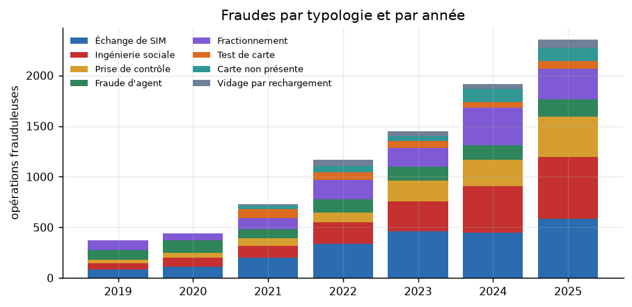

*Figure III.2 — Fraudes par typologie et par année.*

**Par épisode.** Les 8 426 opérations frauduleuses se regroupent en 3 028 épisodes, de 2,8 opérations en moyenne (15 au maximum). Les épisodes diffèrent beaucoup selon la typologie (tableau III.3) : le fractionnement et le test de carte sont des salves (10,3 et 8,6 opérations par épisode), alors que la fraude d'agent et l'ingénierie sociale se jouent en une ou deux opérations, ce qui laisse très peu de temps pour réagir.

*Tableau III.3 — Épisodes de fraude par typologie.*

| Typologie | Épisodes | Opérations par épisode | Montant médian par épisode (USD) |
|---|---|---|---|
| Échange de SIM | 627 | 3,5 | 268,5 |
| Ingénierie sociale | 977 | 1,9 | 88,0 |
| Prise de contrôle | 371 | 3,0 | 186,8 |
| Fraude d'agent | 604 | 1,5 | 150,0 |
| Fractionnement | 129 | 10,3 | 1 553,0 |
| Test de carte | 42 | 8,6 | 27,4 |
| Carte non présente | 195 | 2,1 | 60,3 |
| Vidage par rechargement | 83 | 3,1 | 537,3 |

**Par canal, opérateur, type d'opération et mode d'accès.** Le taux de fraude de la carte Visa (3,06 %) est plus de deux fois celui du Mobile Money (1,24 %) pour un volume 18 fois moindre (tableau III.4). Parmi les opérations, l'envoi d'argent (3,05 %) et l'achat par carte (4,94 %) concentrent la fraude, alors que les dépôts, crédits téléphoniques et factures n'en contiennent aucune. L'accès par application est le plus exposé (2,08 %), devant l'USSD (1,16 %) et l'agent (0,80 %). Les opérateurs sont proches (1,19 % à 1,46 %).

*Tableau III.4 — Part des transactions et taux de fraude par modalité.*

| Modalité | Part des transactions | Taux de fraude |
|---|---|---|
| Canal : Mobile Money / Visa virtuelle | 94,7 % / 5,3 % | 1,24 % / 3,06 % |
| Opérateur : Vodacom / Airtel / Orange | 50,6 % / 28,6 % / 20,9 % | 1,46 % / 1,22 % / 1,19 % |
| Accès : USSD / application / agent | 39,5 % / 30,7 % / 29,9 % | 1,16 % / 2,08 % / 0,80 % |
| Type : envoi / réception | 21,2 % / 22,3 % | 3,05 % / 1,05 % |
| Type : retrait / dépôt | 14,5 % / 15,3 % | 1,63 % / 0,00 % |
| Type : paiement marchand / achat par carte | 8,3 % / 3,0 % | 0,63 % / 4,94 % |
| Type : recharge de carte | 2,3 % | 0,57 % |
| Téléphone : smartphone / simple | 57,8 % / 42,2 % | 1,43 % / 1,20 % |
| Niveau KYC : 1 / 2 / 3 | 36,2 % / 48,2 % / 15,6 % | 1,50 % / 1,19 % / 1,37 % |

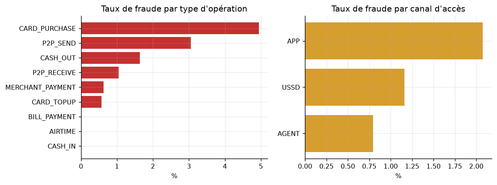

*Figure III.3 — Taux de fraude par type d'opération et par canal d'accès.*

**Par province et par segment.** Kinshasa (236 916 opérations), le Haut-Katanga (106 121) et le Nord-Kivu (82 468) concentrent l'activité, conformément au classement des sources officielles. Les taux de fraude les plus élevés se trouvent au Kasaï-Oriental (2,09 %) et dans le Kongo-Central (1,76 %), mais ils portent sur de faibles volumes. Les segments diffèrent davantage : les commerçants, très actifs, ont le taux le plus bas (0,64 %), alors que les agriculteurs (2,19 %), les bénéficiaires de la diaspora (2,09 %), les étudiants (1,84 %) et le secteur informel (1,86 %) sont plus exposés (figure III.4).

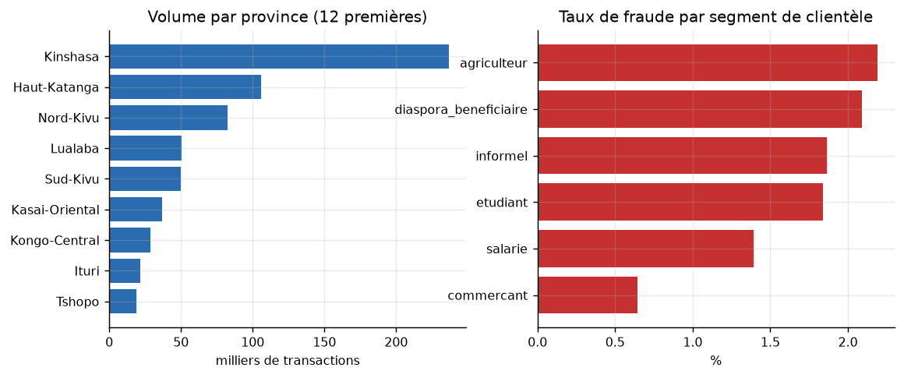

*Figure III.4 — Volume par province (12 premières) et taux de fraude par segment de clientèle.*

#### 1.4 Distribution des montants

Les montants sont très asymétriques : en Mobile Money, la médiane des opérations légitimes est de 24,11 USD pour une moyenne de 44,06 USD, un 99ᵉ centile de 276 USD et une asymétrie (coefficient de Fisher) de 4,63. Après passage au logarithme, l'asymétrie tombe à $-0{,}14$, ce qui justifie de travailler sur $\ln(1+a)$ dans les variables de montant (figure III.5). Les fraudes Mobile Money sont nettement plus grosses (médiane 95 USD, moyenne 259,56 USD), avec un plafond visible à 1 500 USD, valeur du plafond KYC du niveau 2. À l'inverse, les fraudes sur la carte Visa sont plutôt de petits montants (médiane 5,98 USD contre 20,08 USD en légitime), signature des tests de carte, avec une longue traîne jusqu'à 5 000 USD pour les vidages.

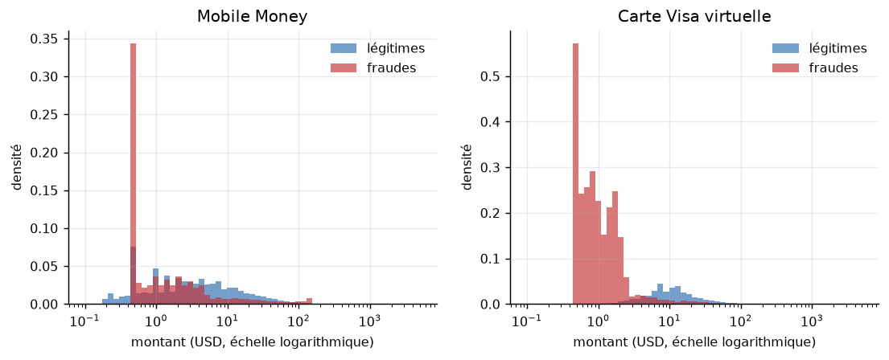

*Figure III.5 — Distribution des montants (échelle logarithmique) des opérations légitimes et frauduleuses, par canal.*

*Tableau III.5 — Montants en USD selon le canal et la classe.*

| Canal et classe | Médiane | Moyenne | 99ᵉ centile | Maximum |
|---|---|---|---|---|
| Mobile Money, légitime | 24,11 | 44,06 | 276,00 | 1 988,42 |
| Mobile Money, fraude | 95,00 | 259,56 | 1 500,00 | 5 000,00 |
| Visa virtuelle, légitime | 20,08 | 42,17 | 335,12 | 1 313,00 |
| Visa virtuelle, fraude | 5,98 | 178,48 | 2 206,25 | 5 000,00 |

#### 1.5 Profil horaire

Les opérations légitimes suivent un profil diurne marqué : 3,4 % seulement ont lieu entre minuit et 5 h. Les fraudes sont réparties de façon beaucoup plus uniforme sur la journée, et 29,1 % se produisent la nuit, soit plus de huit fois plus (figure III.6). Comme il y a très peu d'activité légitime la nuit, le **taux de fraude** y atteint 13 à 18 % entre 2 h et 4 h, contre moins de 1 % en journée. Aucune variation notable n'apparaît selon le jour de la semaine (1,2 % à 1,4 %).

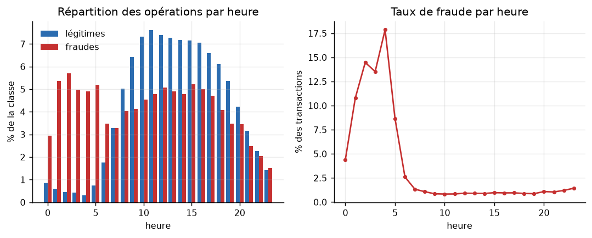

*Figure III.6 — Répartition des opérations par heure et taux de fraude par heure.*

#### 1.6 Structure par client et par contrepartie

Les 500 clients effectuent de 20 à 15 013 opérations, 861 en médiane ; la distribution est très étalée, ce qui impose de normaliser par client. Un fait doit être signalé : 461 des 500 clients (92 %) subissent au moins un épisode de fraude, avec une médiane de 13 opérations frauduleuses par victime. Cette densité est bien supérieure à celle d'un portefeuille réel et vient du faible nombre de clients simulés ; elle limite la portée des conclusions, notamment pour le bootstrap par client, qui repose sur 500 unités.

Côté contreparties, 18 396 portefeuilles reçoivent ou envoient des transferts, dont 13 096 sont partagés par au moins deux clients ; 400 de ces portefeuilles partagés ont reçu de l'argent frauduleux : ce sont les comptes mules, que l'analyse de réseau cherchera à relier.

#### 1.7 Relations entre variables

Sur un échantillon de 200 000 opérations, les variables les plus corrélées à la fraude sont le nombre de clients partageant l'appareil (corrélation de 0,70), la nouveauté de l'appareil (0,47), le nombre passé d'utilisations de l'appareil ($-0{,}29$), l'adresse IP étrangère (0,26), le nombre de débits sur une heure (0,22), le rapport au montant habituel (0,19) et la nouveauté du destinataire (0,19) (tableau III.6, figure III.7).

*Tableau III.6 — Variables les plus corrélées à la cible (corrélation de Pearson).*

| Variable | Corrélation avec la fraude |
|---|---|
| `device_n_users` (clients partageant l'appareil) | 0,70 |
| `is_new_device` | 0,47 |
| `log_device_prior_uses` | −0,29 |
| `is_foreign_ip` | 0,26 |
| `debit_count_1h` | 0,22 |
| `tx_count_1h` | 0,20 |
| `amount_ratio_user_mean` | 0,19 |
| `is_new_counterparty` | 0,19 |
| `counterparty_n_users` | 0,16 |
| `amount_to_kyc_limit` | 0,16 |

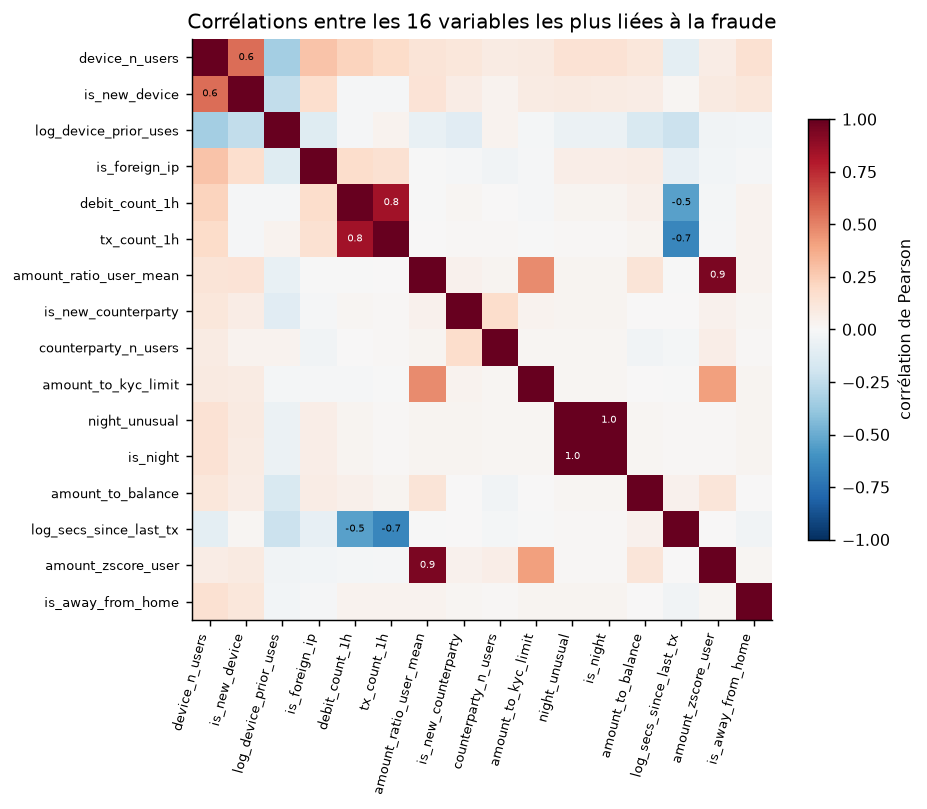

*Figure III.7 — Corrélations entre les 16 variables les plus liées à la fraude.*

La carte révèle aussi de la **redondance** : `night_unusual` et `is_night` sont quasi identiques (0,999) ; `amount_ratio_user_mean` et `amount_zscore_user` mesurent presque la même chose (0,94) ; le nombre de débits et le nombre d'opérations sur une heure sont corrélés à 0,84. Cette redondance explique qu'en ablation, retirer toute une famille de variables temporelles coûte peu, d'autres variables compensant.

#### 1.8 Enseignements pour la modélisation

L'analyse exploratoire conduit à cinq décisions de conception, toutes déjà prises dans la méthodologie : (1) la PR-AUC plutôt que l'exactitude, à cause du déséquilibre de 74 pour 1 ; (2) le logarithme des montants, à cause de leur asymétrie ; (3) des variables relatives au profil de chaque client, à cause de l'hétérogénéité des clients ; (4) des variables d'horaire cyclique et de nuit inhabituelle, à cause du profil diurne de l'activité légitime ; (5) un découpage chronologique, à cause de la dérive des typologies. Elle signale aussi une **précaution** : la variable la plus corrélée à la fraude, le nombre de clients par appareil, bénéficie du fait que le générateur réutilise un nombre fini d'appareils de fraudeurs (150) sur de nombreuses victimes. Une partie de sa force est donc propre à la simulation.

### 2. Résultats des modèles

#### 2.1 Comparaison des huit méthodes

Les huit méthodes sont évaluées sur le même jeu de test (13/12/2024 au 31/12/2025 : 183 240 transactions dont 2 437 fraudes, jamais vues pendant l'apprentissage), avec les mêmes 58 variables et un seuil fixé sur la validation (tableau III.7).

*Tableau III.7 — Performances des méthodes sur le jeu de test.*

| Méthode | PR-AUC | ROC-AUC | Précision | Rappel | F1 | Taux de faux positifs |
|---|---|---|---|---|---|---|
| **Hybride** | **0,9955** | 0,9999 | **0,951** | **0,978** | **0,964** | 0,067 % |
| XGBoost seul | 0,9895 | 0,9998 | 0,918 | 0,959 | 0,938 | 0,116 % |
| LSTM-attention seul | 0,9894 | 0,9998 | 0,930 | 0,967 | 0,948 | 0,098 % |
| Random Forest | 0,9842 | 0,9998 | 0,934 | 0,929 | 0,932 | 0,088 % |
| Régression logistique | 0,9513 | 0,9989 | 0,882 | 0,868 | 0,875 | 0,157 % |
| Autoencodeur seul | 0,7094 | 0,9708 | 0,959 | 0,616 | 0,750 | 0,035 % |
| Isolation Forest | 0,3913 | 0,9487 | 0,428 | 0,395 | 0,411 | 0,710 % |
| Règles métier | 0,2755 | 0,7841 | 0,371 | 0,357 | 0,364 | 0,815 % |

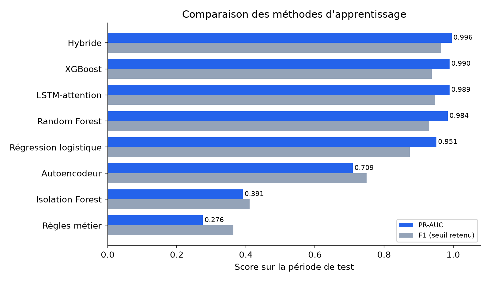

*Figure III.8 — PR-AUC et F1 des méthodes comparées.*

La ROC-AUC est très élevée pour presque toutes les méthodes (0,95 ou plus), même pour l'Isolation Forest qui ne détecte pourtant que 39 % des fraudes : c'est la confirmation pratique du choix de la PR-AUC. Les méthodes se répartissent en trois groupes. Les **méthodes non supervisées et les règles** (Isolation Forest, règles métier, autoencodeur seul) sont nettement insuffisantes. Les **méthodes supervisées** (régression logistique, Random Forest, XGBoost, LSTM) atteignent de très bonnes performances, ce qui montre la valeur des variables comportementales. L'**hybride** obtient les meilleurs résultats sur toutes les mesures principales.

#### 2.2 Significativité des écarts

Les écarts entre l'hybride, XGBoost et le LSTM semblent faibles en PR-AUC (environ 0,006). Les tests du protocole établissent qu'ils ne sont pas dus au hasard (tableau III.8).

*Tableau III.8 — Significativité des écarts (bootstrap apparié par usager, 1 000 tirages ; McNemar exact au seuil retenu).*

| Comparaison | Écart de PR-AUC [IC 95 %] | Test de McNemar | Conclusion |
|---|---|---|---|
| Hybride − XGBoost | +0,0060 [+0,0044 ; +0,0079] | 156 contre 23 ; p = 1,8 × 10⁻²⁵ | Hybride significativement meilleur |
| Hybride − LSTM-attention | +0,0061 [+0,0045 ; +0,0078] | 157 contre 75 ; p = 7,8 × 10⁻⁸ | Hybride significativement meilleur |
| Hybride − autoencodeur | +0,2861 [+0,2306 ; +0,3417] | 943 contre 118 ; p = 2,5 × 10⁻¹⁶⁰ | Hybride significativement meilleur |
| XGBoost − Random Forest | +0,0104 [+0,0079 ; +0,0135] | — | XGBoost significativement meilleur |
| XGBoost − régression logistique | +0,0450 [+0,0340 ; +0,0591] | — | XGBoost significativement meilleur |

Dans le test de McNemar, « 156 contre 23 » signifie que, sur les opérations où l'hybride et XGBoost ne sont pas d'accord, l'hybride a raison 156 fois et XGBoost 23 fois. Aucun intervalle de confiance ne contient 0. Les conséquences pratiques d'un écart de PR-AUC de 0,006 sont importantes (tableau III.9) : par rapport à XGBoost seul, l'hybride réduit les **fausses alertes de 42 %** (210 à 122) et les **fraudes manquées de 45 %** (99 à 54).

*Tableau III.9 — Erreurs au seuil retenu sur le test.*

| Méthode | Fausses alertes | Fraudes manquées |
|---|---|---|
| **Hybride** | **122** | **54** |
| XGBoost seul | 210 | 99 |
| LSTM-attention seul | 178 | 80 |

#### 2.3 Métriques complètes et analyse graphique

Le tableau III.10 donne la matrice de confusion et l'ensemble des métriques de classification au seuil retenu ; le tableau III.11 les intervalles de confiance de quatre d'entre elles.

*Tableau III.10 — Métriques complètes au seuil retenu sur la validation (test : 183 240 opérations, dont 2 437 fraudes).*

| Méthode | VP | FP | FN | VN | Précision | Rappel | Spécificité | F1 | F2 | MCC | Exact. équil. | Kappa |
|---|---|---|---|---|---|---|---|---|---|---|---|---|
| **Hybride** | **2 383** | 122 | **54** | 180 681 | 0,9513 | **0,9778** | 0,9993 | **0,9644** | **0,9724** | **0,9640** | **0,9886** | **0,9639** |
| LSTM-attention | 2 357 | 178 | 80 | 180 625 | 0,9298 | 0,9672 | 0,9990 | 0,9481 | 0,9595 | 0,9476 | 0,9831 | 0,9474 |
| XGBoost | 2 338 | 210 | 99 | 180 593 | 0,9176 | 0,9594 | 0,9988 | 0,9380 | 0,9507 | 0,9374 | 0,9791 | 0,9372 |
| Random Forest | 2 264 | 160 | 173 | 180 643 | 0,9340 | 0,9290 | 0,9991 | 0,9315 | 0,9300 | 0,9306 | 0,9641 | 0,9306 |
| Régression logistique | 2 114 | 284 | 323 | 180 519 | 0,8816 | 0,8675 | 0,9984 | 0,8745 | 0,8702 | 0,8728 | 0,9329 | 0,8728 |
| Autoencodeur | 1 500 | **64** | 937 | **180 739** | **0,9591** | 0,6155 | **0,9996** | 0,7498 | 0,6630 | 0,7660 | 0,8076 | 0,7472 |
| Isolation Forest | 962 | 1 284 | 1 475 | 179 519 | 0,4283 | 0,3947 | 0,9929 | 0,4108 | 0,4010 | 0,4036 | 0,6938 | 0,4032 |
| Règles métier | 870 | 1 474 | 1 567 | 179 329 | 0,3712 | 0,3570 | 0,9918 | 0,3639 | 0,3597 | 0,3556 | 0,6744 | 0,3555 |

*Tableau III.11 — Intervalles de confiance à 95 % (bootstrap par usager, 1 000 tirages).*

| Méthode | PR-AUC | Précision | Rappel | F1 |
|---|---|---|---|---|
| **Hybride** | [0,9938 ; 0,9967] | [0,9400 ; 0,9610] | [0,9701 ; 0,9841] | [0,9573 ; 0,9704] |
| LSTM-attention | [0,9861 ; 0,9918] | [0,9168 ; 0,9412] | [0,9580 ; 0,9749] | [0,9391 ; 0,9554] |
| XGBoost | [0,9861 ; 0,9919] | [0,9019 ; 0,9318] | [0,9482 ; 0,9699] | [0,9274 ; 0,9462] |
| Random Forest | [0,9798 ; 0,9875] | [0,9201 ; 0,9459] | [0,9150 ; 0,9417] | [0,9203 ; 0,9414] |
| Régression logistique | [0,9375 ; 0,9626] | [0,8493 ; 0,9057] | [0,8426 ; 0,8907] | [0,8516 ; 0,8930] |
| Autoencodeur | [0,6533 ; 0,7668] | [0,9457 ; 0,9721] | [0,5401 ; 0,6914] | [0,6899 ; 0,8047] |
| Isolation Forest | [0,3246 ; 0,4578] | [0,3231 ; 0,5268] | [0,3458 ; 0,4431] | [0,3498 ; 0,4672] |
| Règles métier | [0,2388 ; 0,3123] | [0,3251 ; 0,4219] | [0,3101 ; 0,4015] | [0,3227 ; 0,4074] |

L'hybride obtient la meilleure valeur sur toutes les mesures au seuil, sauf trois : la précision, la spécificité et le nombre de fausses alertes, où seul l'**autoencodeur** le dépasse (64 fausses alertes contre 122). Mais l'autoencodeur manque 937 fraudes, 17 fois plus que l'hybride : sa précision est celle d'un détecteur très prudent, pas d'un meilleur détecteur, comme le montre son MCC de 0,766 contre 0,964. Les intervalles de confiance en PR-AUC et en F1 de l'hybride ne recoupent pas ceux du LSTM et d'XGBoost.

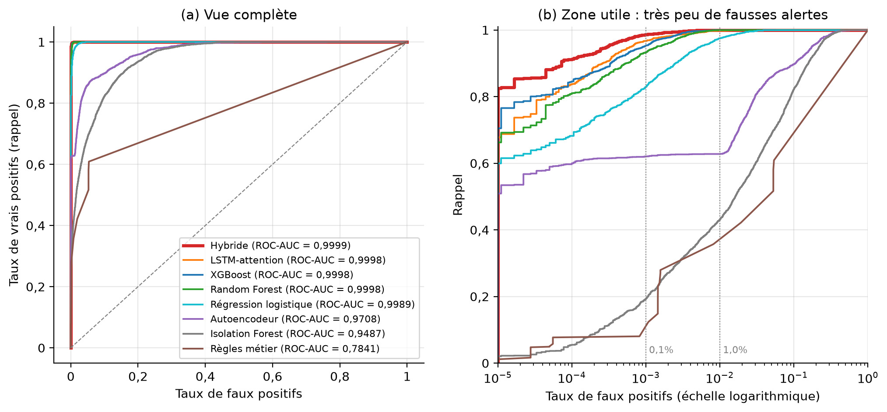

*Figure III.9 — Courbes ROC des huit méthodes : vue complète et taux de faux positifs en échelle logarithmique.*

La vue complète confirme la limite de la ROC-AUC sur données déséquilibrées : sept courbes sur huit se confondent près du coin supérieur gauche. L'échelle logarithmique révèle la zone qui compte pour un opérateur, celle où très peu de clients honnêtes sont dérangés : à 0,01 % de faux positifs, l'hybride détecte déjà 91,3 % des fraudes, contre 84,6 % pour XGBoost et 83,8 % pour le LSTM.

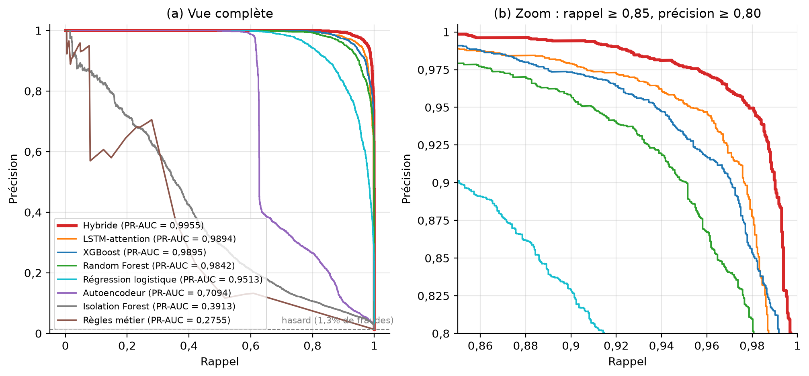

*Figure III.10 — Courbes précision-rappel des huit méthodes : vue complète et zoom sur les meilleures.*

La courbe de l'hybride est au-dessus de toutes les autres sur toute la plage de rappel de 0,85 à 1. L'avantage n'est donc pas obtenu à un seul seuil favorable. Un opérateur ne pouvant traiter qu'un nombre limité d'alertes, le rappel à budget de fausses alertes fixé est la mesure la plus proche de l'exploitation (tableau III.12).

*Tableau III.12 — Rappel à budget de fausses alertes fixé.*

| Méthode | 0,05 % de FP | 0,10 % de FP | 0,50 % de FP | 1 % de FP |
|---|---|---|---|---|
| **Hybride** | **0,9688** | **0,9865** | **0,9992** | 0,9996 |
| LSTM-attention | 0,9401 | 0,9672 | 0,9918 | 0,9979 |
| XGBoost | 0,9233 | 0,9528 | 0,9967 | **1,0000** |
| Random Forest | 0,8970 | 0,9327 | 0,9930 | 0,9996 |
| Régression logistique | 0,7854 | 0,8289 | 0,9458 | 0,9746 |
| Autoencodeur | 0,6167 | 0,6204 | 0,6274 | 0,6278 |
| Isolation Forest | 0,1461 | 0,1924 | 0,3603 | 0,4313 |
| Règles métier | 0,0771 | 0,0804 | 0,2794 | 0,3570 |

Plus le budget est serré, plus l'avantage de l'hybride est grand : à 0,05 % de faux positifs, il détecte 96,9 % des fraudes, contre 94,0 % pour le LSTM et 92,3 % pour XGBoost. À 1 %, les meilleures méthodes se rejoignent, et XGBoost détecte une fraude de plus. L'avantage est donc maximal dans les conditions réalistes d'exploitation, où les alertes doivent rester rares.

#### 2.4 Résultats par typologie

L'écart entre méthodes se joue sur les fraudes qui imitent un comportement normal : l'ingénierie sociale et le fractionnement (tableau III.13, figure III.11).

*Tableau III.13 — Rappel par typologie de fraude (test).*

| Typologie | Nombre | Hybride | XGBoost | LSTM | Autoencodeur |
|---|---|---|---|---|---|
| Échange de SIM | 623 | 1,000 | 1,000 | 1,000 | 0,998 |
| Ingénierie sociale | 630 | **0,921** | 0,859 | 0,882 | 0,003 |
| Prise de contrôle | 406 | 1,000 | 1,000 | 1,000 | 0,988 |
| Fractionnement | 303 | **0,987** | 0,974 | 0,987 | 0,000 |
| Fraude d'agent | 181 | 1,000 | 1,000 | 1,000 | 1,000 |
| Carte non présente | 131 | **1,000** | 0,985 | 0,985 | 1,000 |
| Vidage par rechargement | 82 | 1,000 | 1,000 | 1,000 | 1,000 |
| Test de carte | 81 | 1,000 | 1,000 | 1,000 | 1,000 |

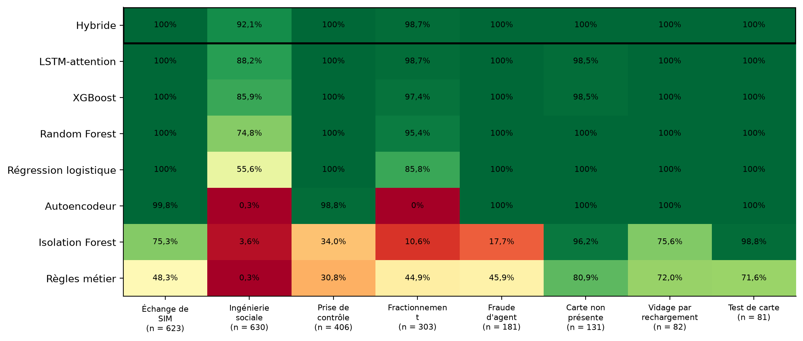

*Figure III.11 — Rappel des huit méthodes par typologie de fraude (test).*

Les règles détectent 45 % du fractionnement mais seulement 0,3 % de l'ingénierie sociale ; l'autoencodeur et l'Isolation Forest y échouent presque totalement. Les autres typologies sont détectées à plus de 98 % par toutes les méthodes supervisées. L'apport de l'hybride se concentre sur l'**ingénierie sociale**, fraude la plus difficile car c'est la victime elle-même qui paie, et la plus en hausse sur la période : son rappel passe de 85,9 % (XGBoost) à 92,1 %.

#### 2.5 Contribution de chaque composante

Pour vérifier que chaque composante de l'hybride est utile, on la retire et on mesure la perte (tableau III.14).

*Tableau III.14 — Ablation des composantes de l'hybride.*

| Modèle | PR-AUC | F1 | Taux de faux positifs |
|---|---|---|---|
| Hybride complet | **0,9955** | **0,964** | **0,067 %** |
| Sans LSTM-attention | 0,9905 | 0,944 | 0,098 % |
| Sans XGBoost | 0,9912 | 0,957 | 0,084 % |
| Sans autoencodeur | 0,9950 | 0,960 | 0,080 % |

Chaque retrait dégrade le modèle. Le LSTM et XGBoost sont les deux piliers : les coefficients du méta-apprenant sont de 1,69 pour XGBoost, 1,56 pour le LSTM et 0,46 pour l'autoencodeur. L'autoencodeur apporte peu en PR-AUC sur les fraudes connues du test, mais il réduit les fausses alertes et remplit un rôle qu'aucune autre composante ne remplit : il signale les comportements jamais vus.

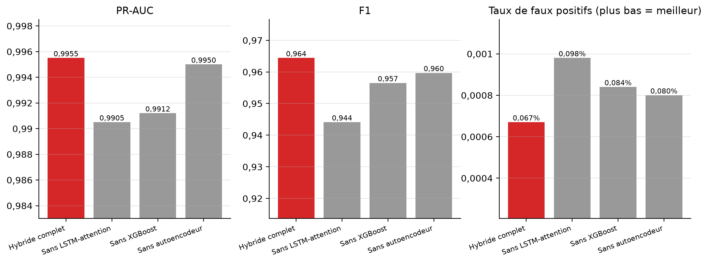

*Figure III.12 — Ablation : PR-AUC, F1 et taux de faux positifs de l'hybride complet et de l'hybride privé d'une composante.*

#### 2.6 Matrice de décision multicritère

Les critères et poids du tableau II.26 sont appliqués aux résultats mesurés (tableau III.15). Les notes de performance découlent des résultats ci-dessus ; les autres sont justifiées sous le tableau.

*Tableau III.15 — Matrice de décision multicritère (notes de 1 à 5).*

| Méthode | PR-AUC (30 %) | F1 (20 %) | Explicabilité (15 %) | Temps réel (15 %) | Dynamique (10 %) | Inédit (10 %) | **Score pondéré / 5** |
|---|---|---|---|---|---|---|---|
| Règles métier | 1 | 1 | 5 | 5 | 1 | 2 | 2,30 |
| Régression logistique | 3 | 3 | 5 | 5 | 1 | 1 | 3,20 |
| Random Forest | 4 | 4 | 3 | 4 | 1 | 1 | 3,25 |
| Isolation Forest | 1 | 1 | 2 | 4 | 1 | 4 | 1,90 |
| Autoencodeur | 2 | 2 | 2 | 4 | 1 | 5 | 2,50 |
| XGBoost | 4 | 4 | 4 | 5 | 2 | 1 | 3,65 |
| LSTM-attention | 4 | 4 | 2 | 3 | 5 | 2 | 3,45 |
| **Hybride** | **5** | **5** | **4** | **3** | **5** | **4** | **4,45** |

L'**explicabilité** reçoit 5 pour les règles et la régression logistique, transparentes par nature ; 4 pour XGBoost (TreeSHAP exact) et l'hybride (TreeSHAP, contribution de chaque composante, poids d'attention) ; 2 pour le LSTM seul (attention seulement) et les méthodes d'anomalie (score global). Le **temps réel** reçoit 4 ou 5 pour les modèles linéaires et à arbres, 3 pour le LSTM et l'hybride, plus coûteux. La **dynamique** reçoit 5 pour les seuls modèles qui lisent la séquence (LSTM, hybride). L'**inédit** reçoit 5 et 4 pour les méthodes sans étiquette, et 4 pour l'hybride, qui hérite de l'autoencodeur et des lois physiques.

La pondération comporte une part de jugement ; deux contrôles vérifient que le choix n'en dépend pas. Avec des **poids égaux**, l'hybride reste premier (4,33 contre 3,33 pour XGBoost et le LSTM). Sur **2 000 pondérations tirées au hasard**, il arrive premier dans 91 % des cas (1 817 sur 2 000) ; XGBoost ne passe devant que lorsque presque tout le poids porte sur la simplicité et l'explicabilité. Le modèle retenu est donc l'hybride, XGBoost restant la solution de repli naturelle.

#### 2.7 Résultats sur les cinq hypothèses

*Tableau III.16 — Synthèse des hypothèses.*

| Hypothèse | Résultat principal | Conclusion |
|---|---|---|
| H1 — le profilage bat le statique | PR-AUC 0,9893 avec profilage, 0,7533 sans historique, 0,2726 pour les règles ; écarts de −0,236 et −0,717, significatifs | **Confirmée** |
| H2 — les variables comportementales discriminent | Le retrait des familles contextuelle, de montant et fréquentielle dégrade significativement le modèle ; la famille temporelle est redondante | **Confirmée** |
| H3 — la famille de modèles compte | Tous les modèles diffèrent significativement de XGBoost (de −0,010 à −0,717) | **Confirmée** |
| H4 — la logique se transpose à la carte | PR-AUC 0,9849 sur Visa sans aucune donnée Visa ; rapport de transfert 0,985 | **Confirmée** (réserve : effet plafond) |
| H5 — mettre à jour le modèle | Écart cumulatif − figé de +0,0299 en 2025, qui se creuse de +0,0105 par an | **Confirmée** (réserve : circularité) |

**H1.** Le tableau III.17 compare le modèle de profilage à deux références statiques : un XGBoost privé de toute variable d'historique, et les règles métier. Les écarts sont considérables : sans historique du client, la PR-AUC tombe à 0,753. La variance selon la graine est faible (0,9895 ± 0,0004 pour le profilage). L'ingénierie sociale est la plus sensible : son rappel passe de 0,856 avec profilage à 0,137 sans historique.

*Tableau III.17 — H1 : profilage contre approches statiques.*

| Modèle | PR-AUC [IC 95 %] | Écart vs profilage | Rappel à 1 % de FP |
|---|---|---|---|
| Profilage | 0,9893 [0,9857 ; 0,9917] | référence | 0,9996 |
| Statique appris (sans historique) | 0,7533 [0,7027 ; 0,7897] | −0,2360 [−0,2831 ; −0,2014] | 0,7505 |
| Règles métier | 0,2726 [0,2405 ; 0,3041] | −0,7167 [−0,7477 ; −0,6845] | 0,2860 |

**H2.** Les familles contextuelles (appareil, localisation, contrepartie) sont les plus déterminantes : sans elles, la PR-AUC tombe de 0,989 à 0,843 (tableau III.18). Les variables de montant (−0,083) et fréquentielles (−0,035) comptent aussi. Les variables temporelles, seules, n'apportent presque rien (0,162 ajoutées au socle) et leur retrait est non significatif (+0,0009) : c'est de la **redondance**, comme l'analyse exploratoire l'avait laissé voir (`is_night`, `night_unusual`), les autres familles compensant.

*Tableau III.18 — H2 : ablation et ajout par famille de variables.*

| Famille | PR-AUC sans la famille | Écart vs complet | PR-AUC socle + famille |
|---|---|---|---|
| Contextuelles | 0,8426 | −0,1467 (significatif) | 0,8174 |
| Montants | 0,9066 | −0,0827 (significatif) | 0,6898 |
| Fréquentielles | 0,9539 | −0,0354 (significatif) | 0,4646 |
| Temporelles | 0,9902 | +0,0009 (non significatif) | 0,1623 |
| Socle seul | — | — | 0,0561 |

**H4.** Entraîné sur le seul Mobile Money, le modèle atteint une PR-AUC de 0,9849 sur la carte Visa (tableau III.19), soit 35,5 fois le hasard. Le **classement** des opérations se transpose donc très bien ; le **seuil** moins bien (F1 de 0,929 avec le seuil Mobile Money, 0,950 une fois recalibré sur Visa). Avec 5 % ou 20 % de données Visa, l'écart au modèle mixte n'est plus significatif. Dans le sens inverse, un modèle entraîné sur Visa seule s'effondre sur le Mobile Money (PR-AUC 0,555). La PR-AUC Visa du modèle mixte est proche de 1 : la carte simulée est très séparable (la seule variable d'adresse IP étrangère a une AUC de 0,97), ce qui peut surestimer la transposabilité.

*Tableau III.19 — H4 : transposition du Mobile Money vers la carte Visa (294 fraudes Visa).*

| Entraînement | PR-AUC Visa [IC 95 %] | Écart vs mixte | F1 (seuil Mobile Money) | F1 (seuil Visa) |
|---|---|---|---|---|
| Mobile Money seul | 0,9849 [0,9734 ; 0,9959] | −0,0151 (significatif) | 0,929 | 0,950 |
| Mobile Money + 5 % de Visa | 0,9977 [0,9930 ; 1,0000] | −0,0023 (non significatif) | 0,970 | 0,993 |
| Mobile Money + 20 % de Visa | 0,9988 [0,9959 ; 1,0000] | −0,0012 (non significatif) | 0,993 | 0,993 |
| Visa seule | 1,0000 | non significatif | 0,998 | 0,998 |
| Mixte | 1,0000 | référence | 0,997 | 0,995 |
| Règles métier | 0,6343 [0,5634 ; 0,7107] | −0,3657 (significatif) | 0,670 | 0,670 |

**H5.** Un modèle figé sur 2019-2021 perd en qualité d'année en année, de 0,986 de PR-AUC en 2022 à 0,968 en 2025, alors qu'un modèle réentraîné la gagne (0,998 en 2025) : l'écart cumulatif − figé passe de 0 en 2022 à +0,030 en 2025 (tableau III.20). Le rappel au seuil du modèle figé chute de 0,887 à 0,834, et celui de l'ingénierie sociale à 0,425, alors que le modèle mis à jour la retrouve à 0,967. Une fenêtre glissante de trois ans fait aussi bien que le cumul : la **récence** compte plus que le volume.

*Tableau III.20 — H5 : modèle figé contre modèle mis à jour (PR-AUC).*

| Année | Fraudes | Figé | Cumulatif | Écart cumulatif − figé |
|---|---|---|---|---|
| 2022 | 1 164 | 0,9858 | 0,9858 | +0,0000 |
| 2023 | 1 449 | 0,9835 | 0,9911 | +0,0076 (significatif) |
| 2024 | 1 916 | 0,9729 | 0,9958 | +0,0229 (significatif) |
| 2025 | 2 355 | 0,9681 | 0,9980 | +0,0299 (significatif) |

#### 2.8 Classifieur de typologie

Le second étage identifie la typologie avec une exactitude de 96,2 % (macro-F1 de 0,971), contre 28,9 % pour un classifieur qui prédirait toujours la typologie majoritaire ; la bonne typologie figure toujours parmi les deux premières propositions. Les confusions se concentrent entre échange de SIM et prise de contrôle : 54 échanges de SIM sont pris pour des prises de contrôle (rappel de 0,901) et 26 prises de contrôle pour des échanges de SIM (rappel de 0,936), deux fraudes qui ont la même signature (nouvel appareil, vidage). Ingénierie sociale, fractionnement, vidage par rechargement sont identifiés sans erreur ; l'exactitude est de 0,986 sur la carte et de 0,959 en Mobile Money.

#### 2.9 Lois physiques

Les déplacements légitimes du jeu respectent la physique : seules 75 opérations légitimes (0,01 %) violent nettement la cinématique, contre 88 fraudes (1,04 %), et 54 % des opérations qui la violent sont des fraudes, contre 1,33 % en moyenne. Ajoutées comme variables du modèle de données, les valeurs physiques n'apportent rien de significatif (+0,0001 de PR-AUC, du même ordre que l'écart-type d'une graine à l'autre) : le modèle appris retrouve par ailleurs ce qu'elles diraient pour les fraudes connues. Leur valeur est ailleurs : la **robustesse** (tableau III.21).

*Tableau III.21 — Robustesse face à une attaque « session relayée » inédite (300 attaques, province à 1 568 km en moyenne, 3 minutes après une opération légitime).*

| Détecteur | Attaques détectées | Fausses alertes (opérations légitimes) |
|---|---|---|
| Modèle de données (seuil F1) | 0,3 % | 0,12 % |
| Modèle de données (seuil à 1 % de faux positifs) | 7,0 % | 1,00 % |
| Lois physiques seules | 100 % | 0,01 % |
| **Hybride (données OU physique)** | **100 %** | 0,13 % |

Face à une attaque jamais vue à l'entraînement, le modèle appris est quasi aveugle (0,3 %), alors que les lois physiques la détectent entièrement à un coût de 0,01 % de vérifications inutiles. C'est le complément qui justifie la défense en profondeur. Il s'agit d'un scénario construit par l'équipe, non d'une mesure sur des fraudes réelles.

#### 2.10 Explication et preuves

**Cas similaires.** La part de fraudes parmi les sept cas passés les plus proches identifie à elle seule les fraudes avec une PR-AUC de 0,960 [0,950 ; 0,970], contre 0,990 pour le modèle. Surtout, elle sert de contrôle de cohérence (tableau III.22) : quand les cas proches confirment une alerte, elle est justifiée dans 98,0 % des cas ; quand ils la contredisent, seulement 60,9 % : c'est le signal qui dit à l'analyste de redoubler d'attention. Les cas proches retrouvent 22 des 99 fraudes manquées, mais au prix de 53 fausses alertes supplémentaires, ce qui n'en fait pas un détecteur de remplacement. Pour le type de fraude, le vote des cas proches atteint 88,0 % contre 96,2 % pour le classifieur.

*Tableau III.22 — Précision des alertes selon l'avis des cas proches.*

| Avis des cas proches | Alertes | Vraies fraudes | Précision [IC 95 %] |
|---|---|---|---|
| Confirment | 1 978 | 1 939 | 0,980 [0,972 ; 0,987] |
| Contredisent | 437 | 266 | 0,609 [0,550 ; 0,661] |
| Peu comparables | 133 | 133 | 1,000 |

**Analyse du message.** Sur le corpus de test (61 messages, dont 30 d'ingénierie sociale), l'analyse détecte les manipulations avec une précision de 1,00 (aucune fausse alerte) et un rappel de 0,73 (F1 de 0,846, IC 95 % [0,727 ; 0,943]) au niveau « moyen ou plus ». Au niveau « élevé », qui seul impose une vérification, le rappel tombe à 0,43. L'analyse de sentiment est exacte à 83,9 % (31 messages). Les erreurs viennent de manipulations sans mot-clé reconnu (faux agent de l'opérateur, urgence familiale), ce qui montre les limites d'une approche lexicale et du corpus en français seulement. Conformément à RG-10, le texte ne sert qu'à imposer une vérification.

#### 2.11 Réseaux de fraude

L'analyse de réseau est évaluée par un rejeu chronologique, avec des verdicts révélés après sept jours (tableau III.23).

*Tableau III.23 — Réseau : détection au niveau des transactions (période de test, seuil réseau choisi sur la validation pour 0,5 % de fausses alertes).*

| Règle | Rappel | Fausses alertes | Précision |
|---|---|---|---|
| Modèle hybride seul | 97,8 % | 0,07 % | 95,1 % |
| Réseau seul | 97,4 % | 0,5 % | 74,1 % |
| **Modèle OU réseau** | **100 %** | 0,5 % | 71,9 % |

La règle « modèle OU réseau » rattrape **54 fraudes** manquées par le modèle (dont 50 d'ingénierie sociale et 4 de fractionnement), au prix de 831 fausses alertes supplémentaires. L'ingénierie sociale passe de 92,1 % à 100 % de rappel : la victime paie seule, mais le **destinataire**, lui, reçoit de plusieurs victimes. Au niveau des entités, le score de réseau classe en tête des entités réellement frauduleuses (tableau III.24), là où le simple nombre de comptes distincts, déjà une variable du modèle, échoue.

*Tableau III.24 — Réseau : précision des 25, 50, 100 et 200 entités partagées les mieux classées.*

| Classement | p@25 | p@50 | p@100 | p@200 |
|---|---|---|---|---|
| Nombre de comptes distincts | 0,0 % | 2,0 % | 2,0 % | 7,0 % |
| Risque direct | 68,0 % | 70,0 % | 78,0 % | 88,0 % |
| Score de réseau (direct + propagé) | 68,0 % | 72,0 % | 79,0 % | 88,0 % |
| Score de réseau, sans aucune étiquette | 96,0 % | 94,0 % | 93,0 % | 93,0 % |

Le score de réseau avec propagation est légèrement supérieur au risque direct seul. Sans aucune étiquette, à partir des seules probabilités du modèle sur 30 jours, l'analyse détecte 3 réseaux dont l'ensemble des entités sont réellement frauduleuses (pureté de 100 %, mais couverture de 44 % des entités frauduleuses partagées). Sur tout l'historique avec étiquettes, elle forme un seul grand réseau de 467 comptes et 582 entités, pur à 95,7 % et qui couvre 97 % des entités frauduleuses partagées. Ces chiffres profitent du nombre fini de mules et d'appareils du générateur : ils montrent le mécanisme, pas une performance réelle.

#### 2.12 Décision selon le coût

La décision selon le coût attendu est comparée à un seuil unique, avec les mêmes coûts métier pour toutes les politiques, sur la seconde moitié du test (91 620 transactions, 1 207 fraudes) (tableau III.25).

*Tableau III.25 — Politiques de décision comparées (pertes en USD).*

| Politique | Perte totale | Fraude non stoppée | Friction | Faux blocages | Fraudes stoppées | Clients honnêtes gênés |
|---|---|---|---|---|---|---|
| Seuil F1, blocage | 2 354 | 1 807 | 0 | 547 | 98,4 % | 0,08 % |
| Seuil F1, vérification | 38 292 | 37 933 | 359 | 0 | 98,4 % | 0,08 % |
| Coût, paramètres par défaut | 1 017 | 133 | 153 | 730 | 99,9 % | 0,63 % |
| Coût, paramètres réglés | 976 | 236 | 164 | 576 | 99,9 % | 0,63 % |

La décision selon le coût divise la perte par plus de deux (de 2 354 à 1 017 USD) et stoppe 99,9 % des fraudes au lieu de 98,4 %. En contrepartie, elle gêne davantage de clients honnêtes (0,63 % contre 0,08 %), surtout par des vérifications peu coûteuses. Se contenter de vérifier au seuil F1, sans bloquer, est très coûteux (38 292 USD) : la vérification ne stoppe qu'une part de fraudes. Les paramètres réglés sur la première moitié (plancher de blocage à 0,9, coût d'un faux blocage doublé) gagnent encore 4 %. Les coûts métier sont des hypothèses de simulation, à remplacer par ceux de chaque opérateur ; l'écran de politique permet de les simuler avant application.

#### 2.13 Boucle de retour des analystes

Le rejeu mensuel sur 13 mois compare cinq stratégies de revue, à budget égal de 200 revues supplémentaires par mois (tableau III.26).

*Tableau III.26 — Stratégies de revue des analystes.*

| Stratégie | Poids des verdicts | PR-AUC moyenne | Rappel | Fraudes manquées | Fraudes trouvées par les revues |
|---|---|---|---|---|---|
| Alertes seules | 1 | 0,9932 | 96,90 % | 73 | 0 |
| Échantillon témoin aléatoire | 3 | 0,9948 | 97,41 % | 61 | 2 |
| Cas incertains | 1 | 0,9955 | 97,83 % | 51 | 52 |
| Cas incertains | 3 | 0,9961 | 98,39 % | 38 | 39 |
| Incertains + témoin | 3 | 0,9960 | 98,17 % | 43 | 42 |

Ne revoir que les alertes laisse passer 73 fraudes. Faire revoir les cas où le modèle hésite en ramène 38 quand les verdicts sont pondérés, et 51 sans pondération : le poids de trois accordé aux verdicts vérifiés apporte donc un gain propre. L'échantillon témoin seul apprend peu (61 fraudes manquées), mais c'est la seule source qui **mesure** le taux de fraudes manquées sans biais : son intervalle de confiance couvre le vrai taux dans 85 % des mois, et dans 100 % des mois pour la stratégie mixte. Mélanger incertitude et témoin garde l'essentiel du gain (43) tout en fournissant cette mesure.

#### 2.14 Équité

Le taux global de fausses alertes est de 0,58 % et le rappel de 99,92 %. Le rappel reste proche de 100 % dans tous les groupes ; les écarts portent sur les fausses alertes (tableau III.27).

*Tableau III.27 — Groupes signalés pour un taux de fausses alertes significativement supérieur, et groupes de comparaison.*

| Dimension | Groupe | Taux de fausses alertes [IC 95 %] | Rapport au taux global |
|---|---|---|---|
| Tranche de revenu | Q1 (plus modestes) | 0,84 % [0,76 ; 0,93] | 1,45 |
| Tranche de revenu | Q4 (plus aisés) | 0,37 % [0,32 ; 0,43] | 0,63 |
| Segment | Agriculteur | 1,09 % [0,86 ; 1,37] | 1,87 |
| Segment | Étudiant | 0,88 % [0,75 ; 1,03] | 1,52 |
| Segment | Commerçant | 0,33 % [0,29 ; 0,38] | 0,57 |
| Mode d'accès | USSD | 0,84 % [0,78 ; 0,91] | 1,45 |
| Mode d'accès | Application | 0,78 % [0,71 ; 0,86] | 1,35 |
| Mode d'accès | Agent | 0,03 % [0,02 ; 0,04] | 0,04 |
| Niveau KYC | KYC 1 | 0,73 % [0,66 ; 0,80] | 1,26 |
| Province | Kasaï-Oriental | 0,78 % [0,62 ; 0,98] | 1,35 |
| Province | Ituri | 0,78 % [0,59 ; 1,02] | 1,34 |
| Province | Kongo-Central | 0,74 % [0,59 ; 0,94] | 1,29 |

Neuf groupes sont signalés. Les clients les plus modestes subissent 2,3 fois plus de fausses alertes que les plus aisés, les agriculteurs 3,3 fois plus que les commerçants. En revanche, l'opérateur (écart maximal de 1,13) et le type de téléphone (1,03) ne créent aucune inégalité. L'écart selon le mode d'accès est surtout structurel : la fraude est presque absente des opérations en agence.

#### 2.15 Temps réel et diagnostic d'apprentissage

**Temps réel.** Un rejeu de 19 165 opérations vers l'API d'intégration, à 15 opérations par seconde, donne une latence de bout en bout de **59,5 ms en médiane**, 104,4 ms au 95ᵉ centile et 299 ms au 99ᵉ (tableau III.28). Les 111 épisodes de fraude du rejeu sont tous détectés ; 100 % des épisodes sont stoppés dès la première opération, sauf l'ingénierie sociale (96,7 %, 40,71 USD passés sur 3 987,79 USD). Sur les 18 883 opérations légitimes, 67 (0,35 %) sont signalées et 5 bloquées. La médiane respecte l'objectif de 100 ms ; le 95ᵉ centile le touche, ce que l'ajout de copies du service de notation permet de réduire.

*Tableau III.28 — Rejeu temps réel (19 165 opérations).*

| Mesure | Valeur |
|---|---|
| Latence médiane / 95ᵉ centile / 99ᵉ centile | 59,5 ms / 104,4 ms / 299,2 ms |
| Épisodes de fraude détectés | 111 sur 111 |
| Épisodes stoppés dès la première opération | 100 % (96,7 % pour l'ingénierie sociale) |
| Opérations légitimes signalées / bloquées | 67 sur 18 883 (0,35 %) / 5 |

**Apprentissage.** Le diagnostic des courbes d'apprentissage (tableau III.29) conclut à un surapprentissage léger pour XGBoost et le LSTM, et à un entraînement sain pour l'autoencodeur. L'écart de perte d'XGBoost (437 %) est très élevé mais sans perte de performance (écart de PR-AUC de 0,006) : le modèle est très confiant sur ses données d'entraînement. Le blocage automatique du réentraînement ne s'applique que si la PR-AUC de validation est plus basse de plus de 0,05.

*Tableau III.29 — Diagnostic d'apprentissage (entraînement de 403 s).*

| Branche | Verdict | Époque retenue | Perte d'entraînement | Perte de validation | Écart |
|---|---|---|---|---|---|
| XGBoost | surapprentissage léger | 538 sur 588 | 0,00086 | 0,00462 | 437 % |
| LSTM-attention | surapprentissage léger | 7 sur 8 | 0,00949 | 0,01223 | 29 % |
| Autoencodeur | sain | 30 sur 30 | 0,1994 | 0,2163 | 8,5 % |

**Choix du seuil et calibration.** Le seuil $\tau^*=0{,}538$ choisi sur la validation tombe dans le **plateau** du F1 sur le test : entre 0,45 et 0,75, le F1 varie de moins d'un point. Le choix du seuil est donc robuste (figure III.13).

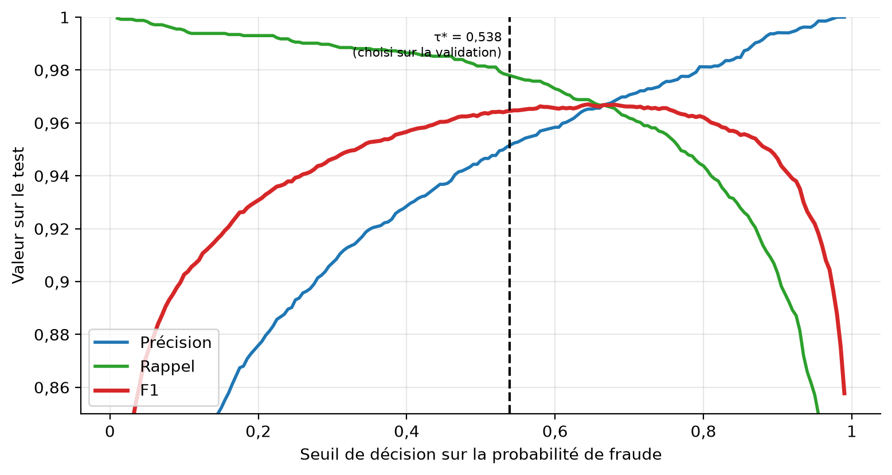

*Figure III.13 — Précision, rappel et F1 de l'hybride sur le test selon le seuil de décision.*

Les deux classes sont nettement séparées : sur 179 349 opérations notées sous 0,01, une seule est une fraude, et les 1 830 opérations notées au-dessus de 0,99 sont toutes des fraudes ; 419 opérations seulement (0,2 %) tombent dans la zone d'incertitude entre 0,2 et 0,8 (figure III.14). Le score de Brier est très faible (0,00077). Mais la courbe de calibration montre que, dans la zone intermédiaire, la probabilité prédite **surestime** le taux réel : une opération notée 0,45 est frauduleuse dans environ 20 % des cas (figure III.15). Cette zone n'affecte pas la décision, qui repose sur un seuil, mais la valeur affichée à l'analyste ne doit pas y être lue comme une probabilité exacte. Cette surestimation est cohérente avec le sous-échantillonnage des légitimes à l'apprentissage du LSTM, qui fausse les probabilités sans changer le classement (Dal Pozzolo et al., 2015). Une recalibration par régression isotonique sur la validation est une amélioration possible.

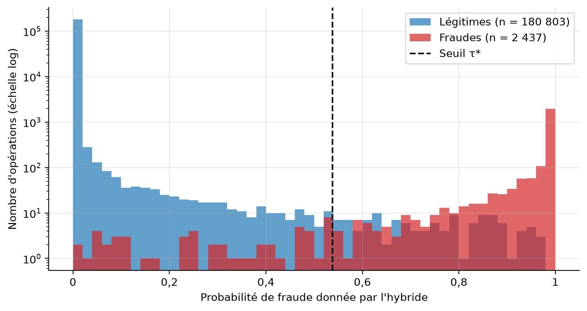

*Figure III.14 — Distribution de la probabilité de fraude donnée par l'hybride (échelle logarithmique).*

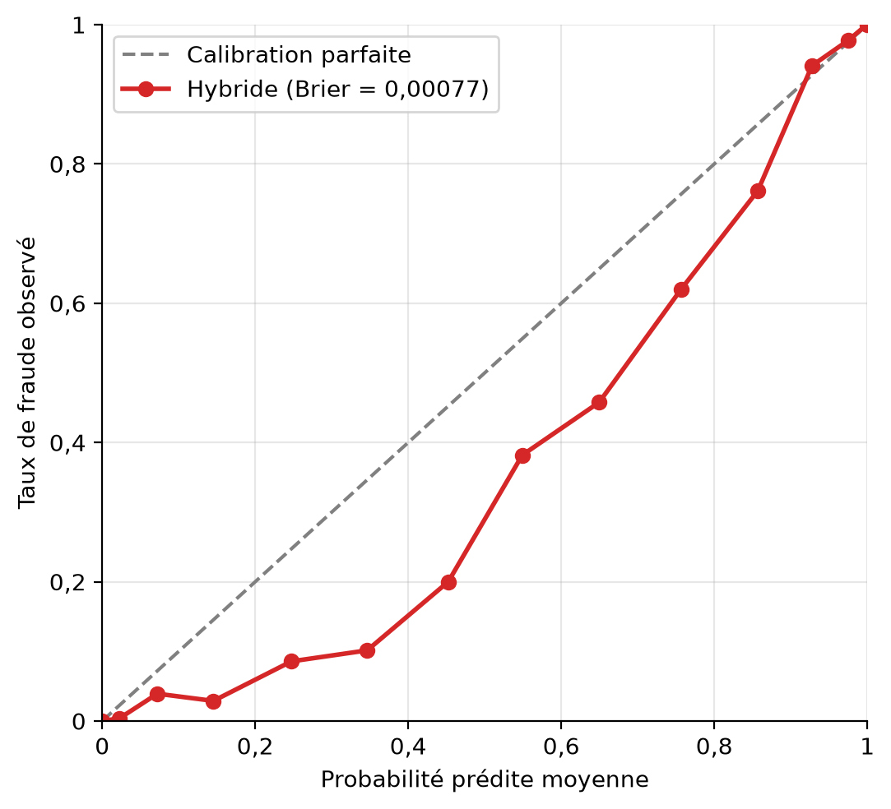

*Figure III.15 — Courbe de calibration de l'hybride.*

### 3. Interprétation des résultats

**Pourquoi le profilage change tout.** Sans l'historique du client, la PR-AUC chute de 0,989 à 0,753 et le rappel de l'ingénierie sociale de 0,856 à 0,137 (H1). Cela confirme le principe du travail : une fraude est une rupture d'habitude, et seul un modèle qui connaît l'habitude de chaque client peut la voir. Parmi les familles de variables, ce sont celles qui décrivent le contexte (appareil, lieu, destinataire) puis les montants qui portent le plus (H2) ; les horaires sont largement redondants avec elles.

**Pourquoi l'hybride l'emporte, et où.** XGBoost et le LSTM obtiennent des performances très proches seuls (PR-AUC 0,9895 et 0,9894), mais leurs erreurs ne sont pas les mêmes : sur 179 opérations où l'hybride et XGBoost divergent, l'hybride a raison 156 fois. Le LSTM lit la dynamique (escalade, salves) que résume mal un profil instantané, ce qui explique le gain sur l'ingénierie sociale et le fractionnement. L'autoencodeur est mauvais seul (rappel de 0,3 % sur l'ingénierie sociale) parce qu'une fraude qui imite le normal n'est pas une anomalie ; mais, combiné aux deux autres, il réduit les fausses alertes et reste le seul signal de nouveauté. Le gain de l'hybride est modeste en PR-AUC (+0,006) mais important en erreurs (−42 % de fausses alertes, −45 % de fraudes manquées), et maximal quand le budget d'alertes est serré. Une PR-AUC proche de 1 masque donc des écarts opérationnels sensibles.

**Le modèle appris ne suffit pas.** Trois résultats convergent. Face à une attaque inédite, le modèle de données ne détecte que 0,3 % des sessions relayées, les lois physiques 100 %. Face aux réseaux de mules, le modèle ne voit pas que le destinataire est partagé ; l'analyse de réseau rattrape 54 fraudes. Face à l'évolution des fraudes, un modèle figé perd 0,018 de PR-AUC entre 2022 et 2025 et ne retrouve plus que 42 % de l'ingénierie sociale en 2025, contre 97 % pour un modèle mis à jour. D'où l'architecture en défense en profondeur et l'apprentissage continu.

**La décision graduée vaut plus que le modèle.** Le choix de la règle de décision compte autant que celui du modèle : avec le même modèle, la perte varie de 976 à 38 292 USD selon la politique. Bloquer ou vérifier selon le coût attendu divise la perte par plus de deux par rapport à un seuil unique, au prix de davantage de vérifications. C'est un résultat de conception, indépendant de la simulation, car il découle de l'asymétrie des coûts.

**Ce que le modèle laisse passer, et à qui il nuit.** Le rappel de 97,8 % dissimule 54 fraudes manquées, que seules des revues ciblées permettent de corriger : l'apprentissage actif par cas incertains les réduit de 73 à 38. Quant à l'équité, le modèle n'est pas neutre : les clients modestes, les agriculteurs et les étudiants subissent plus de fausses alertes. Une partie de cet écart reflète leur taux de fraude de base plus élevé (2,19 % chez les agriculteurs contre 0,64 % chez les commerçants), mais il demeure un coût inégal à surveiller, d'autant qu'une vérification pèse davantage pour un client sur téléphone simple, loin d'un agent.

### 4. Comparaison avec la littérature

Comparer des chiffres entre études n'a de sens que si les données sont comparables. Aucune étude ne porte sur le Mobile Money en RDC ; le rapprochement est donc surtout qualitatif, sur les constats de méthode (tableau III.30).

*Tableau III.30 — Positionnement par rapport à la littérature.*

| Étude | Données | Constat | Rapprochement avec ce travail |
|---|---|---|---|
| Lopez-Rojas et al. (2016), PaySim | Simulateur Mobile Money, calibré sur un échantillon réel d'un pays africain | Les données Mobile Money réelles n'étant pas publiques, la simulation est la voie adoptée pour la recherche | Même contrainte et même démarche ; ici la simulation repose entièrement sur des hypothèses paramétrées et a été confrontée aux statistiques officielles |
| Azamuke et al. (2022, 2025), MoMTSim | Simulateur Mobile Money d'Afrique subsaharienne | XGBoost est le meilleur des modèles comparés (MCC 0,82 ; AUC 0,97) devant la régression logistique (MCC 0,67) | Même hiérarchie : boosting devant modèle linéaire (MCC 0,937 contre 0,873 ici). Les valeurs plus élevées de ce travail viennent d'un autre simulateur et de variables de profil par client |
| Bahnsen et al. (2016) | Cartes bancaires réelles | Des variables agrégées par client et des variables périodiques pour l'heure améliorent la détection | Même principe : les 58 variables d'écart au profil et l'heure cyclique ; H1 montre l'effet de l'historique (PR-AUC 0,989 contre 0,753) |
| Jurgovsky et al. (2018) | Cartes bancaires réelles | Le LSTM améliore la détection des paiements en présence de la carte, moins ceux à distance ; les variables agrégées restent très efficaces | Même nuance : le LSTM seul égale XGBoost (0,9894 contre 0,9895) ; le gain vient de leur combinaison, surtout sur la dynamique de l'ingénierie sociale |
| Carcillo et al. (2019) | Cartes bancaires réelles | Combiner l'apprentissage non supervisé et supervisé améliore la détection quand les fraudes évoluent | Même idée avec l'autoencodeur : peu utile seul, il réduit les fausses alertes et signale l'inédit ; l'évolution est testée par H5 |
| Dal Pozzolo et al. (2015) | Cartes bancaires réelles (jeu ULB : 492 fraudes sur 284 807 transactions) | Le sous-échantillonnage ne change pas le classement mais biaise les probabilités | Même effet observé : la calibration de l'hybride surestime dans la zone intermédiaire, sans effet sur le seuil |
| Grinsztajn et al. (2022) | 45 jeux tabulaires | Les modèles à base d'arbres restent les plus performants sur des jeux de taille moyenne | XGBoost est le meilleur modèle simple de ce travail, devant la régression logistique et la Random Forest ; mais le réseau séquentiel l'égale ici, sur un jeu de 632 000 lignes structuré en séquences |

**Concordances.** Trois constats de la littérature sont retrouvés : le boosting surpasse les modèles linéaires ; la modélisation de séquence apporte un gain réel mais pas systématique, qui dépend du type d'opération ; combiner des méthodes supervisées et non supervisées aide face à l'évolution des fraudes. L'effet du sous-échantillonnage sur la calibration est lui aussi retrouvé.

**Différences et prudence.** Les performances absolues de ce travail (PR-AUC 0,9955, MCC 0,964) sont plus élevées que celles rapportées sur des simulateurs voisins comme MoMTSim (MCC 0,82) et, a fortiori, que celles qu'on observe sur des données réelles, où la fraude est moins nette. Elles ne sont pas comparables terme à terme : les générateurs, les variables et les taux de fraude diffèrent, et les fraudes simulées ici suivent des schémas que le modèle apprend plus facilement que de vraies fraudes. La comparaison se limite donc aux tendances.

**Apports de ce travail.** Il ajoute à ces études : un contexte congolais explicite (USSD, double monnaie au taux de l'année, déplacements entre provinces) ; un protocole statistique complet (bootstrap par client, test de McNemar, variance selon la graine) ; une décision graduée selon le coût plutôt qu'un seuil unique ; une mesure de ce que le modèle laisse passer grâce à un échantillon témoin ; une défense par les lois physiques et l'analyse de réseau ; et une évaluation de l'équité entre groupes de clients, rarement traitée dans les travaux sur la fraude.

### 5. Discussion

**Réponse à la problématique.** La question était de savoir si un modèle d'intelligence artificielle apprenant le comportement habituel de chaque utilisateur peut détecter en temps réel et de façon explicable les fraudes Mobile Money en RDC, et comment cette approche se transpose aux cartes virtuelles. Sur les données simulées, la réponse est positive pour les cinq hypothèses : le profilage est nettement supérieur aux approches statiques (H1), les variables de contexte, de montant et de fréquence portent la détection (H2), les familles de modèles diffèrent significativement (H3), la logique se transpose à la carte avec une PR-AUC de 0,985 sans donnée Visa (H4), et un modèle mis à jour reste meilleur qu'un modèle figé (H5). Le modèle hybride rend sa décision en 59 ms en médiane.

**Apports.** Au-delà des hypothèses, le travail livre un système complet et vérifiable : 158 tests automatisés, une architecture en services, une décision graduée et explicable, une API ouverte aux institutions, un apprentissage continu maîtrisé, et des outils de pilotage (qualité réelle, politique de coût, équité) qui permettent à un opérateur de régler et de surveiller le système.

**Limites.** Elles sont de six ordres, déjà identifiées dans les menaces sur la validité. (1) Les **données sont simulées** : les fraudes y sont plus nettes qu'en réalité, et les performances réelles seront plus faibles. (2) Le générateur **réutilise un nombre fini d'appareils de fraudeurs et de mules** : la variable la plus corrélée à la fraude, comme l'analyse de réseau, en bénéficient. (3) Seuls **500 clients** sont simulés, et 92 % d'entre eux sont victimes au moins une fois, ce qui limite la portée des intervalles de confiance par client. (4) Le canal Visa étant très séparable, la **transposabilité** est probablement surestimée, et H5 est en partie **circulaire**, l'évolution des fraudes étant un paramètre du générateur. (5) Les rejeux de la boucle de retour **supposent des analystes sans erreur** et un taux de plainte fixe. (6) Les **coûts métier** et le corpus de messages (en français seulement) sont des hypothèses de l'auteur.

**Considérations éthiques.** Un système de détection touche des clients réels : une fausse alerte bloque ou retarde un paiement parfois vital. L'évaluation de l'équité montre que ce coût n'est pas réparti également, et qu'il pèse plus sur les clients modestes, les agriculteurs et les étudiants. Le système le mesure et l'affiche pour que l'opérateur puisse corriger avant que l'écart ne devienne une discrimination. Les décisions sont expliquées, le journal d'audit est inaltérable, les données ne quittent pas la plateforme, et un déblocage important exige la validation d'une seconde personne.

**Perspectives.** Quatre pistes prolongent ce travail : (1) la **validation sur données réelles** d'un opérateur, selon la démarche en cinq étapes, avec un mode observation avant tout blocage ; (2) des **tests adversariaux** : un fraudeur qui s'adapte (fractionnement sous les seuils, imitation de l'appareil et de la province de la victime, étalement dans le temps) ; un protocole est écrit, ses résultats restent à produire ; (3) la **recalibration** des probabilités par régression isotonique et l'ajout de réseaux de neurones sur graphes ; (4) l'**apprentissage fédéré entre opérateurs**, qui permettrait de voir un fraudeur actif sur plusieurs réseaux sans partager les données, ainsi que l'extension de l'analyse de texte au lingala et au swahili.

