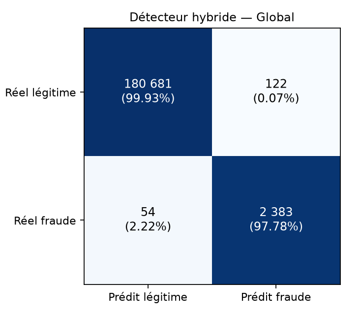
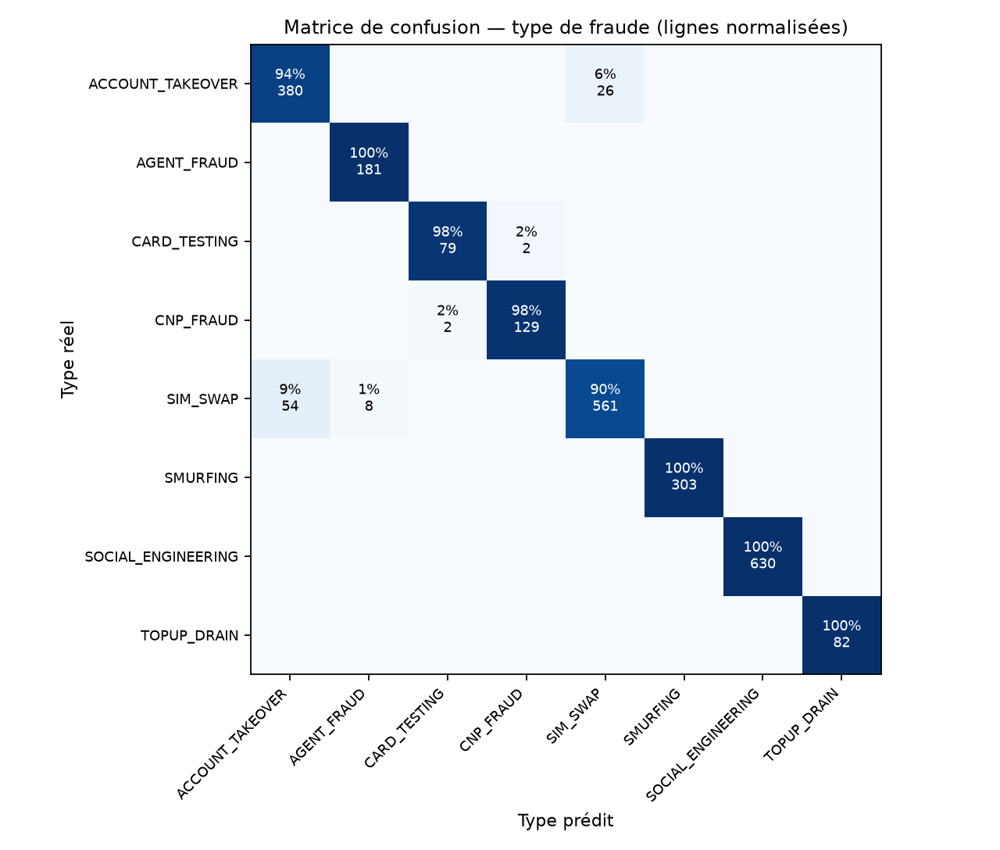
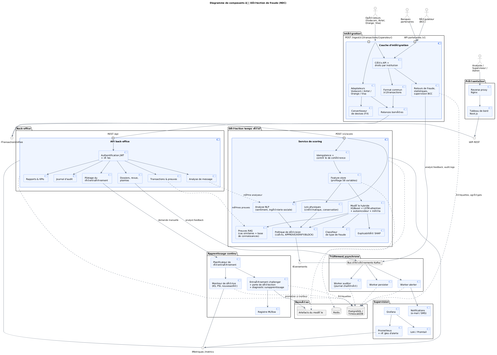
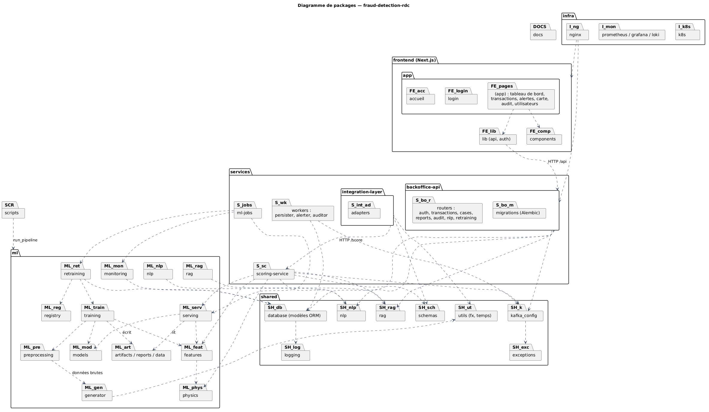
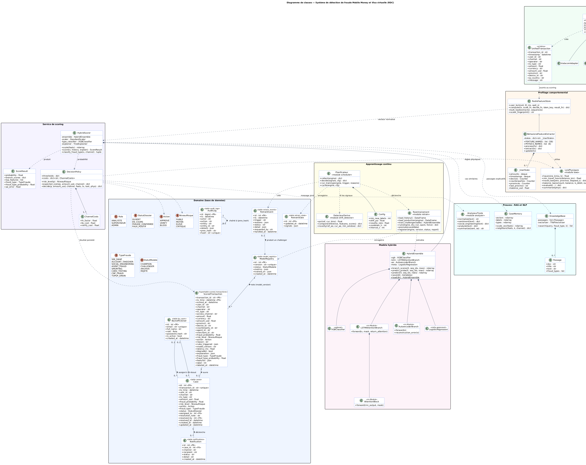
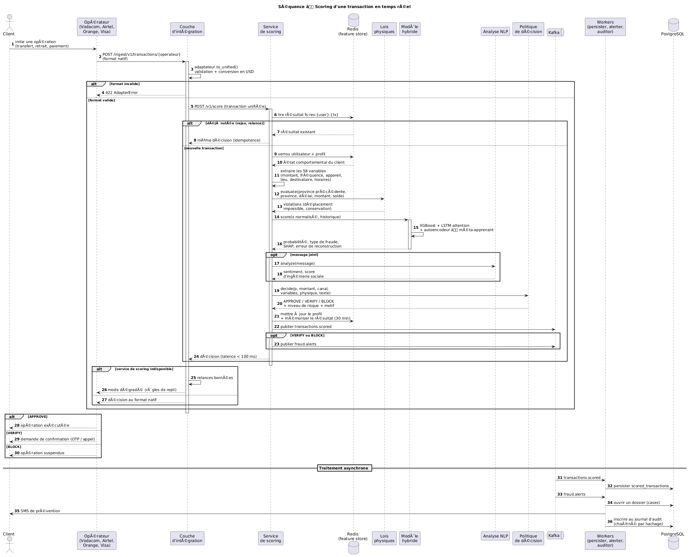
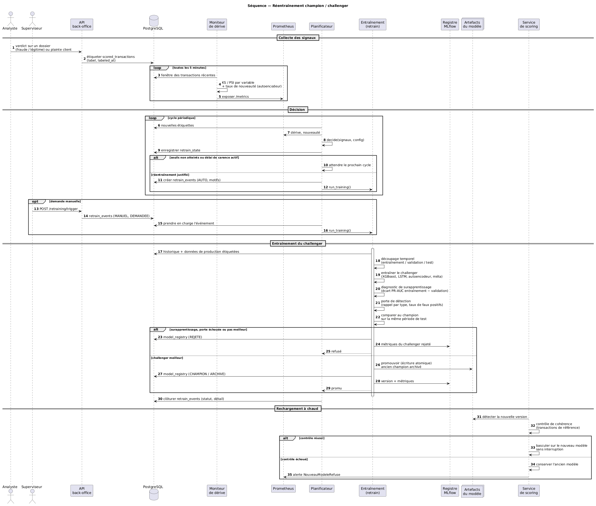
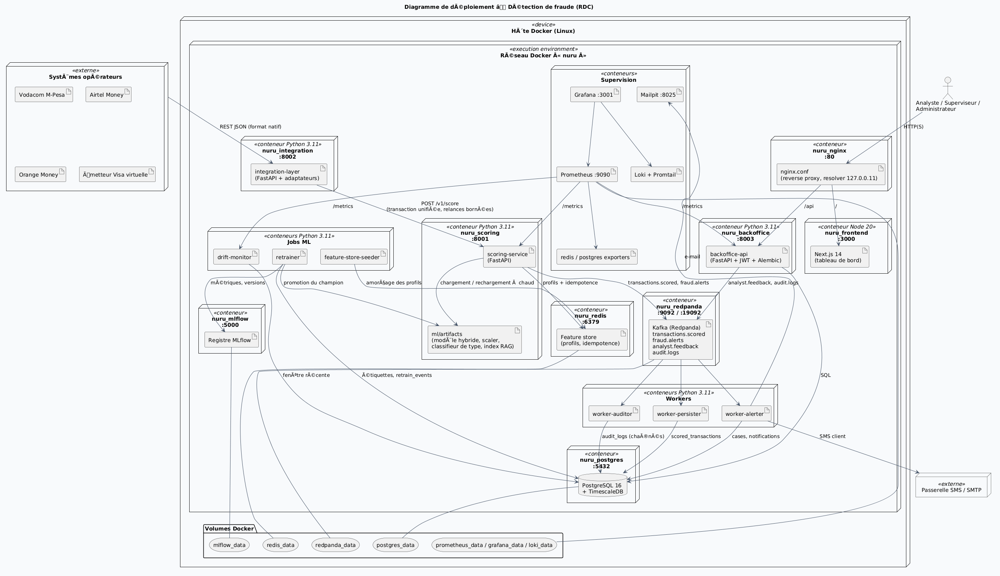

# Analyse du besoin, méthodologie et conception du système

**Sujet :** Conception et évaluation d'un modèle IA de profilage comportemental pour la détection de fraude Mobile Money en RDC : extension comparative aux cartes virtuelles.

> **Avertissement méthodologique.** Aucun jeu de données réel de transactions Mobile Money congolaises n'est publiquement accessible. Les résultats chiffrés de ce document sont donc obtenus sur des **données simulées**, produites par un générateur conçu pour reproduire le contexte de la RDC (2019-2025). Ils mesurent la capacité du système à retrouver des fraudes injectées. Leur confirmation sur données réelles est une étape ultérieure, décrite au § 2.10.

---

## Table des matières

**Partie I — Analyse du besoin**
- 1.1 Contexte
- 1.2 Problématique
- 1.3 Questions de recherche et hypothèses
- 1.4 Acteurs
- 1.5 Besoins fonctionnels
- 1.6 Besoins non fonctionnels
- 1.7 Contraintes propres à la RDC
- 1.8 Diagramme des cas d'utilisation
- 1.9 Priorisation
- 1.10 Traçabilité besoins et hypothèses

**Partie II — Méthodologie**
- 2.1 Démarche générale
- 2.2 Données (dont source et provenance, § 2.2.3)
- 2.3 Ingénierie des variables
- 2.4 Découpage temporel
- 2.5 Modèles comparés
- 2.6 Métriques et tests statistiques
- 2.7 Protocole expérimental par hypothèse
- 2.8 Résultats
- 2.9 Validité et limites
- 2.10 Validation sur données réelles
- 2.11 Outils

**Partie III — Conception du système**
- 3.1 Principes d'architecture
- 3.2 Architecture logique
- 3.3 Organisation en packages
- 3.4 Modèle de données
- 3.5 Comportement dynamique
- 3.6 Moteur de détection
- 3.7 API partenaires
- 3.8 Apprentissage continu
- 3.9 Sécurité
- 3.10 Déploiement et supervision
- 3.11 Interfaces utilisateur
- 3.12 Choix technologiques

**Annexes**

---

# PARTIE I — ANALYSE DU BESOIN

## 1.1 Contexte

En République démocratique du Congo, le Mobile Money est devenu un moyen de paiement de masse. Il sert aux transferts entre particuliers, aux dépôts et retraits chez des agents, aux paiements marchands, à l'achat de crédit et au paiement des factures. Trois opérateurs principaux le proposent : Vodacom M-Pesa, Airtel Money et Orange Money.

Le service est utilisé aussi bien sur smartphone (application) que sur téléphone simple (USSD), en francs congolais (CDF) et en dollars (USD). Les **cartes Visa virtuelles**, rechargées depuis le portefeuille mobile, ouvrent l'accès aux achats en ligne et internationaux.

Cette croissance attire des fraudes variées, qui évoluent dans le temps :

| Typologie | Mécanisme | Canal |
|---|---|---|
| Échange de SIM (SIM swap) | Le fraudeur reprend la ligne du client puis vide le compte depuis un nouvel appareil | Mobile Money |
| Ingénierie sociale | Le client est manipulé et envoie lui-même l'argent (faux agent, faux gain) | Mobile Money |
| Prise de contrôle de compte | Accès non autorisé à l'application du client | Mobile Money |
| Fraude d'agent | Retraits non autorisés par un agent compromis | Mobile Money |
| Fractionnement (smurfing) | Petits montants répétés vers des comptes mules pour rester sous les seuils | Mobile Money |
| Test de carte | Salves de petits achats pour tester une carte volée | Visa virtuelle |
| Carte non présente (CNP) | Achat en ligne avec les données de la carte | Visa virtuelle |
| Vidage par rechargement | Rechargement de la carte puis vidage rapide | Visa virtuelle |

## 1.2 Problématique

Les dispositifs classiques de détection reposent sur des **règles statiques** : seuils de montant, listes noires, plafonds. Ils présentent trois faiblesses :

1. **Ils ignorent l'individu.** Un retrait de 300 USD est banal pour un commerçant et anormal pour un étudiant. Une règle unique produit donc à la fois des fausses alertes et des fraudes manquées.
2. **Ils sont figés.** Les fraudeurs apprennent les seuils et s'y adaptent, par exemple par le fractionnement.
3. **Ils n'expliquent pas leurs décisions** et ne graduent pas la réponse. Bloquer 2 USD de crédit et 900 USD de retrait n'a pas le même coût.

**Problématique.** *Comment concevoir un modèle d'intelligence artificielle qui apprend le comportement habituel de chaque utilisateur pour détecter, en temps réel et de manière explicable, les transactions frauduleuses Mobile Money en RDC, et dans quelle mesure cette approche se transpose-t-elle aux cartes virtuelles ?*

## 1.3 Questions de recherche et hypothèses

| Question de recherche | Hypothèse |
|---|---|
| QR1 — Le profilage comportemental détecte-t-il mieux la fraude que les approches statiques ? | **H1** : un modèle fondé sur le profil comportemental de l'utilisateur est significativement plus performant que les règles statiques et qu'un modèle sans historique. |
| QR2 — Quelles caractéristiques comportementales sont les plus discriminantes ? | **H2** : les variables temporelles, fréquentielles et contextuelles contribuent significativement à la détection. |
| QR3 — Quelle famille de modèles est la plus adaptée ? | **H3** : les performances varient significativement selon la famille de modèles (ensembles d'arbres, modèles linéaires, détection d'anomalies, réseaux récurrents). |
| QR4 — La logique se transpose-t-elle aux cartes virtuelles ? | **H4** : un modèle appris sur le Mobile Money conserve une performance élevée sur les cartes Visa virtuelles, avec peu ou pas de données Visa. |
| QR5 — Le modèle doit-il évoluer avec les fraudes ? | **H5** : face à l'évolution des fraudes, un modèle régulièrement mis à jour reste significativement plus performant qu'un modèle figé. |

**Objectif général.** Concevoir, réaliser et évaluer un système de détection de fraude par profilage comportemental, opérationnel en temps réel, explicable, évolutif, et ouvert aux institutions du secteur.

**Objectifs spécifiques :**
- **(1)** construire un profil comportemental par utilisateur ;
- **(2)** comparer plusieurs familles de modèles selon un protocole statistique rigoureux ;
- **(3)** mesurer la transposabilité du Mobile Money vers la carte Visa virtuelle ;
- **(4)** intégrer le modèle dans une architecture temps réel avec explication, supervision et réentraînement ;
- **(5)** l'exposer aux opérateurs, aux banques et au régulateur par une API.

## 1.4 Acteurs

| Acteur | Type | Rôle | Attentes |
|---|---|---|---|
| Client (titulaire) | Humain, externe | Effectue les opérations | Être protégé sans être bloqué à tort ; être prévenu en cas d'opération suspecte |
| Opérateur Mobile Money | Système externe | Transmet les opérations, applique la décision | Décision rapide (< 100 ms), fiable, dans son format |
| Émetteur de cartes virtuelles | Système externe | Idem pour les cartes | Idem |
| Banque partenaire | Système externe | Utilise le système par l'API au format commun | Intégration simple, isolement de ses données |
| Analyste anti-fraude | Humain, interne | Traite alertes et dossiers | Alertes priorisées, expliquées, typées |
| Superviseur | Humain, interne | Encadre, suit le modèle, déclenche le réentraînement | Indicateurs, audit, pilotage du modèle |
| Administrateur | Humain, interne | Gère comptes, rôles, institutions et clés d'API | Contrôle des accès |
| Régulateur (BCC) / auditeur | Humain ou système, externe | Supervise le secteur, contrôle la conformité | Agrégats sans donnée personnelle, traçabilité inaltérable |

## 1.5 Besoins fonctionnels

| Réf. | Besoin | Réponse du système |
|---|---|---|
| BM-01 | Détecter la fraude **avant** l'exécution de l'opération | Scoring synchrone de chaque opération par le modèle hybride |
| BM-02 | Reconnaître le **comportement habituel** de chaque client et ses écarts | 58 variables de profilage calculées sur l'historique du client |
| BM-03 | **Graduer la réponse** : laisser passer, faire vérifier, bloquer | Décision coût-sensible (probabilité × montant), règles métier prioritaires |
| BM-04 | Limiter les **fausses alertes** | Seuil optimisé ; vérification plutôt que blocage dans les cas intermédiaires |
| BM-05 | Identifier le **type de fraude** | Classifieur de typologie (8 types) affiché sur chaque alerte |
| BM-06 | **Expliquer** chaque décision | SHAP, contribution de chaque branche, attention sur l'historique, cas similaires (RAG) |
| BM-07 | **Prioriser et traiter** les alertes | Dossiers classés par risque et montant ; statuts ; affectation ; note obligatoire |
| BM-08 | **Prévenir le client** | SMS au client, e-mail à l'équipe pour les cas critiques |
| BM-09 | Enregistrer les **plaintes** des clients | Plainte → dossier « fraude confirmée » → étiquette d'apprentissage |
| BM-10 | Repérer l'**ingénierie sociale** | Profilage, analyse du message (NLP), règle de vérification |
| BM-11 | Couvrir **plusieurs opérateurs et la carte Visa** | Un adaptateur par format, vers un schéma unique |
| BM-12 | **Comparer et transposer** au canal Visa | Protocole d'évaluation Mobile Money → Visa |
| BM-13 | Vision **géographique** nationale | Carte des 26 provinces |
| BM-14 | **Tableau de bord** de supervision | Indicateurs temps réel, séries, répartitions, matrices de confusion |
| BM-15 | **S'adapter** aux fraudes nouvelles | Réentraînement déclenché, avec stratégie champion / challenger |
| BM-16 | Faire **examiner les comportements nouveaux** | Détection de nouveauté, revue d'analyste → étiquette |
| BM-17 | **Traçabilité** | Journal d'audit chaîné par hachage, inaltérable |
| BM-18 | **Gérer les droits** selon le rôle | Rôles analyste, superviseur, administrateur |
| BM-19 | Permettre aux institutions de **signaler les fraudes constatées** | API `/v1/feedback` : le dossier est clos et l'étiquette sert au réentraînement |
| BM-20 | Permettre au régulateur de **superviser le secteur** | API de supervision en lecture seule, agrégats sans donnée personnelle |
| BM-21 | **Gérer les institutions partenaires** et leurs accès | Création, droits, renouvellement et révocation des clés d'API |

## 1.6 Besoins non fonctionnels

| Catégorie | Réf. | Exigence | Réponse du système |
|---|---|---|---|
| Performance | BT-01 | Décision avant exécution | Médiane ≈ 60 ms, 95ᵉ centile ≈ 110 ms de bout en bout (rejeu) |
| | BT-02 | Débit des opérateurs | Plusieurs processus de scoring, limitation de débit (Nginx), réplicas Kubernetes |
| Disponibilité | BT-03 | Continuité si le scoring tombe | Politique de repli configurable, relances bornées |
| | BT-04 | Résilience aux doublons | Idempotence : une opération rejouée renvoie la décision d'origine |
| Intégration | BT-06 | Formats hétérogènes | Patron *Adapter* et schéma pivot `UnifiedTransaction` |
| | BT-07 | Double monnaie | Conversion CDF → USD au taux de l'année de l'opération |
| | BT-10 | Découplage | Bus d'événements Kafka et workers indépendants |
| Apprentissage automatique | BT-11 | Cohérence entraînement / production | Mêmes fonctions de calcul ; contrôle de l'empreinte du scaler |
| | BT-12 | Déséquilibre des classes (≈ 1,3 % de fraudes) | Pondération, sous-échantillonnage, métrique PR-AUC |
| | BT-13 | Absence de fuite d'information | Variables calculées sur le passé ; découpage temporel |
| | BT-14 | Explicabilité | TreeSHAP exact, attention, RAG |
| | BT-15 | Évaluation statistiquement fondée | Bootstrap apparié par usager, test de McNemar |
| | BT-16 | Surveillance de la dérive | Kolmogorov-Smirnov, PSI, taux de nouveauté |
| | BT-17 | Réentraînement maîtrisé | Champion / challenger, porte de détection, garde-fou contre le surapprentissage |
| | BT-19 | Robustesse aux attaques inédites | Lois physiques (cinématique, conservation) |
| Sécurité | BT-20 | Authentification des systèmes | Clé d'API par institution (empreinte SHA-256), droits par institution |
| | BT-21 | Authentification des utilisateurs | JWT, contrôle d'accès par rôle |
| | BT-22 | Intégrité du journal | Chaînage SHA-256, modification et suppression interdites en base |
| | BT-23 | Confidentialité | Aucun service externe ; texte des messages jamais stocké ; isolement des données par institution |
| Exploitation | BT-25 | Observabilité | Prometheus, Grafana, Loki, règles d'alerte |
| | BT-26 | Qualité logicielle | Tests automatisés par service |
| | BT-27 | Portabilité | Conteneurs Docker, Docker Compose, Kubernetes |

## 1.7 Contraintes propres à la RDC

| Contrainte | Conséquence sur la conception |
|---|---|
| Téléphones simples et USSD très répandus | Variables indépendantes de l'application (montant, fréquence, agent) |
| Réseau d'agents de proximité | Variables liées à l'agent ; typologie « fraude d'agent » |
| Double monnaie CDF / USD, dépréciation du franc | Montants ramenés en USD au taux de l'année |
| Connectivité inégale | Aucune dépendance à un service en ligne pour décider |
| 26 provinces, vaste territoire | Localisation par province ; loi physique de déplacement entre chefs-lieux |
| Niveaux KYC et plafonds | Variable « montant / plafond KYC » ; règle de vérification |
| Marché multi-opérateurs, régulé par la BCC | API ouverte aux institutions, isolement des données, supervision du régulateur |
| Absence de jeu de données public | Générateur de données synthétiques réaliste ; validation sur données réelles à prévoir |

## 1.8 Diagramme des cas d'utilisation

*Figure 1 — Cas d'utilisation (code : `docs/uml/besoins_metier.puml`).*

## 1.9 Priorisation (MoSCoW)

| Priorité | Besoins |
|---|---|
| **Indispensable** (*Must*) | BM-01, BM-02, BM-03, BM-04, BM-06, BM-17, BT-01, BT-11, BT-13, BT-21, BT-22 |
| **Important** (*Should*) | BM-05, BM-07, BM-08, BM-09, BM-11, BM-15, BM-19, BM-21, BT-03, BT-04, BT-16, BT-17, BT-20 |
| **Souhaitable** (*Could*) | BM-10, BM-12, BM-13, BM-14, BM-16, BM-20, BT-19, BT-25 |
| **Hors périmètre** (*Won't, pour l'instant*) | Raccordement aux systèmes réels des opérateurs ; validation sur données réelles ; analyse de messages en lingala et swahili |

## 1.10 Traçabilité besoins et hypothèses

| Hypothèse | Besoins concernés |
|---|---|
| H1 | BM-01, BM-02, BM-04 |
| H2 | BM-02, BT-13 |
| H3 | BM-01, BT-12, BT-15 |
| H4 | BM-11, BM-12 |
| H5 | BM-15, BM-16, BM-19, BT-16, BT-17 |

---

# PARTIE II — MÉTHODOLOGIE

## 2.1 Démarche générale

La recherche suit une démarche de **science de la conception** (*design science research*) : on construit un artefact, le système, et on l'évalue au regard d'un problème réel. Le volet données suit le cycle **CRISP-DM**, adapté :

| Étape | Contenu | Livrable |
|---|---|---|
| 1. Compréhension du métier | Contexte RDC, typologies de fraude, acteurs, besoins | Partie I |
| 2. Compréhension et constitution des données | Générateur synthétique 2019-2025 | `ml/generator/`, `docs/dictionnaire_donnees.md` |
| 3. Préparation | 58 variables comportementales, normalisation, découpage temporel | `ml/features/`, `ml/preprocessing/` |
| 4. Modélisation | Références de comparaison, modèle hybride, classifieur de typologie | `ml/models/`, `ml/training/` |
| 5. Évaluation | Protocole statistique H1 à H5, matrices de confusion | `ml/reports/` |
| 6. Déploiement | Architecture temps réel, API, supervision, apprentissage continu | Partie III |

La démarche est **itérative** : les diagnostics d'évaluation ont conduit à des corrections successives (fuites d'information, cohérence entre entraînement et production, surapprentissage, seuils).

## 2.2 Données

### 2.2.1 Justification du recours à des données simulées

Les données transactionnelles des opérateurs sont confidentielles (secret bancaire, protection des données personnelles) et aucun jeu public ne couvre la RDC. Un **générateur paramétré** a donc été conçu. Il reproduit les régularités connues du marché : opérateurs, provinces, agents, double monnaie, saisonnalité, typologies de fraude. La graine est fixe, ce qui rend la génération reproductible à l'octet près.

### 2.2.2 Caractéristiques du jeu de données

| Caractéristique | Valeur |
|---|---|
| Période | 1ᵉʳ janvier 2019 → 31 décembre 2025 |
| Transactions | 631 968 |
| Utilisateurs | 500 (arrivées progressives, croissance d'environ 8 % par an) |
| Fraudes | 8 426 (**1,33 %**) |
| Canaux | Mobile Money 598 515 ; Visa virtuelle 33 453 (lancée en 2021) |
| Opérateurs | Vodacom 319 549 ; Airtel 180 649 ; Orange 131 770 |
| Monnaies | CDF et USD, taux de change par année |

Répartition des fraudes par typologie : échange de SIM 2 220, ingénierie sociale 1 850, fractionnement 1 334, prise de contrôle 1 112, fraude d'agent 888, carte non présente 406, test de carte 362, vidage par rechargement 254.

**Évolution dans le temps.** Les tendances des fraudes varient selon l'année (paramètres `FRAUD_TRENDS`). L'ingénierie sociale et le fractionnement progressent, ce qui permet de tester H5. Les déplacements des utilisateurs respectent des durées de trajet réalistes entre provinces.

Le dictionnaire complet des données est dans `docs/dictionnaire_donnees.md`.

### 2.2.3 Source et provenance des données

**Nature de la source.** Les données utilisées sont des **données primaires synthétiques**, produites par un générateur développé dans le cadre de ce travail. Elles ne proviennent d'aucun opérateur, d'aucune banque et d'aucune base publique. Aucune donnée personnelle réelle n'est utilisée.

| Élément | Valeur |
|---|---|
| Source | Générateur de données synthétiques du projet : `ml/generator/generate_synthetic_data.py` |
| Auteur | l'auteur du mémoire (générateur conçu et paramétré pour ce travail) |
| Commande de génération | `python ml/generator/generate_synthetic_data.py --multi-year` (période 2019-2025) |
| Graine aléatoire | 42 : la génération est reproductible à l'identique |
| Fichiers produits | `transactions.csv` (631 968 lignes), `users.csv` (500), `agents.csv` (800), `merchants.csv` (600 Mobile Money, 300 commerçants carte), `fraud_mapping.json` |
| Traçabilité | `ml/data/raw/generation_metadata.json` : configuration complète et statistiques de chaque génération |
| Dictionnaire des données | `docs/dictionnaire_donnees.md` |

**Paramètres de simulation.** Ce sont des **hypothèses de l'auteur**, choisies pour produire des ordres de grandeur plausibles. Ce ne sont **pas** des statistiques officielles.

| Paramètre | Valeur retenue | Statut |
|---|---|---|
| Taux de fraude visé, Mobile Money | 1,2 % des transactions (1,24 % obtenu) | hypothèse de simulation |
| Taux de fraude visé, carte virtuelle | 2,5 % (3,06 % obtenu) | hypothèse de simulation |
| Comptes « mules » | 1 % des comptes | hypothèse |
| Changements d'appareil légitimes | 4 % des utilisateurs | hypothèse (cas difficile légitime) |
| Comptes existants au 1ᵉʳ janvier 2019 | 35 %, les autres ouverts progressivement | hypothèse |
| Croissance de l'activité par client | + 8 % par an | hypothèse |
| Lancement de la carte Visa virtuelle | 1ᵉʳ janvier 2021 | hypothèse |
| Évolution des typologies (`FRAUD_TRENDS`) | coefficients annuels par type (ex. ingénierie sociale × 0,7 en 2019, × 1,6 en 2025) | hypothèse : sert à tester H5 |
| Taux USD/CDF par année | 1 650 (2019), 1 850, 1 990, 2 010, 2 450, 2 800, 2 850 (2025) | approximation de l'ordre de grandeur du marché, à remplacer par le cours officiel de la BCC |
| Plafonds KYC par transaction | paramètres du générateur | **ne sont pas** les plafonds réglementaires de la BCC |
| Solde du portefeuille | un solde unique en équivalent USD | simplification (en réalité, sous-comptes CDF et USD distincts) |
| Déplacements entre provinces | durée de trajet respectée (route, avion) | contrainte physique réaliste |

**Ce qui est modélisé.** Le générateur reproduit plusieurs régularités du comportement :
- des rythmes horaires individuels et des cycles hebdomadaires ;
- des pics de fin de mois et les frais scolaires de septembre ;
- des abonnements récurrents ;
- des **cas légitimes difficiles** : changement de téléphone, voyage, usage nocturne, nouveau destinataire, montant inhabituel mais légitime.

Les fraudes sont injectées par **épisodes**, sur des victimes dont le solde est réellement débité. Une fraude échoue si le solde est insuffisant.

**Précédent méthodologique.** Le recours à un simulateur pour étudier la fraude Mobile Money, faute de données publiques, a des précédents dans la littérature. C'est notamment le cas de PaySim (Lopez-Rojas, Elmir et Axelsson, 2016), simulateur de transactions Mobile Money conçu pour la détection de fraude. La différence est que PaySim s'appuie sur un échantillon de transactions réelles agrégées. Le présent générateur, lui, repose entièrement sur des hypothèses paramétrées, faute d'un tel échantillon pour la RDC.

**Confrontation aux sources officielles de la RDC (validation a posteriori).** Les paramètres du générateur ont été fixés avant cette vérification. Ils ont ensuite été comparés aux statistiques publiées par l'ARPTC (Observatoire du marché de la téléphonie mobile), la Banque Centrale du Congo et la Banque mondiale :

| Indicateur | Générateur | Source officielle | Écart |
|---|---|---|---|
| Répartition des clients Mobile Money par opérateur | Vodacom 45 %, Airtel 32 %, Orange 23 % | Abonnés actifs (90 jours) en 2025 : M-Pesa 15,4 M, Airtel Money 11,1 M, Orange Money 7,7 M, soit **45 % / 33 % / 23 %** (ARPTC, rapport T4-2025, cité par Bankable) | cohérent (≤ 1 point) |
| Répartition des transactions par opérateur | Vodacom 50,5 %, Airtel 28,6 %, Orange 20,9 % | Parts de marché : M-Pesa 50,4 %, Airtel 34,7 %, Orange 14,5 % (T1 2024) ; M-Pesa 43,4 %, Airtel 40,8 % (2025, transactions) (ARPTC) | même ordre de grandeur ; Airtel sous-représenté, Orange surreprésenté |
| Provinces les plus actives | Kinshasa 39 %, Haut-Katanga 16 %, Nord-Kivu 11 % des montants | Revenus Mobile Money T1 2024 : Kinshasa 23,2 M USD, Haut-Katanga 14,4 M, Nord-Kivu 8,4 M (ARPTC) | **même classement** ; Kinshasa plus concentrée dans le générateur |
| Taux USD/CDF 2019 | 1 650 | 1 647,8 (moyenne annuelle officielle, Banque mondiale d'après la BCC) | +0,1 % |
| Taux 2020 | 1 850 | 1 851,1 | −0,1 % |
| Taux 2021 | 1 990 | 1 989,4 | 0,0 % |
| Taux 2022 | 2 010 | 2 006,7 | +0,2 % |
| Taux 2023 | 2 450 | 2 340,0 | +4,7 % |
| Taux 2024 | 2 800 | moyenne annuelle non publiée dans la série ; cours officiels BCC : 2 675,9 (3 janvier), 2 786,5 (1ᵉʳ avril), 2 841,8 (13 septembre) | cohérent avec les cours observés |
| Taux 2025 | 2 850 | 2 693,2 | +5,8 % (appréciation du franc fin 2025, non simulée) |
| Taux de fraude | 1,24 % (Mobile Money) | **aucune statistique publique** de la fraude Mobile Money en RDC | non vérifiable |
| Plafonds KYC | paramètres du générateur | Instruction BCC n° 24 (2011) sur la monnaie électronique ; plafonds par niveau non publiés dans les sources consultées | non vérifiable |

**Lecture.** La structure du marché simulé est **cohérente avec les statistiques officielles** : poids relatif des opérateurs, classement des provinces, taux de change de 2019 à 2022. Les écarts restants sont limités. Ils concernent la part d'Airtel, la concentration sur Kinshasa et le taux de change de 2023 et 2025. Ils n'affectent pas la méthode, car le modèle raisonne en écarts au comportement de chaque client, mais pourraient être corrigés par un recalibrage. En revanche, le **taux de fraude** et les **typologies** restent des hypothèses : aucune donnée publique ne les documente pour la RDC.

**Sources consultées :**
- ARPTC, Observatoire du marché de la téléphonie mobile, rapport T4-2025, relayé par Bankable : <https://bankable.africa/en/numerique/1205-2922-mobile-money-avec-194-8-millions-de-revenus-en-2025-airtel-money-talonne-m-pesa-en-rdc>
- ARPTC, Observatoire, T1 2024, relayé par Deskeco : <https://deskeco.com/2024/08/30/rdc-le-marche-des-services-financiers-mobiles-genere-863-millions-usd-au-1er-trimestre-2024-rapport>
- Banque mondiale, indicateur PA.NUS.FCRF (taux de change officiel, moyenne annuelle) : <https://data.worldbank.org/indicator/PA.NUS.FCRF?locations=CD>
- Banque Centrale du Congo, cours de change officiels : <https://www.bcc.cd/marche-des-changes/cours-de-change>
- ARPTC, rapports de l'observatoire : <https://arptc.gouv.cd>

**Sources complémentaires à consulter :**
- GSMA, *State of the Industry Report on Mobile Money* ;
- Banque mondiale, base *Global Findex* ;
- rapports annuels de la BCC : <https://www.bcc.cd/publications/rapports-annuels>.

**Comment citer les données dans le mémoire :**

> « Jeu de données synthétique de transactions Mobile Money et cartes Visa virtuelles (RDC, 2019-2025), généré par l'auteur à l'aide du générateur `generate_synthetic_data.py` (graine 42, 631 968 transactions, 8 426 fraudes réparties en 8 typologies). Paramètres et statistiques : `generation_metadata.json`. »

## 2.3 Ingénierie des variables

Chaque transaction est décrite par **58 variables comportementales**. Toutes sont calculées **uniquement à partir du passé** du client, par un rejeu chronologique, ce qui exclut toute fuite d'information. Elles se répartissent en quatre familles, plus deux groupes complémentaires :

| Famille | Exemples | Ce qu'elle capte |
|---|---|---|
| **Montants** | écart au montant habituel (z-score log), rapport au montant moyen, part du solde, vidage, montant / plafond KYC | rupture des habitudes de dépense |
| **Fréquentielles** | nombre d'opérations sur 1 h, 24 h et 7 j ; somme débitée sur 24 h ; délai depuis l'opération précédente | vélocité anormale (vidage, salves) |
| **Contextuelles** | nouvel appareil, nouvel agent, nouvelle province, nouveau destinataire, destinataire lié à de nombreux clients (mule), IP étrangère | rupture de contexte |
| **Temporelles** | heure cyclique (sin, cos), nuit inhabituelle, écart à l'heure habituelle (statistique circulaire), jour de la semaine | rupture des horaires |
| Socle | type d'opération, canal d'accès, ancienneté, niveau KYC | contexte de l'opération |
| **Physiques** (6, hors entrée du modèle) | infaisabilité du déplacement, déficit de conservation, vitesse de vidage, score physique | lois que la fraude ne peut contourner |

Normalisation : $\tilde x_j=\operatorname{clip}\big((x_j-m_j)/\sigma_j,-10,10\big)$, où $m_j$ et $\sigma_j$ sont estimés **sur la période d'entraînement seulement**. Les formules détaillées sont dans `docs/formules_mathematiques.md`.

## 2.4 Découpage temporel

Un découpage aléatoire serait irréaliste : il mélangerait passé et futur, et laisserait fuir les tendances futures dans l'entraînement. Le découpage est donc **chronologique** :

| Tranche | Période | Usage |
|---|---|---|
| Entraînement | 01/2019 → 02/03/2023 | apprentissage des modèles |
| Arrêt précoce (*early stop*) | 02/03/2023 → 25/11/2023 | arrêt de l'apprentissage, détection du surapprentissage |
| Validation | 25/11/2023 → 13/12/2024 | choix du seuil, calibrage du méta-apprenant |
| **Test** | 13/12/2024 → 31/12/2025 | évaluation finale : 183 240 transactions, 2 437 fraudes, jamais vues |

## 2.5 Modèles comparés

| Famille | Modèle | Rôle |
|---|---|---|
| Règles statiques | Règles métier à seuils fixes | référence actuelle du secteur |
| Statique appris | XGBoost limité aux variables sans historique | isole l'apport du profilage (H1) |
| Linéaire | Régression logistique | référence interprétable |
| Ensembles d'arbres | Random Forest, XGBoost | modèles tabulaires de référence |
| Détection d'anomalies | Isolation Forest, autoencodeur | apprentissage sans étiquette |
| Séquentiel | LSTM avec attention sur les 10 dernières opérations | dynamique du comportement |
| **Hybride (retenu)** | XGBoost + LSTM-attention + autoencodeur, combinés par un méta-apprenant logistique (empilement) | combine profil instantané, séquence et anomalie |
| Second étage | XGBoost multiclasse restreint par canal | type de fraude (8 classes) |

**Mesures contre le surapprentissage :**
- arrêt précoce sur une tranche distincte ;
- dropout de 0,2 ;
- régularisation L2 (AdamW pour le LSTM, $\lambda$ et $\gamma$ pour XGBoost) ;
- découpage temporel ;
- diagnostic automatique de l'écart de PR-AUC entre entraînement et validation, qui bloque toute promotion d'un modèle si l'écart dépasse 0,05.

## 2.6 Métriques et tests statistiques

**Pourquoi la PR-AUC.** Avec 1,3 % de fraudes, la ROC-AUC est trompeuse : elle reste élevée même avec beaucoup de fausses alertes. La **PR-AUC** (aire sous la courbe précision-rappel) est donc la métrique principale.

| Métrique | Définition | Lecture métier |
|---|---|---|
| PR-AUC | aire sous la courbe précision-rappel | qualité du classement des transactions |
| Rappel | $VP/(VP+FN)$ | part des fraudes interceptées |
| Précision | $VP/(VP+FP)$ | part des alertes justifiées |
| F1 | $2PR/(P+R)$ | compromis au seuil retenu |
| Taux de faux positifs | $FP/(FP+VN)$ | clients légitimes dérangés |
| Rappel à 1 % de FP | rappel quand 1 % des légitimes sont alertés | capacité à budget d'alertes fixé |

**Tests statistiques :**
- **Intervalles de confiance à 95 % par bootstrap apparié par usager.** On rééchantillonne les utilisateurs, et non les transactions, car les transactions d'un même client sont corrélées. Les deux modèles sont évalués sur le même rééchantillon, ce qui donne un écart apparié.
- **Test de McNemar exact.** Il compare les erreurs de deux modèles au seuil opérationnel.
- **Variance selon la graine.** Les entraînements sont répétés avec plusieurs graines.

Une différence est déclarée **significative** si l'intervalle de confiance de l'écart exclut 0.

## 2.7 Protocole expérimental par hypothèse

| Hyp. | Expérience | Critère de confirmation |
|---|---|---|
| H1 | Profilage (toutes variables) contre statique appris et règles métier | écart de PR-AUC significatif, McNemar p < 0,05 |
| H2 | Ablation : retrait de chaque famille ; ajout : socle + une famille ; AUC univariées | retrait dégradant significativement, ou ajout améliorant nettement |
| H3 | Comparaison XGBoost, Random Forest, régression logistique, Isolation Forest, règles ; branches et hybride | écarts significatifs entre familles |
| H4 | Entraînement Mobile Money seul, puis évaluation sur Visa ; variantes avec 5 % et 20 % de données Visa ; sens inverse | PR-AUC élevée sur Visa sans données Visa |
| H5 | Modèle figé (2019-2021) contre modèle mis à jour (cumulatif, glissant sur 3 ans), évalués chaque année de 2022 à 2025 | modèle mis à jour significativement meilleur, écart croissant |

## 2.8 Résultats

### 2.8.1 Synthèse des hypothèses

| Hyp. | Résultat principal | Verdict |
|---|---|---|
| **H1** | PR-AUC : profilage 0,989 [0,986 ; 0,992], statique 0,753 [0,703 ; 0,790], règles 0,273. Écart −0,236, significatif ; McNemar p < 0,001 | **Confirmée** |
| **H2** | Le retrait des variables contextuelles fait perdre 0,147 de PR-AUC ; celui des montants 0,083 ; celui des fréquentielles 0,035 (tous significatifs). Les variables temporelles sont redondantes en ablation, mais apportent +0,106 au socle | **Confirmée** |
| **H3** | XGBoost 0,989 ; Random Forest 0,979 ; régression logistique 0,944 ; Isolation Forest 0,380 ; règles 0,273 (écarts significatifs). Hybride : **0,9955** | **Confirmée** |
| **H4** | Modèle Mobile Money seul, évalué sur Visa : PR-AUC 0,985. Avec 5 % de données Visa : 0,998, écart non significatif avec le modèle mixte | **Confirmée**, avec réserve (Visa simulée très séparable) |
| **H5** | En 2025 : figé 0,968 contre mis à jour 0,998 (+0,030, significatif). L'écart se creuse de +0,011 par an. Rappel sur l'ingénierie sociale : 42 % (figé) contre 97 % (mis à jour) | **Confirmée** (en partie par construction du générateur) |

### 2.8.2 Performance du modèle hybride (test)

| Modèle | PR-AUC | Précision | Rappel | F1 | Taux de FP |
|---|---|---|---|---|---|
| **Hybride** | **0,9955** | 0,951 | 0,978 | 0,964 | 0,067 % |
| Hybride sans LSTM | 0,9905 | 0,929 | 0,959 | 0,944 | 0,098 % |
| Hybride sans XGBoost | 0,9912 | 0,940 | 0,974 | 0,957 | 0,084 % |
| Hybride sans autoencodeur | 0,9950 | 0,943 | 0,977 | 0,960 | 0,080 % |
| XGBoost seul | 0,9895 | 0,918 | 0,959 | 0,938 | 0,116 % |
| Random Forest | 0,9842 | 0,934 | 0,929 | 0,932 | 0,088 % |
| Régression logistique | 0,9513 | 0,882 | 0,868 | 0,875 | 0,157 % |
| Règles métier | 0,2755 | 0,371 | 0,357 | 0,364 | 0,815 % |

Chaque branche apporte une contribution : la retirer dégrade le modèle. L'hybride divise par 12 le taux de fausses alertes par rapport aux règles métier, tout en interceptant presque trois fois plus de fraudes.

### 2.8.3 Matrice de confusion (test, seuil opérationnel)

|  | Prédit légitime | Prédit fraude |
|---|---|---|
| **Réel légitime** | 180 681 | 122 (fausses alertes) |
| **Réel fraude** | 54 (fraudes manquées) | 2 383 |

*Figure 2 — Matrice de confusion du détecteur hybride.*

**Typologie (second étage)** : exactitude 96,2 %, F1 macro 0,971. Cinq types sur huit sont reconnus à 100 %. La seule confusion notable oppose l'échange de SIM et la prise de contrôle de compte (6 à 9 %), deux fraudes de signature voisine.

*Figure 3 — Matrice de confusion par type de fraude.*

### 2.8.4 Composants complémentaires

| Composant | Évaluation | Résultat |
|---|---|---|
| Lois physiques | Attaque par relais simulée (déplacement impossible) | 100 % détectée par l'hybride, contre 0,3 % par le modèle de données seul ; 0,01 % de légitimes signalés |
| RAG (cas similaires) | Cohérence entre les cas proches et la décision | Alertes confirmées par les cas proches : 98 % de vraies fraudes, contre 61 % quand ils divergent |
| NLP (ingénierie sociale) | Corpus de test de messages | Précision 100 %, rappel 73 % |
| Temps réel | Rejeu de flux | 278 fraudes interceptées sur 279 ; 0,4 % de légitimes soumis à vérification ; écart médian de 0 entre scores en ligne et hors ligne |

## 2.9 Validité et limites

| Menace | Nature | Mesure prise ou réserve |
|---|---|---|
| **Données simulées** | Validité externe | Les fraudes simulées sont plus nettes que les vraies : les performances réelles seront plus faibles. À confirmer sur données réelles (§ 2.10) |
| Circularité de H5 | Validité interne | L'évolution des fraudes est un paramètre du générateur : H5 démontre surtout que le mécanisme de mise à jour fonctionne |
| Visa trop séparable | Validité de construit | Effet plafond (PR-AUC proche de 1) : la transposabilité H4 peut être surestimée |
| Fuite d'information | Validité interne | Variables calculées sur le passé, découpage temporel, seuil choisi sur la validation |
| Corrélation intra-client | Validité statistique | Bootstrap apparié par usager plutôt que par transaction |
| Surapprentissage | Validité interne | Arrêt précoce, régularisation, diagnostic automatique ; PR-AUC de validation au niveau de celle d'entraînement |
| Corpus NLP construit par l'auteur | Validité externe | Messages en français seulement ; lingala et swahili non couverts |
| Étiquettes réelles imparfaites | Validité externe | Fraudes non signalées et délai d'étiquetage ; les retours des institutions (BM-19) visent à les réduire |

## 2.10 Validation sur données réelles

Pour établir la confiance sur données réelles, la démarche proposée comporte cinq étapes :

1. **Accord de données** avec un opérateur, avec anonymisation.
2. **Validation hors ligne** sur son historique, avec le même protocole.
3. **Mode observation de 2 à 4 semaines** : le système note les opérations sans rien bloquer.
4. **Recalibrage** des seuils et des coûts.
5. **Mise en service progressive** : vérification seulement, puis blocage des cas critiques.

## 2.11 Outils

| Domaine | Outils |
|---|---|
| Langage, données | Python 3.12, pandas, NumPy |
| Apprentissage | XGBoost 2.0, PyTorch 2.2 (LSTM, autoencodeur), scikit-learn |
| Explicabilité | SHAP (TreeSHAP) |
| Suivi des expériences | MLflow (registre des modèles) |
| Tests | pytest |
| Diagrammes | PlantUML |

---

# PARTIE III — CONCEPTION DU SYSTÈME

## 3.1 Principes d'architecture

| Principe | Mise en œuvre |
|---|---|
| **Microservices** | Intégration, scoring, back-office, workers et jobs d'apprentissage automatique sont déployables séparément |
| **Architecture orientée événements** | Le chemin critique (décision) est synchrone ; tout le reste (enregistrement, alertes, audit) passe par Kafka, de façon asynchrone |
| **Schéma pivot** | Un format unique (`UnifiedTransaction`) entre l'intégration et le scoring |
| **Défense en profondeur** | Modèle de données + règles métier + lois physiques ; les règles ne peuvent que renforcer la décision |
| **Explicabilité par conception** | Chaque décision est accompagnée de son explication et de ses preuves |
| **Évolutivité maîtrisée** | Un nouveau modèle n'est promu que s'il est meilleur et passe les contrôles |
| **Sécurité et confidentialité** | Moindre privilège, isolement par institution, aucun service externe |

## 3.2 Architecture logique

*Figure 4 — Diagramme de composants (`docs/uml/diagramme_composants.puml`).*

| Couche | Composants | Responsabilité |
|---|---|---|
| Présentation | Nginx, tableau de bord Next.js | accès des utilisateurs internes |
| Intégration (API publique) | adaptateurs, format commun, clés et droits, retours, supervision | point d'entrée de toutes les institutions |
| Détection temps réel | feature store, lois physiques, modèle hybride, typologie, SHAP, NLP, RAG, politique de décision | décision en moins de 100 ms |
| Traitement asynchrone | Kafka, workers persister, alerter, auditor | enregistrement, alertes, journal d'audit |
| Back-office | API JWT : transactions, dossiers, rapports, audit, institutions, réentraînement | travail des analystes et des administrateurs |
| Apprentissage continu | moniteur de dérive, planificateur, entraînement challenger, MLflow | adaptation du modèle |
| Données | PostgreSQL / TimescaleDB, Redis, artefacts | persistance |
| Supervision | Prometheus, Grafana, Loki | observabilité |

## 3.3 Organisation en packages

*Figure 5 — Diagramme de packages (`docs/uml/diagramme_packages.puml`).*

| Package | Contenu |
|---|---|
| `frontend/` | tableau de bord (pages, composants, accès à l'API) |
| `services/integration-layer` | API publique : adaptateurs, format commun, partenaires |
| `services/scoring-service` | service de décision temps réel |
| `services/backoffice-api` | API interne, migrations de base (Alembic) |
| `services/workers` | persister, alerter, auditor |
| `ml/` | générateur, variables, physique, modèles, entraînement, serving, RAG, NLP, surveillance, réentraînement |
| `shared/` | modèles de base, schémas, sujets Kafka, NLP, RAG, utilitaires (taux de change, clés d'API) |
| `infra/` | Nginx, Prometheus, Grafana, Loki, Kubernetes |

## 3.4 Modèle de données

*Figure 6 — Diagramme de classes (`docs/uml/diagramme_classes.puml`).*

| Table | Rôle | Particularités |
|---|---|---|
| `scored_transactions` | toute transaction notée : données, décision, explication, variables, étiquette | hypertable TimescaleDB, clé (`transaction_id`, `tx_time`), rattachée à une institution |
| `cases` | dossier d'alerte : statut, affectation, résolution | statuts OUVERT → EN_COURS → FRAUDE_CONFIRMEE / FAUX_POSITIF |
| `notifications` | SMS et e-mails envoyés | liées au dossier |
| `audit_logs` | journal inaltérable | chaînage `prev_hash` → `hash` (SHA-256), modification et suppression interdites |
| `bo_users` | utilisateurs internes | rôle ANALYSTE / SUPERVISEUR / ADMIN, mot de passe bcrypt |
| `institutions` | partenaires de l'API | type, droits, formats natifs, empreinte de la clé |
| `model_registry` | versions des modèles | CHAMPION / CHALLENGER / ARCHIVE / REJETE, métriques |
| `retrain_events`, `retrain_state` | journal et signaux de l'apprentissage continu | déclencheur AUTO ou MANUEL, motifs |

Feature store **Redis** : état comportemental de chaque client (agrégats, appareils, destinataires, dernière province) et séquence de ses 10 dernières opérations. Il conserve aussi les résultats pendant 30 minutes, pour l'idempotence.

## 3.5 Comportement dynamique

### 3.5.1 Scoring d'une transaction en temps réel

*Figure 7 — Séquence du scoring (`docs/uml/sequence_scoring_temps_reel.puml`).*

1. L'institution envoie l'opération **avant de l'exécuter**.
2. L'API vérifie la clé, convertit le format et rattache l'opération à l'institution.
3. Le scoring vérifie l'idempotence, met à jour le profil sous verrou, calcule les variables et les lois physiques, applique le modèle hybride puis le classifieur de type, analyse le message éventuel et décide.
4. La décision est renvoyée de façon synchrone. L'événement est publié dans Kafka : les workers enregistrent la transaction, ouvrent un dossier, préviennent le client et écrivent le journal d'audit.

### 3.5.2 Réentraînement champion / challenger

*Figure 8 — Séquence du réentraînement (`docs/uml/sequence_reentrainement.puml`).*

## 3.6 Moteur de détection

### 3.6.1 Modèle hybride

| Branche | Entrée | Ce qu'elle capte |
|---|---|---|
| XGBoost | 58 variables de l'opération courante | profil instantané, interactions non linéaires |
| LSTM + attention | séquence des 10 dernières opérations | dynamique : escalade, salves, changement soudain |
| Autoencodeur | 58 variables ; entraîné sur les légitimes seulement | anomalie, y compris les fraudes inédites |

Combinaison par empilement : $p=\sigma\big(\beta_0+\sum_k\beta_k z_k\big)$, où $z_k$ est le score standardisé de la branche $k$. Le terme $\beta_k z_k$ donne la **contribution de chaque branche** affichée à l'analyste.

### 3.6.2 Décision coût-sensible

Pour une probabilité $p$ et un montant $m$, le système choisit l'action de **coût attendu minimal** :

$$\mathbb{E}[\text{APPROVE}]=p\,m,\qquad \mathbb{E}[\text{VERIFY}]=c_f+p\,m(1-\kappa),\qquad \mathbb{E}[\text{BLOCK}]=(1-p)(c_b+\lambda m)$$

- $c_f$ est le coût de friction d'une vérification ;
- $\kappa$ est le taux de capture d'une vérification ;
- $c_b$ est le coût d'un blocage à tort ;
- $\lambda$ est la part du montant perdue.

Les règles métier et les lois physiques ne peuvent que **renforcer** l'action, jamais l'alléger. Le niveau de risque (FAIBLE, MOYEN, ÉLEVÉ, CRITIQUE) dépend de la position de $p$ par rapport au seuil $\tau^*$.

### 3.6.3 Lois physiques (modèle hybride données + physique)

- **Cinématique.** Le système calcule la distance haversine entre les provinces de deux opérations consécutives, puis la durée minimale du trajet (route à 80 km/h, avion à 800 km/h plus 2 h de formalités). L'infaisabilité vaut $I=\max(0,\,t_{\min}/\Delta t-1)$.
- **Conservation.** Un débit ne peut dépasser le solde. La vitesse de vidage est aussi mesurée.

Mode `enforce` : une violation nette impose au minimum une vérification.

### 3.6.4 Explication et preuves

- **SHAP exact** (TreeSHAP) : les variables qui ont poussé la décision.
- **Contributions des branches** et **poids d'attention** : les opérations passées qui ont compté.
- **RAG sans modèle de langage externe**, qui fournit deux preuves :
  - les cas passés les plus proches (k plus proches voisins dans l'espace des variables), avec leur part de fraude et un indicateur de cohérence avec la décision ;
  - les passages pertinents d'une base de connaissances (procédures par type de fraude), retrouvés par TF-IDF.
- **NLP** : score d'ingénierie sociale par combinaison « ou bruité » d'indices lexicaux, et polarité du sentiment. Le texte n'est jamais stocké en clair.

### 3.6.5 Typologie

Un XGBoost multiclasse est entraîné sur les fraudes. Sa sortie softmax est restreinte aux types possibles pour le canal, puis renormalisée.

## 3.7 API partenaires

L'API ouvre le système aux opérateurs, aux banques et au régulateur (guide complet : `docs/api_partenaires.md`).

| Route | Droit | Rôle |
|---|---|---|
| `POST /v1/transactions` | transactions | scoring au format commun |
| `POST /v1/transactions/{format}` | transactions | scoring au format natif d'un opérateur |
| `GET /v1/transactions/{id}` | transactions | décision, dossier, étiquette (sa propre transaction) |
| `POST /v1/feedback` | feedback | fraude constatée ou fausse alerte → étiquette |
| `GET /v1/stats` | transactions | statistiques de l'institution |
| `GET /v1/supervision/summary`, `/daily` | supervision | agrégats de toutes les institutions, sans donnée personnelle |

**Conception de la sécurité de l'API :**
- Clé de 256 bits par institution. Seule l'empreinte SHA-256 est conservée ; la clé n'est affichée qu'une fois.
- Droits par institution : un régulateur ne soumet pas de transactions, une banque ne supervise pas.
- **Isolement des données.** Le code de l'institution est fixé par le serveur d'après la clé. Une institution reçoit la même réponse 404 pour la transaction d'une autre que pour une transaction inexistante.
- Limitation de débit, documentation OpenAPI (`/v1/docs`), versionnement (`/v1`).
- Audit des créations de clés, des retours et des consultations du régulateur.

## 3.8 Apprentissage continu

| Signal | Mesure | Déclenchement |
|---|---|---|
| Nouvelles étiquettes | verdicts d'analystes, plaintes, retours des institutions | seuil d'étiquettes nouvelles |
| Dérive des données | KS et PSI par variable, PSI du score | PSI au-dessus du seuil |
| Comportements nouveaux | part des opérations dont l'erreur de reconstruction de l'autoencodeur dépasse le 99ᵉ centile de référence | taux supérieur à 4 % |
| Demande manuelle | superviseur | immédiat |

Le cycle suit quatre étapes :
1. Le planificateur décide, en respectant un délai de carence.
2. Un **challenger** est entraîné sur l'historique et les données de production étiquetées.
3. Le challenger doit passer trois contrôles :
   - le diagnostic de surapprentissage ;
   - la **porte de détection** (rappel par type, taux de faux positifs) ;
   - la comparaison au champion sur la même période.
4. S'il est meilleur, il est promu par écriture atomique et enregistré dans MLflow. Le scoring le recharge à chaud **après un contrôle de cohérence** ; en cas d'échec, l'ancien modèle est conservé et une alerte est levée.

## 3.9 Sécurité

| Menace | Contre-mesure |
|---|---|
| Accès non autorisé à l'interface | JWT, rôles, routes protégées côté serveur et côté interface |
| Système non autorisé | clés d'API par institution, droits, révocation |
| Fuite entre institutions | rattachement fixé par le serveur, filtrage systématique |
| Altération des preuves | journal d'audit chaîné par hachage, interdiction de modification et de suppression en base |
| Abus et déni de service | limitation de débit (Nginx), délais bornés |
| Fuite de données personnelles | aucun service externe, texte des messages non stocké, supervision par agrégats |
| Injection, XSS | requêtes paramétrées (SQLAlchemy), échappement à l'affichage, en-têtes de sécurité |

## 3.10 Déploiement et supervision

*Figure 9 — Diagramme de déploiement (`docs/uml/diagramme_deploiement.puml`).*

Le prototype est déployé par **Docker Compose** sur un hôte : une vingtaine de conteneurs, avec volumes persistants. Les manifestes **Kubernetes** (`infra/kubernetes/`) reprennent les mêmes images pour un déploiement en grappe multi-zones (déclinaisons Kinshasa et Katanga).

La supervision repose sur trois outils :
- **Prometheus** collecte les métriques : latence, décisions, erreurs, dérive, violations physiques, relances, cohérence du feature store.
- **Grafana** affiche les tableaux de bord.
- **Loki** centralise les journaux.

Les règles d'alerte couvrent notamment les comportements nouveaux, les violations physiques élevées, le refus d'un nouveau modèle et l'incohérence du feature store.

## 3.11 Interfaces utilisateur

| Page | Rôle minimal | Contenu |
|---|---|---|
| Accueil (publique) | aucun | présentation, accès à la connexion |
| Connexion | aucun | authentification |
| Tableau de bord | analyste | indicateurs temps réel, flux, alertes récentes, typologies, matrices de confusion, apprentissage continu |
| Carte des fraudes | analyste | 26 provinces, intensité, fond OpenStreetMap facultatif |
| Transactions | analyste | recherche, filtres (dont type de fraude), détail : SHAP, branches, physique, analyse de texte, preuves RAG, revue |
| Alertes et dossiers | analyste | file priorisée, instruction, verdict, analyse de message |
| Journal d'audit | superviseur | journal et vérification de la chaîne |
| Utilisateurs | administrateur | comptes et rôles |
| Institutions et API | administrateur | partenaires, droits, clés d'API |

## 3.12 Choix technologiques

| Besoin | Choix | Justification |
|---|---|---|
| Services web | FastAPI (Python) | même langage que le modèle, performances asynchrones, documentation OpenAPI automatique |
| Modèle tabulaire | XGBoost | état de l'art sur données tabulaires, TreeSHAP exact |
| Séquences, anomalies | PyTorch | LSTM avec attention, autoencodeur |
| Profil temps réel | Redis | accès en moins d'une milliseconde, verrous, expiration |
| Historique | PostgreSQL + TimescaleDB | relationnel et séries temporelles, requêtes analytiques |
| Bus d'événements | Kafka (Redpanda) | découplage, rejeu, garanties de livraison |
| Interface | Next.js, Tailwind | rendu rapide, composants réutilisables |
| Registre de modèles | MLflow | traçabilité des versions et des métriques |
| Observabilité | Prometheus, Grafana, Loki | standard ouvert, sans coût de licence |
| Déploiement | Docker, Kubernetes | portabilité, montée en charge |

---

## Annexes

| Document | Contenu |
|---|---|
| `docs/chapitre2_besoins_metier_technique.md` | besoins détaillés, avec indicateurs |
| `docs/dictionnaire_donnees.md` | dictionnaire des données |
| `docs/formules_mathematiques.md` | toutes les formules |
| `docs/api_partenaires.md` | guide d'intégration de l'API |
| `docs/uml/*.puml` | code PlantUML des 7 diagrammes |
| `ml/reports/research_evaluation.md` | résultats détaillés H1 à H4 |
| `ml/reports/h5_evaluation.md` | résultats détaillés H5 |
| `ml/reports/confusion_matrices.md` | matrices de confusion |
| `ml/reports/training_diagnostics.md` | courbes d'apprentissage, surapprentissage |
| `ml/data/raw/generation_metadata.json` | source des données : configuration et statistiques de la génération |

## Références citées

- Lopez-Rojas, E. A., Elmir, A., & Axelsson, S. (2016). *PaySim: A financial mobile money simulator for fraud detection*. 28th European Modeling and Simulation Symposium (EMSS), Larnaca, Chypre.
- ARPTC — Autorité de régulation de la poste et des télécommunications du Congo. *Observatoire du marché de la téléphonie mobile*, rapports T1-2024 et T4-2025 (consultés via Deskeco, 30/08/2024, et Bankable, 2026). <https://arptc.gouv.cd>
- Banque mondiale. *Official exchange rate (LCU per US$, period average)*, indicateur PA.NUS.FCRF, République démocratique du Congo, consulté le 06/10/2026. <https://data.worldbank.org/indicator/PA.NUS.FCRF?locations=CD>
- Banque Centrale du Congo. *Cours de change officiels* ; Instruction n° 24 relative à l'émission de monnaie électronique (2011). <https://www.bcc.cd>
